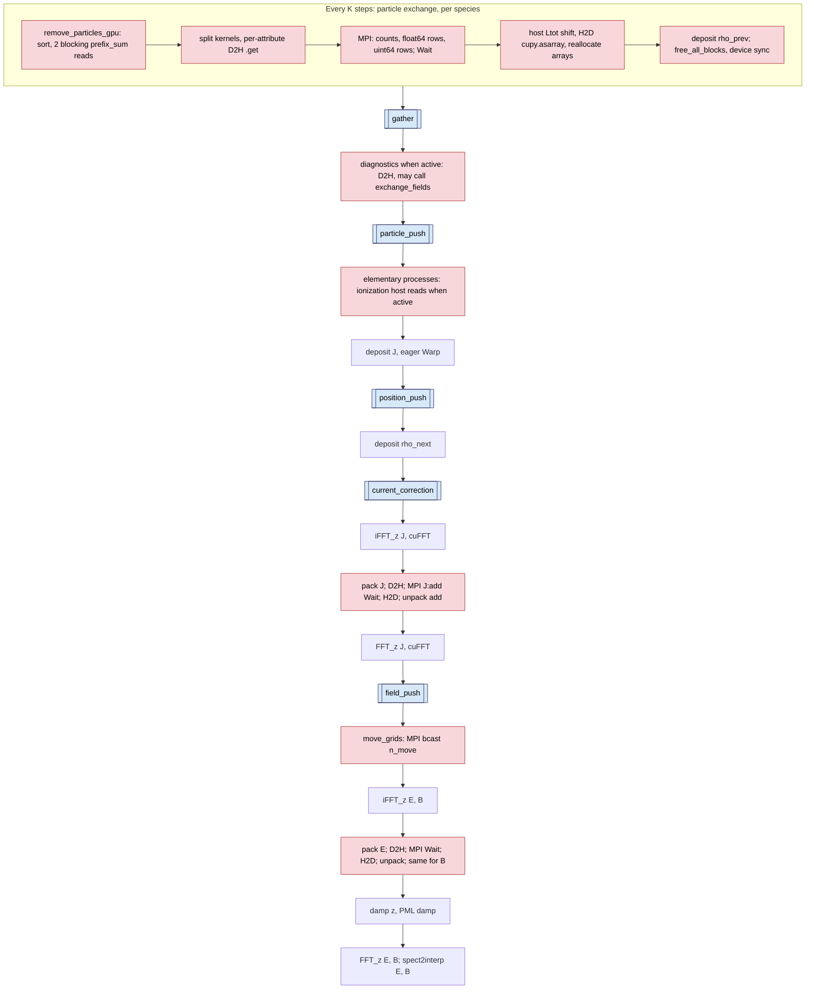
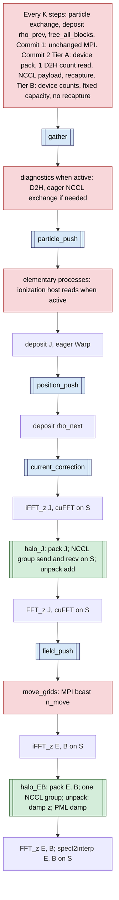

# NCCL Migration Plan for FBPIC-Warp

| Item | Value |
|---|---|
| Status | Draft for review. Nothing is implemented. |
| Date | 2026-10-21 |
| Branch | `snidhan/dev-nccl` (base commit `f6fca8a`) |
| Runtime probes | Pending. Section 9 step 2 and Appendix A list them. |
| Decisions | D1 to D5 decided on 2026-10-21 (Section 11). Graph capture is out of scope (Section 1.4). Option 2b (fused E+B, Section 5.5) is open. |

## Contents

- [Notation](#notation)
- [Abbreviations](#abbreviations)
- [1. Purpose and scope](#1-purpose-and-scope)
- [2. Domain decomposition model](#2-domain-decomposition-model)
- [3. Current MPI communication inventory](#3-current-mpi-communication-inventory)
- [4. Target architecture](#4-target-architecture)
- [5. Field guard-cell exchange](#5-field-guard-cell-exchange)
- [6. Particle exchange](#6-particle-exchange)
- [7. CUDA and NCCL performance considerations](#7-cuda-and-nccl-performance-considerations)
- [8. Verification](#8-verification)
- [9. Rollout plan](#9-rollout-plan)
- [10. Risks and mitigations](#10-risks-and-mitigations)
- [11. Decisions](#11-decisions)
- [12. Future work](#12-future-work)
- [Appendix A. Unverified claims and required probes](#appendix-a-unverified-claims-and-required-probes)

## Notation

This table defines each symbol once, and all sections use these symbols. The indices $i$, $j$, $a$, $\ell$ and $k_z$ are local to the equation where they occur. The symbol $\mathrm{i}$ (upright) is the imaginary unit.

| Symbol | Meaning | Units | Code name |
|---|---|---|---|
| $P$ | Number of ranks in the z decomposition | - | `comm.size` |
| $r$, $r'$ | Rank indices, $0 \le r < P$ | - | `comm.rank` |
| $L(r)$, $R(r)$ | Left and right neighbor of rank $r$. $\varnothing$ marks an open edge. | - | `left_proc`, `right_proc` (`None`) |
| $\delta_L$, $\delta_R$ | 1 if the left or right neighbor exists, else 0 | - | derived |
| $\delta_{a,b}$ | Kronecker delta | - | - |
| $[\cdot]$ | Iverson bracket: 1 if the condition is true, else 0 | - | - |
| $N_z$ | Global physical cells in z | cells | `_Nz_global_domain` |
| $\bar N_z$ | $\lfloor N_z / P \rfloor$, physical cells per rank before the remainder | cells | `Nz_per_proc` |
| $N_z^{\mathrm{phys}}(r)$ | Physical cells owned by rank $r$ | cells | - |
| $N_z^{\mathrm{loc}}(r)$ | Local z rows of rank $r$, with guard, damping and injection cells | cells | `Nz` in the kernels, `fld.Nz` |
| $i_z^{0}(r)$ | Global index of local row 0 of rank $r$ | cells | `iz` in `get_Nz_and_iz` |
| $n_g$ | Guard cells on each side of a local slab | cells | `n_guard` |
| $n_d$ | z damping cells at an open global edge | cells | `nz_damp` |
| $n_{\mathrm{inj}}$ | Injection cells at an open global edge | cells | `n_inject` |
| $d_L(r)$, $d_R(r)$ | Damping plus injection rows at the left and right of rank $r$ | cells | - |
| $n_{\mathrm{order}}$ | z stencil order; -1 is infinite order | - | `n_order` |
| $s(\cdot)$ | Stencil reach | cells | `get_stencil_reach` |
| $N_r$ | Physical radial cells | cells | - |
| $n_{r,d}$ | Radial damping (PML) cells; 0 for reflective $r$ | cells | `nr_damp` |
| $N_r^{d}$ | $N_r + n_{r,d}$, radial size of grids and exchange buffers | cells | `Nr_with_damp`, `fld.Nr` |
| $N_m$ | Number of azimuthal modes | - | `Nm` |
| $\Delta z$, $\Delta r$, $\Delta t$, $c$ | Cell sizes, time step, speed of light | m, m, s, m/s | `dz`, `dr`, `dt`, `c` |
| $v_{\mathrm{comov}}$ | Comoving velocity | m/s | `v_comoving` |
| $z_{\min}$, $z_{\min}^{\mathrm{loc}}$, $z_{\max}^{\mathrm{loc}}$, $r_{\min}$ | Global lower z edge, local z edges, lower r edge | m | `zmin`, `grid[0].zmin` |
| $L_{\mathrm{tot}}$ | Global box length $N_z\,\Delta z$ | m | `Ltot` |
| $K$ | Particle exchange period | steps | `exchange_period` |
| $\sigma$ | Assumed maximum displacement per step, $2c\Delta t/\Delta z$ | cells/step | `cells_per_step` |
| $F$, $F_r[i]$, $F_{k,m}^{(r)}$ | Interpolation-grid field; row $i$ on rank $r$ (all modes, components, radial cells); component $k$ of mode $m$ on rank $r$ | field units | `interp[m].Er` |
| $m$, $k$ | Mode index, component index | - | `m` |
| $\nu$ | Buffer row index: $n_{\mathrm{fld}}m + k$ (E, B), $3m + k$ (J), $m$ (rho) | - | first buffer index |
| $n_{\mathrm{fld}}$ | Components per mode in an E or B buffer: 3, or 5 with PML | - | `n_fld` |
| $n_{\mathrm{buf}}$ | Rows of one exchange buffer: $n_{\mathrm{fld}} N_m$, $3N_m$, or $N_m$ | - | - |
| $\mathrm{snd}_X^{(r)}$, $\mathrm{rcv}_X^{(r)}$ | Send and receive buffers of face $X \in \{L, R\}$ on rank $r$ | complex128 | `d_send_l`, `d_recv_l`, ... |
| $T$ | Ordered list of exchange types in one NCCL group | - | - |
| $z_0$, $z_1$ | Start and end of the packed row range | rows | `nz_start`, `nz_end` |
| $h$ | Rows per pack or unpack launch, $z_1 - z_0$ | rows | - |
| $n_{\mathrm{thr}}$ | Threads in one pack or unpack launch | - | - |
| $u$ | Bytes of one component slab, $16\,N_m n_g N_r^{d}$ | B | - |
| $B_E$, $B_B$, $B_J$, $B_\rho$, $B_k$ | Bytes per side per call for E, B, J, rho, or exchange $k$ | B | - |
| $n_{\mathrm{f64}}$ | float64 element count of one NCCL message, $B/8$ | - | - |
| $n_{\mathrm{side}}$ | Active sides per rank: 2 (interior or periodic), 1 (open end) | - | - |
| $n_x$ | Field exchanges per step (3 with the defaults) | - | - |
| $B_{\mathrm{step}}$ | Field bytes that one rank sends per step, $n_{\mathrm{side}} \sum_k B_k$ | B | - |
| $G$ | NCCL groups per step | - | - |
| $n_{\mathrm{msg}}$ | Send and receive calls in one NCCL group | - | - |
| $B_{\max}$ | Bytes on the most loaded link direction in one group | B | - |
| $S$ | The single runtime CUDA stream of a rank | - | `get_runtime().cupy_stream`, `runtime.stream` |
| $q$, $n_s$ | Species index, number of species | - | `Simulation.ptcl` |
| $N$, $N'$; $N(r)$, $N'(r)$ | Particles of one species before and after an exchange (on rank $r$) | particles | `species.Ntot` |
| $N_L$, $N_{\mathrm{stay}}$, $N_R$ | Particles sent left, kept, sent right | particles | `N_send_l`, `new_Ntot`, `N_send_r` |
| $N_X$ | Particles sent to side $X \in \{L, R\}$ | particles | - |
| $M_L$, $M_R$ | Particles received from $L(r)$ and from $R(r)$ | particles | `N_recv_l`, `N_recv_r` |
| $N_{\mathrm{inj},q}$ | Particles injected by the moving window on rank $P-1$ | particles | host-generated |
| $n_f$, $n_{\mathrm{int}}$, $n_a$ | float64, uint64 and total attributes per particle, $n_a = n_f + n_{\mathrm{int}}$ | - | `n_float_quantities`, `n_integer_quantities` |
| $n_{a,q}$, $n_{\mathrm{int},q}$ | $n_a$ and $n_{\mathrm{int}}$ of species $q$ | - | - |
| $b$ | Payload bytes per particle, $8\,n_a$ | B | - |
| $B_{\mathrm{ptcl}}$ | Particle payload per side per species per exchange, count included | B | - |
| $B_{p,q}$, $B_{p,q}^{\mathrm{cap}}$ | Payload of species $q$ per exchange (both sides), exact and at capacity | B | - |
| $N_c$ | Sort cells, $N_z^{\mathrm{loc}}(N_r^{d} + 1)$ | - | `prefix_sum.shape[0]` |
| $\kappa_i$ | Sort-cell key of particle $i$ | - | `cell_idx` |
| $\ell$ | Sort-cell index | - | - |
| $\mathcal{P}[\ell]$ | Inclusive prefix sum over sort cells (`PS` in pseudocode) | particles | `prefix_sum` |
| $i_{\mathrm{sh}}$ | Moving-window shift since the last sort | cells | `prefix_sum_shift` |
| $i_z^{\min}$, $i_z^{\max}$ | First kept z column; first removed column after the kept range | - | `iz_min`, `iz_max` |
| $i_{\min}$, $i_{\max}$ | First kept index; first right-sent index in the sorted arrays | - | `i_min`, `i_max` |
| $\mathrm{id}$, $n_{\mathrm{id}}$ | Particle ID $r + n_{\mathrm{id}}P$; per-rank ID counter | - | `tracker.id`, `next_attributed_id` |
| $w$ | Width of the source band of migrating particles | cells | - |
| $N_{\mathrm{col}}(k_z)$ | Particles in z column $k_z$ (all $r$) | particles | - |
| $N_{\mathrm{new}}$ | Particles created in the source band between two exchanges | particles | - |
| $n_{\mathrm{ppc}}$ | Macroparticles per cell (estimates only) | - | - |
| $\chi$ | Safety factor for local density compression | - | - |
| $(e)$ | Superscript: exchange number | - | - |
| $C$, $C_s$ | Species capacity (Tier B); per-side send and receive capacity | particles | - |
| $C_{L,q}$, $C_{R,q}$ | Per-side capacity of species $q$ | particles | - |
| $n_{\mathrm{dev}}$ | Live particle count in device memory (Tier B) | particles | - |
| $\alpha_C$, $\theta$ | Capacity growth factor and growth threshold | - | - |
| $f_{\mathrm{idle}}$ | Idle-thread fraction in launches over $C$ | - | - |
| $F_{\mathrm{ovf}}$ | Device overflow flag (Tier B) | - | - |
| $\alpha_N$ | Fixed cost of one NCCL group (launch and peer handshake) | s | - |
| $\alpha_{\mathrm{msg}}$ | Cost per message in one NCCL group | s | - |
| $\beta_N$, $\beta_N^{\mathrm{P2P}}$, $\beta_N^{\mathrm{SHM}}$ | NCCL point-to-point bandwidth per direction, total and per transport | B/s | - |
| $\alpha_{\mathrm{MPI}}$, $\beta_{\mathrm{MPI}}$ | Fixed cost per host MPI round; host MPI copy bandwidth | s, B/s | - |
| $\beta_{\mathrm{D2H}}$, $\beta_{\mathrm{H2D}}$, $\beta_{\mathrm{dev}}$ | Pinned copy bandwidths; device memory bandwidth | B/s | - |
| $t_{\mathrm{sync}}$, $t_{\mathrm{gap}}$ | Return latency of a host stream sync; GPU idle time after a host sync | s | - |
| $T_{\mathrm{grp}}$ | Modeled time of one NCCL group | s | - |
| $T^{\mathrm{staged}}$, $T^{\mathrm{NCCL}}$ | Field communication time per step, host-staged MPI and NCCL | s | - |
| $T_c$ | Step time without field communication | s | - |
| $T_{\mathrm{comm}}$ | Field exchange time per step for the path under test | s | - |
| $T_{\mathrm{step}}$ | Time per step | s | - |
| $\phi$ | Communication fraction, $T_{\mathrm{comm}}/T_{\mathrm{step}}$ | - | - |
| $\mathcal{S}$, $\mathcal{S}_x$, $\mathcal{S}_{\max}$ | Step speedup; exchange-only speedup; Amdahl estimate of $\mathcal{S}$ | - | - |
| $\delta_T$ | Run-to-run spread of $T_{\mathrm{step}}$ | - | - |
| $T_{\mathrm{pex}}$, $T_{\mathrm{recap}}$ | Particle exchange time; graph recapture time per exchange step | s | - |
| $T_{\mathrm{ptcl}}$, $\epsilon_B$ | Particle kernel time per step; fractional overhead of capacity-sized kernels | s, - | - |
| $\eta$, $\eta_B$ | Upper bounds of the step-time share that Tier B can remove (coarse, refined) | - | - |
| $t(B)$ | Measured time of one `sendrecv` of $B$ bytes | s | - |
| $T_J^{\mathrm{NCCL}}$, $T_{\mathrm{push},x}$, $T_\rho$ | NCCL time of the J exchange; kernel times of the position push and the `rho_next` deposit | s | - |
| $N_w$, $N_t$, $T(n)$ | Warm-up steps, timed steps, wall time after step $n$ | steps, steps, s | - |
| $n_{\mathrm{cap}}(n)$ | Capture count of the exchange sections after step $n$ | - | new counter |
| $Q$, $\omega$ | Integer field code; code offset per graph replay | - | - |
| $M_z$, $M_r$ | Upper bounds of $N_z^{\mathrm{loc}}$ and $N_r^{d}$ over all ranks | cells | - |
| $f_r$, $\mathcal{O}_r$ | Coded field before the exchange; exact expected field after it | - | - |
| $F_r^{\mathrm{mpi}}$, $F_r^{\mathrm{nccl}}$ | Field after the exchange with each transport | - | - |
| $\mathrm{bits}(x)$ | 64-bit pattern of a float64 value $x$ | - | - |
| $A(r, a, j_p)$, $M_p$ | Particle attribute code; upper bound of the local particle index $j_p$ | - | - |
| $z_{\mathrm{src}}$, $z'$, $\xi$ | Received z position, z after the shift, shift sign | m, m, - | - |
| $\mathcal{I}_r$, $\lambda(p)$ | Particle ID set on rank $r$; ionization level of particle $p$ | - | - |
| $\mathcal{M}$, $\mathcal{N}$ | Sets of MPI runs and NCCL runs | - | - |
| $e_F$, $e_{\mathrm{noise},F}$, $e_{\min}$ | Relative L2 error; MPI-vs-MPI noise floor; lower guard of the floor | - | - |
| $k_{\mathrm{acc}}$ | Acceptance factor of the Level 2 gate | - | - |

## Abbreviations

| Abbreviation | Meaning |
|---|---|
| ACS | PCIe Access Control Services |
| CFL | Courant-Friedrichs-Lewy |
| CTA | Cooperative thread array (one CUDA block) |
| D2H, H2D | Device-to-host copy, host-to-device copy |
| DMI | Direct Media Interface (CPU to chipset link) |
| FIFO | First in, first out |
| IOMMU | I/O memory management unit |
| IPC | Inter-process communication |
| LL, LL128, Simple | NCCL protocols |
| MPI | Message Passing Interface |
| NCCL | NVIDIA Collective Communications Library |
| NET | NCCL network transport |
| NVTX | NVIDIA Tools Extension |
| P2P | NCCL peer-to-peer GPU transport |
| PHB, PXB | `nvidia-smi` path types: through a PCIe host bridge; through PCIe switches only |
| PML | Perfectly matched layer |
| SHM | NCCL shared host memory transport |
| SM | Streaming multiprocessor |
| UUID | Universally unique identifier (of a GPU) |

## 1. Purpose and scope

### 1.1 Purpose

This document describes how FBPIC-Warp can move its z-domain exchanges from mpi4py to NCCL.
The Python binding is nccl4py 0.6.0, imported as `nccl.core`.
Every NCCL operation runs on the single runtime stream $S$. When `use_cuda_graphs=True`, CUDA graphs capture the per-step field exchanges.
The reference pattern is `/tmp/example_fdtd_3d_nccl.py` (Warp kernels, NCCL halos, and one CUDA graph per step).
Nothing in this document is implemented. The document gives the information that you need to accept or reject the migration.

All code paths are relative to `lpa/FBPIC_Warp/`. The line numbers come from the working tree at commit `f6fca8a`.
The nccl4py citations (`nccl/core/...`) come from the nccl4py 0.6.0 install in conda env `warp-env`. The env `fbpic-warp` does not have nccl4py yet.
In pseudocode, `PBH` means `fbpic/boundaries/particle_buffer_handling.py` and `BC` means `fbpic/boundaries/boundary_communicator.py`.

### 1.2 What changes

1. The GPU field guard-cell exchange `BoundaryCommunicator.exchange_fields` (`fbpic/boundaries/boundary_communicator.py:604-746`) gets an NCCL transport for E, B, J and rho.
2. The pack, NCCL and unpack operations of the per-step exchanges move into new CUDA graph sections.
3. The particle payload exchange (`fbpic/boundaries/boundary_communicator.py:820-904`) gets an NCCL transport in commit 2.
4. A new bootstrap creates one NCCL communicator per run. A backend selector keeps MPI as the default.

### 1.3 What stays on MPI

- Process launch (`mpiexec`), the NCCL unique-ID broadcast, and GPU selection (`fbpic/utils/cuda.py:288-333`).
- The moving-window broadcast of `n_move` (`fbpic/boundaries/moving_window.py:107`). It is host control flow.
- All diagnostics gathers, checkpoint barriers, and initialization collectives (Section 3, rows 9 to 11).
- CPU runs (`use_cuda=False`), runs with $P = 1$, and independent runs (`use_all_mpi_ranks=False`, `fbpic/boundaries/boundary_communicator.py:228-236`).
- The CUDA-aware MPI path (`FBPIC_ENABLE_GPUDIRECT=1`, `fbpic/utils/mpi.py:31-37`) stays as a separate MPI mode.

### 1.4 Decision status

| Item | Status | Content |
|---|---|---|
| Environment | Decided | Install `nccl4py[cu12]` with pip into conda env `fbpic-warp`, and add it to `environment.yml`. Warp 1.18.0 (cu12) and conda-forge CuPy 14.2 stay unchanged (repo rule 1). |
| Phasing | Decided | Commit 1: field halo exchange on NCCL, validated against MPI. Commit 2: particle exchange. |
| Graph capture | Decided (2026-10-21) | Out of scope for the NCCL work. Develop and validate with `use_cuda_graphs=False`. NCCL calls run eagerly on the runtime stream. The `halo_J` and `halo_EB` sections and the recorder change (Sections 4.5, 5.6) are deferred. Reason: measured graph gain today is within 2 % (graphs on vs off), and the particle sections recapture every step because the sort rotates `sorting_buffer` (`fbpic/particles/particles.py:840-851`). |
| Particle phase depth | Decided (D1, 2026-10-21) | Tier A: NCCL payload, one D2H count read per exchange (Section 6.6). Tier B is future work F1 (Section 12.1). |
| Backend selector | Decided (D2, 2026-10-21) | Environment variable `FBPIC_COMM_BACKEND`, default `mpi` (Section 4.6, option A). |
| Stray GPU 0 context | Decided (D3, 2026-10-21) | Fix `fbpic/utils/warp.py:50` in a separate commit before commit 1 (option a). Sections 4.2 and 11 give the details. |
| Runtime probes | Not run | Baseline timings, NCCL same-peer ordering, zero-count behavior, capture, and transport selection (Section 9 step 2). |

Pip must not install a second CuPy or change the `cuda-bindings==12.9.9` pin in `environment.yml` (`environment.yml:30`).
The nccl4py 0.6.0 metadata lists these requirements:

1. Base package: `cuda-core~=1.0`, `cuda-pathfinder>=1.5.4,<2.0.0`, `numpy` and `packaging`.
2. Extra `cu12`: `nvidia-nccl-cu12` (no version limit), `cuda-bindings~=12.0` and `nvidia-cutlass-dsl~=4.6`.

The env `fbpic-warp` has `cuda-bindings` 12.9.9 and `cuda-pathfinder` 1.8.3, but it has no `cuda-core`.
Assumption: the resolver keeps `cuda-bindings` at 12.9.9 and pulls no pip CuPy through `cuda-core` or `nvidia-cutlass-dsl`.
Section 9 step 1 gives the dry run that checks this before the install.

### 1.5 Evidence status

The understand phase measured four facts on this host (2x RTX 6000 Ada, sm_89, 48 GB, PCIe, topology PHB, no NVLink):

1. Rank $r$ selects GPU $r$.
2. Warp and CuPy use the same CUDA stream handle after `import fbpic.main`.
3. Rank 1 holds a context of about 426 MiB on GPU 0. This run used `warp-env` with OpenMPI.
4. `NcclBuffer` accepts a `float64` view of a `complex128` CuPy array, with twice the element count and the same pointer. This check ran in conda env `warp-env` (cu13, `nvidia-nccl-cu13` 2.32.3), not in `fbpic-warp`.

This review confirmed by reading that `damp_pml_EB` launches only a Warp kernel on the GPU path (`fbpic/boundaries/pml_damping.py:59-73`, kernel at `:121`).
No 2-rank NCCL run exists. Every other number in this document is an estimate or an assumption, and the text labels it. Appendix A lists every unverified claim.

## 2. Domain decomposition model

### 2.1 Global grid

The global physical grid has $N_z \times N_r$ cells and $N_m$ azimuthal modes.
Each mode stores `complex128` fields on an interpolation grid of shape $(N_z^{\mathrm{loc}}(r), N_r^{d})$ per rank (`fbpic/main.py:348`).
FBPIC decomposes only along $z$. It does not decompose $r$.
Each of the $P$ ranks owns one $z$ slab, plus guard cells on both sides. Ranks at an open global edge also own damping and injection cells.
`BoundaryCommunicator.get_Nz_and_iz` (`fbpic/boundaries/boundary_communicator.py:449-524`) sets the decomposition. All other routines call it.

### 2.2 Guard, damping and injection cells

The constructor sets the guard-cell count $n_g$ (`fbpic/boundaries/boundary_communicator.py:258-293`):

$$
n_g =
\begin{cases}
n_g^{\mathrm{user}} & \text{if } \texttt{n\_guard} \text{ is given} \\
64 & \text{if } n_{\mathrm{order}} = -1 \quad (\text{error if } P > 1) \\
s\left(N_z, \Delta z, c\,\Delta t, n_{\mathrm{order}}, v_{\mathrm{comov}}, \texttt{use\_galilean}\right) + 1 & \text{otherwise}
\end{cases}
\qquad
n_g \leftarrow 0 \ \text{ if periodic and } P = 1
$$

Here $s(\cdot)$ is `get_stencil_reach` (line 275).
The $+1$ covers the one-cell shift of the moving window (lines 283-287).

The damping cells $n_d$, the injection cells $n_{\mathrm{inj}}$ and the radial size $N_r^{d}$ follow from lines 295-315 and 421-433:

$$
(n_d,\; n_{\mathrm{inj}}) =
\begin{cases}
(0,\; 0) & \text{periodic } z \\
\left(\texttt{n\_damp[z]},\; \lfloor n_g / 2 \rfloor\right) & \text{open } z,\ \texttt{n\_inject} \text{ not given} \\
\left(\texttt{n\_damp[z]},\; n_{\mathrm{inj}}^{\mathrm{user}}\right) & \text{open } z,\ \texttt{n\_inject} \text{ given}
\end{cases}
\qquad
N_r^{d} = N_r + n_{r,d},\quad n_{r,d} = 0 \text{ for reflective } r
$$

For a non-reflective $r$ boundary, $n_{r,d}$ is `n_damp["r"]` and `use_pml` is true (lines 310-315).

If `exchange_period` is not given, lines 318-340 set the particle exchange period $K$:

$$
\sigma = \frac{2\,c\,\Delta t}{\Delta z},
\qquad
K = \operatorname{trunc}\!\left(\frac{n_g/2 - 3}{\sigma}\right),
\qquad K \leftarrow 1 \text{ if periodic and } P = 1,
\qquad K < 1 \Rightarrow \text{error}
$$

The code uses `int()`, which truncates, and $n_g/2$ is a real division. For $K \ge 1$, truncation and floor give the same value.
The factor 2 in $\sigma$ is a safety factor for the moving window and the Galilean frame. The 3 is the reach of a cubic shape factor.
The $n_g/2$ term applies because particles stay in half of the guard region, which is the reach of the current correction.
A user-given `exchange_period` replaces $K$ without a check (lines 341-343).

### 2.3 Local slab of rank r

Lines 488-508 give the local row count and the global index of local row 0:

$$
\begin{aligned}
\bar N_z &= \lfloor N_z / P \rfloor \\
N_z^{\mathrm{phys}}(r) &= \bar N_z + \delta_{r,P-1}\,(N_z \bmod P) \\
N_z^{\mathrm{loc}}(r) &= N_z^{\mathrm{phys}}(r) + \left(\delta_{r,0} + \delta_{r,P-1}\right)(n_d + n_{\mathrm{inj}}) + 2\,n_g \\
i_z^{0}(r) &= r\,\bar N_z - \delta_{r,0}\,(n_d + n_{\mathrm{inj}}) - n_g
\end{aligned}
$$

The last rank takes the full remainder $N_z \bmod P$. For $P = 1$ and open $z$, rank 0 gets both damping regions, because both Kronecker deltas are 1.
The local edges are $z_{\min}^{\mathrm{loc}} = z_{\min} + i_z^{0}\,\Delta z$ and $z_{\max}^{\mathrm{loc}} = z_{\min}^{\mathrm{loc}} + N_z^{\mathrm{loc}}\,\Delta z$ (lines 556-561).
The constructor requires $N_z^{\mathrm{loc}}(r) \ge 4\,n_g$ for its own rank (line 410).

### 2.4 Neighbor maps

Lines 237-253 set `left_proc` $= L(r)$ and `right_proc` $= R(r)$:

$$
L(r) =
\begin{cases}
r - 1 & r > 0 \\
P - 1 & r = 0,\ \text{periodic} \\
\varnothing & r = 0,\ \text{open}
\end{cases}
\qquad
R(r) =
\begin{cases}
r + 1 & r < P - 1 \\
0 & r = P - 1,\ \text{periodic} \\
\varnothing & r = P - 1,\ \text{open}
\end{cases}
$$

A rank posts no send and no receive toward a $\varnothing$ side (`fbpic/boundaries/boundary_communicator.py:763-769`).
The two maps are symmetric: $R(r) = r'$ if and only if $L(r') = r$.

### 2.5 Exchange operators

Let $F_r[i]$ be local row $i$ of rank $r$, for all modes, components and $N_r^{d}$ radial cells.
The pack and unpack kernels (`fbpic/boundaries/cuda_methods.py:13`, `:229`, `:439`) and the row ranges (`fbpic/boundaries/field_buffer_handling.py:201-206`) define two operators.

Replace, for E and B (and the PML components of E and B):

$$
\begin{aligned}
F_r[i] &\leftarrow F_{L(r)}\!\left[N_z^{\mathrm{loc}}(L(r)) - 2n_g + i\right], & 0 \le i < n_g \\
F_r\!\left[N_z^{\mathrm{loc}}(r) - n_g + i\right] &\leftarrow F_{R(r)}[n_g + i], & 0 \le i < n_g
\end{aligned}
$$

Add, for J and rho:

$$
\begin{aligned}
F_r[i] &\mathrel{+}= F_{L(r)}\!\left[N_z^{\mathrm{loc}}(L(r)) - 2n_g + i\right], & 0 \le i < 2n_g \\
F_r\!\left[N_z^{\mathrm{loc}}(r) - 2n_g + i\right] &\mathrel{+}= F_{R(r)}[i], & 0 \le i < 2n_g
\end{aligned}
$$

The right-hand sides use the values before the exchange. The code gets this because every pack kernel runs before any unpack kernel, and the send buffers are separate arrays.
The left and right target rows of the add operator do not overlap, because $N_z^{\mathrm{loc}} \ge 4 n_g$.
Substitution of Section 2.3 gives $i_z^{0}(L) + N_z^{\mathrm{loc}}(L) - 2n_g + i = i_z^{0}(r) + i$, modulo $N_z$ for the periodic wrap. Thus the source row and the target row have the same global $z$ index.
The add operator is a local kernel after the receive. NCCL therefore needs only point-to-point transfers and no reduction (Section 5.7).

The payload per side and per call, in bytes, is:

$$
\begin{aligned}
B_E = B_B &= 16\, n_{\mathrm{fld}}\, N_m\, n_g\, N_r^{d}, & n_{\mathrm{fld}} &= 5 \text{ with PML},\ 3 \text{ without} \\
B_J &= 16 \cdot 3\, N_m\, (2 n_g)\, N_r^{d} \\
B_\rho &= 16\, N_m\, (2 n_g)\, N_r^{d} \\
B_{\mathrm{ptcl}} &= 8\,(n_f + n_{\mathrm{int}})\, N_X + 4
\end{aligned}
$$

The factor 16 is the size of one `complex128` element. NCCL has no complex type, so the transport sends $B/8$ `float64` elements.
For particles, $N_X$ is the number of particles sent to side $X$. $n_f \in \{8, 9, 11, 12\}$ (`fbpic/particles/particles.py:301`, `:695`, `:784`) and $n_{\mathrm{int}} \in \{0, 1, 2\}$ (`:494`, `:696`).
The 4 bytes are the `uint32` count. Today the count, the float block and the uint block go in three separate messages.

Example (assumption, not a measured case; Case A of Section 7.2): $N_m = 2$, $n_g = 64$, $N_r^{d} = 256$, no PML. Then $B_E = B_B = 1.5$ MiB and $B_J = 3$ MiB.
With these values and the defaults of Section 3, each rank sends 6 MiB per step to each neighbor.

### 2.6 Special case: P = 2, periodic

For $P = 2$ and periodic $z$, $L(0) = R(0) = 1$ and $L(1) = R(1) = 0$. Both messages in one direction go to the same peer.
MPI separates the two messages with tags. The left send uses tag 1 and the right receive also uses tag 1 (`fbpic/boundaries/boundary_communicator.py:764-769`).
NCCL point-to-point calls have no tag. Assumption: NCCL matches the $k$-th send from rank $a$ to rank $b$ with the $k$-th receive on $b$ from $a$, in posting order.
The reference example states the same rule (`/tmp/example_fdtd_3d_nccl.py:505-507`). No test on this host confirms it.
For this reason, every rank must post sends in the order ($L$, then $R$) and receives in the order ($R$, then $L$).

| Posting index toward the peer | Rank 0 posts | Rank 1 posts | Result |
|---|---|---|---|
| send 1 / recv 1 | send left edge rows to rank 1 | recv from rank 0 into right guard | Rank 0 left edge fills the right guard of $L(0) = 1$. Correct. |
| send 2 / recv 2 | send right edge rows to rank 1 | recv from rank 0 into left guard | Rank 0 right edge fills the left guard of $R(0) = 1$. Correct. |

A wrong order swaps the two halos without a hang or an error. For particles, a wrong order also applies the wrong $\pm L_{\mathrm{tot}}$ shift (`fbpic/boundaries/boundary_communicator.py:892-898`).
The Level 1 unit test (Section 8.2) must cover this case. For $P > 2$, $L(r) \ne R(r)$, so only the order within one direction to one peer matters.

## 3. Current MPI communication inventory

Column "Staged" means that the payload goes through host memory before MPI.
"Per step" assumes the defaults `correct_currents=True`, `use_true_rho=False`, `use_cuda_graphs=True`, and $P > 1$.

| # | Site | Operation | Payload (dtype, shape, bytes per side) | Frequency | Staged | NCCL candidate |
|---|---|---|---|---|---|---|
| 1 | `fbpic/main.py:867`, `:511` -> `exchange_fields(E, replace)` -> `exchange_domains` (`fbpic/boundaries/boundary_communicator.py:748-777`) | `Isend`/`Irecv` to $L$, $R$, then `Wait` | `complex128` $(n_{\mathrm{fld}} N_m, n_g, N_r^{d})$, $B_E$ | Every step, plus once before the loop | Yes. Pinned D2H `.get` (`fbpic/boundaries/field_buffer_handling.py:255-257`), H2D `.set` (`:264-266`). GPUDirect mode: `synchronize()` (`fbpic/boundaries/boundary_communicator.py:703`) | Yes. Fixed size, persistent contiguous buffers. |
| 2 | `fbpic/main.py:868`, `:512` -> `exchange_fields(B, replace)` | Same as row 1 | Same as row 1, $B_B$ | Same as row 1 | Same as row 1 | Yes. Same NCCL group as E. |
| 3 | `fbpic/main.py:658` (corrected J). Also `:630` -> `:783` if `correct_currents=False`, `:562` -> `:783` at `i_step == 0`, and `:696` after the loop | `exchange_fields(J, add)` | `complex128` $(3 N_m, 2 n_g, N_r^{d})$, $B_J$. No PML rows | Every step | Same as row 1 | Yes. The add is a local kernel (`fbpic/boundaries/cuda_methods.py:439`). |
| 4 | `fbpic/main.py:552` -> `:766` and `:648` -> `:766` (only with `use_true_rho`), `:699` after the loop | `exchange_fields(rho, add)` | `complex128` $(N_m, 2 n_g, N_r^{d})$, $B_\rho$ | Every step only with `use_true_rho` | Yes (`fbpic/boundaries/field_buffer_handling.py:550-563`) | Yes |
| 5 | `fbpic/openpmd_diag/field_diag.py:109`, `:118`; `particle_density_diag.py:132`; `boosted_field_diag.py:186`, `:188`; `fbpic/lpa_utils/bunch.py:1089-1090` (through `deposit`) | `exchange_fields(rho or J, add)` | Rows 3 and 4 | Diagnostics, initialization | Yes | Yes, through the same function. Runs eager, outside graphs. |
| 6 | `fbpic/boundaries/boundary_communicator.py:854-860` | Particle count exchange | `uint32`, 0-d, 4 B | Every $K$ steps, per species | Host data | Tier A: yes, one batched NCCL count group. Tier B: yes, device-side counts. |
| 7 | `fbpic/boundaries/boundary_communicator.py:862-867` | Particle float block | `float64` $(n_f, N_X)$, $8 n_f N_X$ | Every $K$ steps, per species | Yes. Per-attribute `.get` (`fbpic/boundaries/particle_buffer_handling.py:315`, `:317`), `cupy.asarray` (`:532-533`) | Yes (commit 2) |
| 8 | `fbpic/boundaries/boundary_communicator.py:869-875` | Particle uint block (if $n_{\mathrm{int}} > 0$) | `uint64` $(n_{\mathrm{int}}, N_X)$, $8 n_{\mathrm{int}} N_X$ | Every $K$ steps, per species | Yes (`fbpic/boundaries/particle_buffer_handling.py:341`, `:343`, `:563-564`) | Yes (commit 2). Can share one message with row 7. |
| 9 | `fbpic/boundaries/moving_window.py:107` | `bcast(n_move)`, pickled | Python `int` | Every step with a moving window | Host | No. Host control flow. |
| 10 | `fbpic/boundaries/boundary_communicator.py:1172`, `:1233`, `:1279`, `:1334`; `fbpic/openpmd_diag/particle_diag.py:283`; `boosted_particle_diag.py:279`; `boosted_field_diag.py:310-312`; `synchrotron_radiation_diag.py:197` | `Gatherv`, `Scatterv`, `allgather`, `gather`, `Reduce` | Host arrays | Diagnostics, initialization | Host | No |
| 11 | `fbpic/utils/cuda.py:259`, `:284`, `:303`, `:320`, `:323`; `fbpic/openpmd_diag/checkpoint_restart.py:57`, `:144`; `fbpic/particles/tracking/tracking.py:139`; `fbpic/lpa_utils/bunch.py:1075-1076`; `fbpic/utils/printing.py:215` | GPU selection, barriers, ID `allgather`, `allreduce`, `gather` | Host scalars | Initialization, checkpoints | Host | No |

Rows 1 to 8 are the NCCL candidates. Rows 1 to 4 and 6 to 8 run in the step, and row 5 runs eager in diagnostics and initialization.
With the defaults, rows 1, 2 and 3 run every step. Each of them blocks the host three times: in the D2H `.get`, in `Wait`, and in the H2D `.set`.
The H2D `.set` blocks because a copy from pinned host memory is host-synchronous, and the legacy stream orders it after $S$.
Rows 6 to 8 add, per species and per exchange, up to 2 blocking prefix-sum reads (`fbpic/boundaries/particle_buffer_handling.py:246`, `:249`). They also add up to $2(n_f + n_{\mathrm{int}})$ D2H copies, up to 3 MPI rounds, and up to $2(n_f + n_{\mathrm{int}})$ H2D copies.

## 4. Target architecture

### 4.1 Stream model

1. Each rank has one CUDA stream $S$. `CudaRuntime.__init__` creates it as `cupy.cuda.Stream(non_blocking=False)` and wraps it as `wp.Stream` (`fbpic/utils/warp.py:50-52`).
2. Every Warp launch uses $S$ (`fbpic/utils/warp.py:245-252`). CuPy and cuFFT use $S$ as the current CuPy stream (`fbpic/utils/warp.py:56-63`).
3. Every NCCL call passes the integer handle `get_runtime().cupy_stream.ptr` through one backend helper. nccl4py accepts an integer directly (`nccl/core/cuda.py:129-130`).
4. `wp.Stream` also implements `__cuda_stream__` (Warp `_src/context.py:5662`), which nccl4py reads (`nccl/core/cuda.py:133`). The integer form avoids the open question whether CuPy 14.2 streams implement it.
5. Never pass `stream=None`. nccl4py maps `None` to handle 0, the legacy default stream (`nccl/core/cuda.py:127-128`). `send` and `recv` default to `stream=None` (`nccl/core/communicator.py:1747-1799`).
6. The NCCL path does not use a second stream in commit 1. The order pack -> NCCL -> unpack on $S$ needs no CUDA event and no host synchronization.

A second communication stream would give little overlap (Section 7.8). The spectral solve needs every guard row before the $z$ FFT, so little independent work runs during a halo exchange. A second stream would also need cross-stream events inside each graph.
$S$ is a blocking stream, so legacy-default-stream work, such as a synchronous `memcpy`, waits for the work queued on $S$. An NCCL kernel on handle 0 would wait for all blocking streams, and later work on $S$ would wait for it.
`cudaFree` in `free_all_blocks` (`fbpic/main.py:557`) synchronizes the whole device, so it also waits for queued NCCL kernels.
An NCCL kernel completes only after the peer posts the matching operation.

**Deadlock rule.** Before a rank does a host-blocking call, it must enqueue all NCCL operations that its peers wait for. All ranks enqueue the same NCCL operations in the same order. Section 7.5 gives an example.

### 4.2 Device selection and the stray GPU 0 context

`mpi_select_gpus` runs at import time (`fbpic/main.py:24`). Rank $r$ selects GPU $(\texttt{comm.rank} \bmod n_{\mathrm{gpu}})$ (`fbpic/utils/cuda.py:307-315`).
The NCCL communicator must be created after this selection, with the selected device current.
NCCL requires one GPU per rank. Today a duplicate GPU gives only a warning (`fbpic/utils/cuda.py:326-333`).
The NCCL path must detect duplicate UUIDs on all ranks (Algorithm 1). The FDTD example notes that shared GPUs need NCCL 2.30 or later and an experimental flag (`/tmp/example_fdtd_3d_nccl.py:94-96`).

`CudaRuntime.__init__` creates the stream inside `with cupy.cuda.Device(ordinal):` (`fbpic/utils/warp.py:50`). On exit, CuPy makes device 0 current again.
The understand phase measured a context of about 426 MiB on GPU 0 in rank 1, and attributes it to this line.
`fbpic/fields/spectral_transform/hankel.py:35` also uses `with cupy.cuda.Device(ordinal):`. That line is in the teardown helper `_destroy_cublas_handle`, so its risk is lower (inference).
If rank 1 calls NCCL init with device 0 current, NCCL can detect a duplicate GPU and fail (unverified). Algorithm 1 therefore asserts the current device before init.
Decision D3 (Section 11): fix `fbpic/utils/warp.py:50` in a separate commit before commit 1. NCCL adds per-device state, so a clean device mapping removes one variable from the NCCL validation.

### 4.3 NCCL communicator bootstrap

The bootstrap follows `/tmp/example_fdtd_3d_nccl.py:493-498`.
`BoundaryCommunicator.__init__` has no `use_cuda` parameter (`fbpic/boundaries/boundary_communicator.py:61-80`).
For this reason, call the bootstrap from `Simulation.__init__` after the communicator is created (`fbpic/main.py:326-344`), as `self.comm.init_nccl(self.use_cuda)`.

```text
Algorithm 1: NCCL communicator bootstrap
Inputs : MPI COMM_WORLD (rank r, size P); backend choice b_r ("mpi" or "nccl");
         use_cuda_r; use_all_mpi_ranks; device d_r selected by mpi_select_gpus
Outputs: nccl_comm (NCCL backend) or None (MPI backend), the same result on all ranks
Stream : none. Host-side, collective over all ranks.

 1. If P == 1 or not use_all_mpi_ranks:
        return None.                                   [uniform by construction]
 2. ok_r <- (import nccl.core succeeds) if b_r == "nccl" else True.
 3. uuid_r <- UUID of d_r.
 4. (b, cu, ok, uuid) <- MPI allgather((b_r, use_cuda_r, ok_r, uuid_r)).
                                                       [all ranks enter]
 5. If every b is "mpi", or every cu is False:
        return None.                                   [MPI backend]
 6. If b or cu differs between ranks, any ok is False, or uuid has duplicates:
        raise an error on all ranks.                   [decision from gathered data]
 7. Assert that (n_g, N_m, N_r^d, use_pml) are equal on all ranks (MPI allgather).
 8. get_runtime().use(); assert that the current device is d_r.
 9. If r == 0: uid <- nccl.get_unique_id(). Else: uid <- None.
10. uid <- MPI bcast(uid, root=0); MPI Barrier.
11. nccl_comm <- nccl.Communicator.init(P, r, uid, config=NCCLConfig(blocking=True)).
12. Register teardown on all ranks: nccl_comm.finalize(); nccl_comm.destroy().
    Teardown runs before MPI finalization.
13. Return nccl_comm.
```

Correctness: step 1 uses only values that are equal on all ranks. Steps 5 and 6 use only gathered data. Thus all ranks take the same branch, and no rank enters the collective `init` alone.
The backend choice goes into the allgather, because an environment variable can differ between ranks.
Step 6 raises an error instead of a silent fallback when NCCL is requested (decision D2).
Step 7 guarantees symmetric message sizes, because each buffer shape depends only on these four values (`fbpic/boundaries/field_buffer_handling.py:67-108`).
`blocking=True` is the NCCL default (`nccl/core/communicator.py:92-97`). With a non-blocking communicator, calls can leave the state "in progress", and the code must poll `get_async_error` (`:2765`).
Teardown is collective, so every rank must reach it, also on the error path.
`abort()` is also collective (`nccl/core/communicator.py:1319-1325`). If one rank fails, use MPI to tell the other ranks to abort.

### 4.4 Field halo transport

The persistent device buffers `d_send_l`, `d_send_r`, `d_recv_l`, `d_recv_r` (`fbpic/boundaries/field_buffer_handling.py:111-123`) are contiguous `complex128` arrays.
Their pointers do not change during a run, so a graph that holds them can replay at every step.
nccl4py does not check strides (`nccl/core/interop/cupy.py:149-170`) and has no complex type (`nccl/core/typing.py:400-410`).
The transport sends `buf.view(cupy.float64)`. Section 5.3 gives the contiguity checks.

```text
Algorithm 2: NCCL field halo exchange for an ordered list T of exchange types
Inputs : interp grids; for each t in T the persistent device buffers
         sL[t], sR[t], gL[t], gR[t] (contiguous complex128);
         peers L = left_proc, R = right_proc (None at an open edge); stream S
Outputs: guard rows updated by the operators of Section 2.5
Sync   : no host synchronization; no D2H or H2D copy

1. For t in T: launch the pack kernels on S (copy_*_to_gpu_buffer).            [S]
2. Enter "with nccl.group():".                                                  [host]
3. For t in T, in list order:
   3a. If L is not None: send(view64(sL[t]), L, stream=S).                      [S]
   3b. If R is not None: recv(view64(gR[t]), R, stream=S).                      [S]
4. For t in T, in list order:
   4a. If R is not None: send(view64(sR[t]), R, stream=S).                      [S]
   4b. If L is not None: recv(view64(gL[t]), L, stream=S).                      [S]
5. Leave the group (group_end).                       [host; returns before GPU completion]
6. For t in T: launch the unpack kernels on S (replace_* or add_*).             [S]
```

For E and B, $T = (\texttt{E:replace}, \texttt{B:replace})$, so one NCCL group carries both fields. For J, $T = (\texttt{J:add})$.
The context manager closes the group also when an exception occurs, as in the example (`/tmp/example_fdtd_3d_nccl.py:509`).

Correctness:

1. Matching. Every rank sends to $L$ before it sends to $R$, and receives from $R$ before it receives from $L$, in the same $T$ order. Thus the $k$-th send from $a$ to $b$ meets the $k$-th receive on $b$ from $a$, also for $P = 2$ periodic (Section 2.6).
2. Open edges. Rank $r$ sends to $R(r) = r'$ only if $L(r') = r$, and then rank $r'$ posts the matching receive from $L(r')$. The same symmetry holds for $L$. No rank posts an operation toward a $\varnothing$ side, so no operation waits forever.
3. Deadlock freedom. All sends and receives of one round are in one group. NCCL schedules them together, so no circular wait occurs between neighbors.
4. Stream order. Pack -> NCCL -> unpack on $S$ is FIFO. The send buffers hold values before the exchange, which the add operator needs. The next pack on $S$ starts after the NCCL kernel ends, so it cannot overwrite a buffer that NCCL still reads.
5. Cross-rank uniformity. The sequence of rounds depends only on rank-uniform flags. Inference: the diagnostics conditions (`fbpic/openpmd_diag/field_diag.py:104-118`) are rank-uniform today.

`exchange_domains` stays unchanged, because the particle path and the MPI fallback use it (`fbpic/boundaries/boundary_communicator.py:720`, `:860`, `:865`, `:873`).
Section 5.4 expands Algorithm 2 for one key, with the row ranges of the kernels.

### 4.5 Graph section placement

> **Deferred.** Graph capture is out of scope for the NCCL work (Section 1.4). This section is design input for future work F2 (Section 12).

The current graph sections record only Warp launches made through `launch_kernel` (`fbpic/utils/warp.py:194-221`, `:276-320`). Inside a section, `launch_kernel` appends each launch to `runtime.recorded_launches` and does not run it (`:217-221`).
The section runs the launches at exit. It captures them on a cache miss and replays the graph on a hit (`:297-320`). The cache holds one entry per section name.
A section keys its graph on kernel, dimensions, block size, and each argument (`fbpic/utils/warp.py:258-273`). An array argument contributes its pointer, shape, strides, dtype and device. A scalar contributes its value. A changed key causes a new capture.
The class docstring excludes MPI from sections (`fbpic/utils/warp.py:281`).
The five sections in the step are `gather` (`fbpic/main.py:572`), `particle_push` (`:594`), `position_push` (`:636`), `current_correction` (`:651`) and `field_push` (`:663`). No exchange is inside a section today.
If `use_cuda_graphs` is false, `_gpu_section` returns a `nullcontext` (`fbpic/main.py:428-431`), and the new sections run eager.

Section 5.6 gives the recorder change: a recorded NCCL group entry next to the Warp launches. The proposed placement for commit 1 is:

```text
NCCL backend, proposed graph sections (use_cuda_graphs=True):

main.py:511-513 (before the loop)       eager: exchange E, B (one group); damp z.
                                        Runs once per step() call; also warms up NCCL.
deposit("rho"), main.py:766             section "halo_rho" { rho:add }  (use_true_rho only)
deposit("J"), main.py:783               section "halo_J" { J:add }
                                        (correct_currents=False, and i_step == 0 via main.py:562)
main.py:657-659                         spect2partial_interp("J"); section "halo_J" { J:add };
                                        partial_interp2spect("J")   (same buffers -> same key)
exchange_and_damp_EB (main.py:841-891):
  spect2interp / spect2partial_interp   outside: cuFFT, cuBLAS (main.py:854-864)
  section "halo_EB":
      exchange E, B                     Algorithm 4 (one group)
      damp_EB_open_boundary             Warp kernels, boundary_communicator.py:906-1003
      damp_pml_EB if use_pml            Warp kernels, pml_damping.py:50-73
  mirrors                               outside, unchanged (main.py:874-875)
  interp2spect / partial_interp2spect   outside (main.py:878-891)
main.py:696, :699 (after the loop)      eager
diagnostics                             eager NCCL on S, no section
MPI backend                             no section (MPI blocks the host)
```

The eager E and B exchange at `fbpic/main.py:511-512` runs before the first capture of `halo_EB` and `halo_J`, and it opens the NCCL connections to both peers.
The before-loop exchange stays eager, because the graphs are cleared at each `step()` call (`fbpic/main.py:505`). A graph for it would capture once and never replay.
The whole `exchange_and_damp_EB` cannot be one section with the current mechanism. The transforms use cuFFT plans (`fbpic/fields/spectral_transform/fourier.py:83`) and cuBLAS. These enqueue at host time inside a section, so they would run out of order with the recorded kernels.

Commit 1 does not capture one graph per step, as the FDTD example does. Four facts prevent it:

1. The partial transforms use cuFFT and CuPy element-wise operations (`fbpic/fields/spectral_transform/fourier.py:83`, `:136`, `:169`). The section recorder cannot hold them.
2. The pointers in the `gather` and push sections change every step. Each sort swaps the particle arrays with `sorting_buffer` (`fbpic/particles/particles.py:840-851`), and the particle exchange reallocates them every $K$ steps. The graph key includes the pointers (`fbpic/utils/warp.py:258-273`). Measured on 2026-10-21: 602 captures per 200 steps.
3. Diagnostics, `bcast(n_move)` and the ionization host reads (`fbpic/particles/elementary_process/ionization/ionizer.py:413`, `:428`) run on the host inside the step.
4. A CuPy pool allocation that grows the pool during capture calls `cudaMalloc`. Assumption: `THREAD_LOCAL` capture rejects this call (Section 7.6).

A full-step graph is the end state of Tier B. It needs raw stream capture of cuFFT, cuBLAS and CuPy work, fixed-capacity particle storage, and graph-safe moving-window control.

The two diagrams below show one iteration with $P > 1$, the defaults, and an active moving window. Double-bordered nodes are graph sections. Red nodes block the host.

Before the migration:



After commit 1 (field halos on NCCL, in graph sections):



After commit 1, the per-step field exchanges have no host block.
These host blocks remain: `bcast(n_move)` at every step, the particle exchange and `free_all_blocks` every $K$ steps, and diagnostics and ionization reads when they are active.

### 4.6 Backend switch and MPI fallback

| Option | Mechanism | Advantages | Disadvantages |
|---|---|---|---|
| A. Environment variable | `FBPIC_COMM_BACKEND=mpi` or `nccl`, read in `fbpic/utils/mpi.py` next to `FBPIC_ENABLE_GPUDIRECT` (`:31-37`) | Existing tests and input scripts run unchanged under `mpiexec`. Passes through `mpiexec -genv`. Same pattern as the GPUDirect switch. No API change for sibling packages such as `lpa/Simulation_FBPIC`. | Global for the process. Not visible in the input script. Can differ between ranks, so Algorithm 1 gathers it. |
| B. Keyword argument | `Simulation(..., comm_backend="nccl")`, passed to the bootstrap | Explicit and recorded in the input script. Can differ per `Simulation` object. | API change through `Simulation` and `BoundaryCommunicator`. Every test needs an edit to select NCCL. |
| C. Automatic | NCCL when `nccl.core` imports | No user action. | Changes existing runs without notice. Validation cannot compare backends. |

Recommendation (D2): option A for commit 1, with default `mpi`. Add option B later if a script needs per-object control. Do not use option C until both commits are validated.

Selection rules, for every option:

1. If $P = 1$, `use_all_mpi_ranks` is false, or `use_cuda` is false on all ranks, use the MPI path unchanged.
2. If the user selects NCCL and any check of Algorithm 1 fails on any rank, raise an error on all ranks. Do not fall back silently.
3. Raise an error for an invalid backend value.
4. When NCCL is active, ignore `FBPIC_ENABLE_GPUDIRECT` for the field exchange.
5. Select the particle transport separately, so that commit 1 keeps particles on MPI. Tests can swap the transport object directly.

### 4.7 Performance summary

Section 7 gives the performance model, the transport analysis and the measurement plan.
Estimate: with the defaults, the removal of the 3 host-blocking field exchanges per step gives most of the gain, not the higher bandwidth. No baseline timing exists yet.

## 5. Field guard-cell exchange

This section defines the field guard-cell exchange as the code implements it today. It then gives the NCCL algorithms that replace the host-staged MPI path. Every timing and bandwidth number in this section is an estimate. No probe has run.

### 5.1 Local grid layout

The z decomposition gives each rank $r$ an enlarged local grid of $N_z^{\mathrm{loc}}(r)$ rows (Section 2.3). In the notation of this section:

$$
N_z^{\mathrm{loc}}(r) = N_z^{\mathrm{phys}}(r) + 2n_g + d_L(r) + d_R(r),
\qquad
d_L(r) = [\,r = 0\,]\,(n_d + n_{\mathrm{inj}}), \quad d_R(r) = [\,r = P-1\,]\,(n_d + n_{\mathrm{inj}})
$$

The row order from left to right is: $n_g$ guard rows, $d_L$ damping and injection rows, $N_z^{\mathrm{phys}}$ physical rows, $d_R$ damping and injection rows, and $n_g$ guard rows. The guard cells are outermost because `get_Nz_and_iz` subtracts $n_g$ after the damping offset (`fbpic/boundaries/boundary_communicator.py:499-508`).

**Lemma 5.1 (no damping offset on an exchanged face).** If $L(r) \neq \varnothing$, then $d_L(r) = 0$. If $R(r) \neq \varnothing$, then $d_R(r) = 0$.
Proof: the z boundary is either `periodic` or `open` (`fbpic/boundaries/boundary_communicator.py:216-220`). Periodic z sets $n_d = n_{\mathrm{inj}} = 0$ (`:299-301`). Open z sets $L(0) = \varnothing$ and $R(P-1) = \varnothing$ (`:248-253`).

For this reason, the exchange index equations below contain no damping offset. The offset enters only through $N_z^{\mathrm{loc}}$. The bound $N_z^{\mathrm{loc}} \ge 4n_g$ (`:410`) makes the left window $[0, 2n_g)$ and the right window $[N_z^{\mathrm{loc}} - 2n_g, N_z^{\mathrm{loc}})$ disjoint.

Adjacent enlarged grids overlap by $2n_g$ rows:

$$
i_z^{0}(r) = i_z^{0}\big(L(r)\big) + N_z^{\mathrm{loc}}\big(L(r)\big) - 2n_g \pmod{N_z \text{ for periodic } z}
$$

The $n_g$ left guard rows of $r$ are the last $n_g$ physical rows of $L(r)$. The first $n_g$ physical rows of $r$ are the $n_g$ right guard rows of $L(r)$.

### 5.2 Exchange semantics from the code

The buffer row index is $\nu = n_{\mathrm{fld}}\,m + k$ for E and B. Here $k \in \{r, t, z\}$, plus $\{r_{\mathrm{pml}}, t_{\mathrm{pml}}\}$ when PML is active (`fbpic/boundaries/cuda_methods.py:72-74`, `:149-153`). For J, $\nu = 3m + k$. For rho, $\nu = m$ (`cuda_methods.py:221`).

**Replace (E, B).** Pack uses `nz_start = n_g` and `nz_end = 2 n_g` (`fbpic/boundaries/field_buffer_handling.py:201-203`). The pack kernel reads `iz_left = nz_start + iz` and `iz_right = Nz - nz_end + iz` (`cuda_methods.py:71`, `:77`). The unpack kernel writes `iz_left = iz` and `iz_right = Nz - (nz_end - nz_start) + iz` (`cuda_methods.py:285`, `:291`).

$$
\begin{aligned}
\mathrm{snd}_L^{(r)}[\nu,i,j] &= F_{k,m}^{(r)}[\,n_g + i,\ j\,] \\
\mathrm{snd}_R^{(r)}[\nu,i,j] &= F_{k,m}^{(r)}[\,N_z^{\mathrm{loc}}(r) - 2n_g + i,\ j\,] \\
F_{k,m}^{(r)}[\,i,\ j\,] &\leftarrow \mathrm{snd}_R^{(L(r))}[\nu,i,j] \\
F_{k,m}^{(r)}[\,N_z^{\mathrm{loc}}(r) - n_g + i,\ j\,] &\leftarrow \mathrm{snd}_L^{(R(r))}[\nu,i,j]
\end{aligned}
\qquad 0 \le i < n_g,\quad 0 \le j < N_r^{d}
$$

The left guard rows of $r$ receive the last $n_g$ physical rows of $L(r)$. The right guard rows of $r$ receive the first $n_g$ physical rows of $R(r)$. With the overlap relation in Section 5.1, each assignment copies the owner value of one global row into the guard copy of that row.

**Add (J, rho).** Pack and add use `nz_start = 0` and `nz_end = 2 n_g` (`field_buffer_handling.py:204-206`). The add kernels are `add_vec_from_gpu_buffer` (`cuda_methods.py:439-504`) and `add_scal_from_gpu_buffer` (`cuda_methods.py:508-566`).

$$
\begin{aligned}
\mathrm{snd}_L^{(r)}[\nu,i,j] &= F_{k,m}^{(r)}[\,i,\ j\,] \\
\mathrm{snd}_R^{(r)}[\nu,i,j] &= F_{k,m}^{(r)}[\,N_z^{\mathrm{loc}}(r) - 2n_g + i,\ j\,] \\
F_{k,m}^{(r)}[\,i,\ j\,] &\leftarrow F_{k,m}^{(r)}[\,i,\ j\,] + \mathrm{snd}_R^{(L(r))}[\nu,i,j] \\
F_{k,m}^{(r)}[\,N_z^{\mathrm{loc}}(r) - 2n_g + i,\ j\,] &\leftarrow F_{k,m}^{(r)}[\,N_z^{\mathrm{loc}}(r) - 2n_g + i,\ j\,] + \mathrm{snd}_L^{(R(r))}[\nu,i,j]
\end{aligned}
\qquad 0 \le i < 2n_g
$$

Rank $r$ sums its guard rows and its first $n_g$ physical rows with the matching $2n_g$ rows of the neighbor $r'$. After the add, both ranks hold $F^{(r)} + F^{(r')}$ in the shared $2n_g$ rows. Each add is one IEEE-754 operation on two operands, and addition is commutative. Therefore the two ranks hold bitwise-equal sums. Each overlap row has exactly two contributors, because the two windows on one rank are disjoint (Section 5.1).

On each rank, the pack precedes the add in stream order. Therefore, every sum uses the pre-exchange values of both ranks.

### 5.3 Buffer layout and message size

`BufferHandler.__init__` allocates one buffer per key, face, and direction (`field_buffer_handling.py:85-123`). The radial size is $N_r^{d}$ (`fbpic/boundaries/boundary_communicator.py:351-354`, `:421-433`). The interpolation grids use the same $N_r^{d}$ (`fbpic/main.py:348`). All buffers are complex128 (16 bytes per element).

| Key | Shape (complex128) | Row index $\nu$ | Bytes per face |
|---|---|---|---|
| `E:replace`, `B:replace` | $(n_{\mathrm{fld}} N_m,\ n_g,\ N_r^{d})$ | $n_{\mathrm{fld}} m + k$ | $B_E = 16\,n_{\mathrm{fld}} N_m n_g N_r^{d}$ |
| `J:add` | $(3N_m,\ 2n_g,\ N_r^{d})$ | $3m + k$ | $B_J = 96\,N_m n_g N_r^{d}$ |
| `rho:add` | $(N_m,\ 2n_g,\ N_r^{d})$ | $m$ | $B_\rho = 32\,N_m n_g N_r^{d}$ |

$n_{\mathrm{fld}} = 5$ with PML and 3 without PML (`field_buffer_handling.py:67-70`). J and rho never carry PML rows.

NCCL has no complex type (`nccl/core/typing.py:400-410`). Send each buffer as a float64 view. The element count of one message is then:

$$
n_{\mathrm{f64}} = 2\,\mathrm{numel}(\mathrm{buf}) = \frac{B}{8}
$$

The byte pattern does not change, so the exchange is exact. With the defaults (`correct_currents=True`, `use_true_rho=False`), a rank with two peers sends this byte count per step:

$$
B_{\mathrm{step}} = 2\,(B_E + B_B + B_J) = 2\,(2B_E + B_J)
$$

A rank with one open face sends $B_{\mathrm{step}}/2$. Section 7.2 gives the values for two example cases. With $P = 2$ and periodic z, all of $B_{\mathrm{step}}$ goes to the single peer in each direction.
The device memory for all field buffers is $4(B_E + B_B + B_J + B_\rho)$ per rank. For Case A of Section 7.2, this is 28 MiB, which is negligible on a 48 GB card.

**Contiguity.** nccl4py resolves a CuPy array to `(data.ptr, size, dtype, device)` and ignores strides (`nccl/core/interop/cupy.py:149-170`). A non-contiguous view sends wrong bytes and raises no error. The device buffers come from `cupy.asarray` of C-contiguous pinned arrays (`field_buffer_handling.py:111-123`), so they are contiguous. A slice along the leading axis of a C-contiguous array is also contiguous. Do these steps once, at communicator setup:

1. Make the float64 views of all send and receive buffers.
2. Assert `flags.c_contiguous` on each view.
3. Assert that the counts match on all ranks, with one MPI `allgather`.

**Stream.** Pass the integer handle of $S$ on every `send` and `recv` (Section 4.1). The `stream` argument is keyword-only (`nccl/core/communicator.py:1747-1799`).

### 5.4 NCCL halo exchange for one key

Algorithm 3 is Algorithm 2 for one key, with the row ranges of the existing kernels. It posts both sends before both receives. Algorithm 2 interleaves them. Both orders give the same per-peer sequences, so both match (item 2 below).

```text
Algorithm 3: NCCL field halo exchange for one key t
Inputs : interp grids F (complex128, shape (N_z^loc, N_r^d) per component and mode)
         key t in {E:replace, B:replace, J:add, rho:add}
         peers L, R (int, or None for an open face)
         persistent buffers sndL[t], sndR[t], rcvL[t], rcvR[t]
         float64 views vsndL, vsndR, vrcvL, vrcvR (made once at setup)
         NCCL communicator C; runtime stream S
Outputs: guard rows replaced (replace) or overlap rows summed (add)
Host syncs: none. Every device step enqueues on S.

 1  if P == 1: return                                  # boundary_communicator.py:652-653
 2  (z0, z1) <- (n_g, 2 n_g) if replace else (0, 2 n_g)
 3  for m in 0 .. N_m-1:                                 # [S] Warp pack kernel
 4      if L != None: sndL[t][rows of m] <- F rows [z0, z1)
 5      if R != None: sndR[t][rows of m] <- F rows [N-z1, N-z0)
 6  nccl.group_start()                                   # host only
 7      if L != None: C.send(vsndL, peer=L, stream=S)    # first send to L
 8      if R != None: C.send(vsndR, peer=R, stream=S)    # second send to R (= L if P = 2 periodic)
 9      if R != None: C.recv(vrcvR, peer=R, stream=S)    # first recv from R
10      if L != None: C.recv(vrcvL, peer=L, stream=S)    # second recv from L (= R if P = 2 periodic)
11  nccl.group_end()                                     # [S] one NCCL launch for the group
12  for m in 0 .. N_m-1:                                 # [S] Warp unpack kernel
13      replace: if L != None: F rows [0, n_g)      <- rcvL
                 if R != None: F rows [N-n_g, N)    <- rcvR
14      add:     if L != None: F rows [0, 2 n_g)   += rcvL
                 if R != None: F rows [N-2 n_g, N) += rcvR
(N = N_z^loc(r))
```

Lines 3-5 and 12-14 are the existing kernels in `cuda_methods.py`. The peer conditions are the existing `copy_left` and `copy_right` flags (`field_buffer_handling.py:208-209`). The pack and unpack stages need no kernel change.

**Correctness argument.**

1. **Stream order (I1).** Pack, NCCL, and unpack enqueue on $S$ in that order. The read-after-write hazards on `snd` and `rcv` therefore need no event and no host sync. The next pack into `snd[t]` comes after this NCCL read in $S$ order, so the write-after-read hazard is also covered.
2. **Message matching (I2).** NCCL point-to-point has no tags. It matches the $k$-th send from $r$ to $r'$ with the $k$-th receive on $r'$ from $r$ (assumption, probe R1). Define the posted sequences:

   $$
   \begin{aligned}
   \mathcal{Q}_{\mathrm{snd}}(r \to r') &= \big[\,\mathrm{snd}_L^{(r)} \text{ if } L(r) = r'\,\big] \Vert \big[\,\mathrm{snd}_R^{(r)} \text{ if } R(r) = r'\,\big] \\
   \mathcal{Q}_{\mathrm{rcv}}(r' \leftarrow r) &= \big[\,\mathrm{rcv}_R^{(r')} \text{ if } R(r') = r\,\big] \Vert \big[\,\mathrm{rcv}_L^{(r')} \text{ if } L(r') = r\,\big]
   \end{aligned}
   $$

   $\Vert$ is list concatenation. $L(r) = r'$ holds exactly when $R(r') = r$, and $R(r) = r'$ holds exactly when $L(r') = r$. Therefore, entry $k$ of $\mathcal{Q}_{\mathrm{snd}}(r \to r')$ pairs with entry $k$ of $\mathcal{Q}_{\mathrm{rcv}}(r' \leftarrow r)$: $\mathrm{snd}_L^{(r)}$ goes to $\mathrm{rcv}_R^{(r')}$, and $\mathrm{snd}_R^{(r)}$ goes to $\mathrm{rcv}_L^{(r')}$. This is the semantics of Section 5.2.
3. **Case $P = 2$, periodic.** Here $L(r) = R(r) = r'$ (`boundary_communicator.py:242-247`), so each list has two entries. The fixed order of lines 7-10 keeps the pairing. A different order on one rank swaps the two faces silently and does not hang. The MPI path used tags 1 and 2 for the same purpose (`boundary_communicator.py:764-769`).
4. **Case $P = 2$, open, and case $P \ge 3$.** Each list has at most one entry, so the order is not significant.
5. **Open faces.** A `None` peer removes the same entry on both sides of a pair, as in `exchange_domains` (`boundary_communicator.py:763-769`). The lists stay matched. The unpack skips the same face, so no stale receive buffer reaches the grid.
6. **Size match.** $n_g$, $N_m$, $N_r^{d}$, and `use_pml` are the same on all ranks, so paired messages have equal counts. Algorithm 1 step 7 asserts this.
7. **Deadlock freedom inside a group.** NCCL progresses all operations of a group together. The cyclic pattern (each rank sends to both neighbors) therefore cannot deadlock.
8. **Deadlock freedom across groups (I3).** Every rank must enqueue the same sequence of groups (deadlock rule, Section 4.1). The exchange call sites depend only on rank-uniform values: `correct_currents`, `use_true_rho`, `exchanged_source`, the iteration, and the diagnostic periods. Assumption: the diagnostic call conditions (`fbpic/openpmd_diag/field_diag.py:109`, `:118`) are rank-uniform. A host-blocking operation waits only for NCCL work that the rank already enqueued. Examples are a stream sync, `cudaFree` in `free_all_blocks` (`fbpic/main.py:557`), and the `bcast` in `fbpic/boundaries/moving_window.py:107`. Each peer enqueues the matching group before it reaches the next cross-rank MPI operation, because the program order is the same on all ranks.
9. **Bitwise equality with MPI.** NCCL copies bytes, and the float64 view is exact. One call of Algorithm 3 therefore gives the same bits as the MPI path.

### 5.5 Fused E+B exchange

**Call-site analysis.** E and B are exchanged as a pair, with no work between the two calls. This occurs before the loop (`fbpic/main.py:511-512`) and in `exchange_and_damp_EB` (`main.py:867-868`). The z damping follows directly (`main.py:513`, `:869`). No other code exchanges E or B; the other callers exchange J and rho only. E and B have the same shape, the same row ranges, and the same `replace` method. Therefore one message per face can carry both fields.

**Buffer.** Allocate one key `EB:replace` with shape $(2n_{\mathrm{buf}},\ n_g,\ N_r^{d})$, where $n_{\mathrm{buf}} = n_{\mathrm{fld}} N_m$. Use the leading-axis sub-views `buf[0:n_buf]` for E and `buf[n_buf:2*n_buf]` for B. Both sub-views are contiguous and have fixed pointers. `as_warp_array` passes the offset pointer and the strides of the view (`fbpic/utils/warp.py:131-138`). The pack kernels index rows $n_{\mathrm{fld}} m + k$ relative to that view. The fused buffer therefore needs no kernel change, only a change in `handle_vec_buffer` to pass the sub-views.

```text
Algorithm 4: fused E+B halo exchange
Inputs : as Algorithm 3, with t = EB:replace, n_buf = n_fld * N_m
         sub-views sndX_E = sndX[0:n_buf], sndX_B = sndX[n_buf:2 n_buf] (X in {L, R}),
         same for rcvX
Outputs: E and B guard rows replaced; open-z damping and PML damping applied
Host syncs: none. Every device step enqueues on S.

1  for m: pack E rows [n_g, 2 n_g) -> sndL_E ; rows [N-2 n_g, N-n_g) -> sndR_E   # [S]
2  for m: pack B rows (same ranges)  -> sndL_B ; sndR_B                          # [S]
3  group { send(vsndL, L); send(vsndR, R); recv(vrcvR, R); recv(vrcvL, L) }      # [S] 2 B_E per message
4  for m: unpack rcvL_E, rcvR_E -> E guard rows (per-face peer condition)        # [S]
5  for m: unpack rcvL_B, rcvR_B -> B guard rows (per-face peer condition)        # [S]
6  damp_EB_open_boundary(interp); if use_pml: damp_pml_EB(interp)                # [S] unchanged kernels
```

Correctness follows from Algorithm 3. The number of messages per face and the per-peer order do not change. The E-then-B layout inside the buffer is the same on all ranks.

**Cost model.** For one NCCL group, use this model:

$$
T_{\mathrm{grp}} \approx \alpha_N + n_{\mathrm{msg}}\,\alpha_{\mathrm{msg}} + \frac{B_{\max}}{\beta_N}
$$

Two separate E and B groups cost $2\alpha_N + 2 n_{\mathrm{msg}} \alpha_{\mathrm{msg}} + B_{\max}/\beta_N$. The fused group costs $\alpha_N + n_{\mathrm{msg}} \alpha_{\mathrm{msg}} + B_{\max}/\beta_N$. The fusion saves one $\alpha_N$ and $n_{\mathrm{msg}}$ times $\alpha_{\mathrm{msg}}$ per step. The bandwidth term does not change.

| Option | Change | Messages per face | Saves | Risk |
|---|---|---|---|---|
| 2a: one group, separate E and B buffers (Algorithm 2) | Python only | 2 | $\alpha_N$ | Lowest |
| 2b: one `EB` buffer with sub-views (Algorithm 4) | Python only, new key | 1 | $\alpha_N + n_{\mathrm{msg}}\alpha_{\mathrm{msg}}$ | Low |
| 2c: 2b plus a fused pack and unpack kernel over $m$, E, B | Warp kernel (user-owned) | 1 | Also $4N_m - 2$ kernel nodes | Kernel change, rule 3 evidence |

Recommendation: use option 2b in commit 1. Defer option 2c until a profile shows that the pack and unpack launches matter. Under graph replay, a kernel node adds about 1 µs of gap (estimate).

J and rho cannot join the E+B group. J is exchanged at `main.py:658`, and rho at `main.py:766`. Each has different producers and consumers in the step. The end-of-loop J and rho exchanges (`main.py:696`, `:699`) are separated by `fld.spect2interp("rho_prev")` at `main.py:697`. They run once per `step()` call, so a fusion there gives no useful gain.

### 5.6 Graph capture of the exchange

> **Deferred.** Graph capture is out of scope for the NCCL work (Section 1.4). This section is design input for future work F2 (Section 12).

Section 4.5 describes the current recorder and the proposed section placement.

**Hazard.** A direct NCCL call inside a section enqueues at host time. The recorded pack kernels enqueue later, at section exit. The NCCL send would therefore read stale buffers. Do not call nccl4py directly inside a section. Record the NCCL group as a section entry.

**Proposed change (scaffolding, no kernel change).**

1. Add a recorded entry type `NcclGroupOp(comm, ops)`. Each op is `(kind, view, peer)`, with `kind` in `{send, recv}`.
2. Give the entry a key: `("nccl", id(comm), ((kind, ptr, count, dtype, peer), ...))`.
3. Give the entry an `issue(stream)` method that runs lines 6-11 of Algorithm 3.
4. Add `enqueue_nccl_group(op)`. When a section is open, the function appends `op` to `recorded_launches`. Otherwise it issues `op` on $S$ at once, as `launch_kernel` does.
5. In `_execute`, keep NCCL entries as they are when the code builds `commands`. Call `issue` for them inside `wp.ScopedCapture`.
6. Give the exchange sections their own capture counter (Section 8.3).
7. Run one eager exchange per key at setup, then synchronize. This step is outside the PIC step, so rule 7 allows the host sync.

Reason for step 7: NCCL sets up point-to-point connections at first use. The reference example captures its first NCCL group with no eager warm-up (`/tmp/example_fdtd_3d_nccl.py:856-861`). This suggests that connection setup inside a capture is supported, but no run on this host confirms it. The warm-up is a cheap precaution, not a measured requirement.

```text
Algorithm 5: graph section with a recorded NCCL group
Inputs : section name n; entries E_1 .. E_k in program order
         (Warp launch or NcclGroupOp); cache[n] = (key, graph, entries) or None; stream S
Outputs: one graph launch on S that runs E_1 .. E_k in order
Host syncs: none

1  key <- (key(E_1), .., key(E_k))             # pointers, counts, peers, scalars
2  if cache[n] is None or cache[n].key != key:
3      cmds <- [record_cmd(E_i) if Warp launch else E_i]    # no device work
4      begin stream capture on S (wp.ScopedCapture)
5      for c in cmds: c.launch(S) if Warp command else c.issue(S)
6      end capture -> graph G ; cache[n] <- (key, G, entries)
7  wp.capture_launch(cache[n].graph, S)        # [S] asynchronous
```

**Correctness of Algorithm 5.**

1. Stream capture of one stream gives a linear chain of nodes in issue order. Pack, NCCL, and unpack therefore keep the order of Algorithm 3.
2. Each rank launches its section graphs in the same program order. A replay therefore posts the same per-peer sequence as Algorithm 3, and invariant I2 holds for each replay.
3. A recapture on one rank changes no operation sequence, so the peer still matches. Example: a pointer change on one rank only.
4. The cached entry must keep the CuPy owners of the NCCL views alive. The existing cache does this for Warp arguments (`utils/warp.py:314-316`).
5. Keep the NCCL default `graph_usage_mode = 2` (Section 7.6). This mode allows the eager diagnostic exchanges and the graph exchanges on one communicator.

**Pointer stability.** `BufferHandler` allocates the device buffers once and keeps references to them (`field_buffer_handling.py:111-123`). `mempool.free_all_blocks()` (`main.py:557`) frees only unused blocks, so the buffers stay valid. The interpolation grids are allocated in `send_fields_to_gpu` at the start of each `step()` call (`fbpic/fields/interpolation_grid.py:209-223`). The moving window shifts the spectral grids and does not reallocate the interpolation grids (`fbpic/boundaries/moving_window.py:110-120`). The graphs are cleared at `main.py:505` and `main.py:704`. Thus each exchange section captures once per `step()` call and replays at all later calls in that `step()`.

**Host syncs that the NCCL path removes.**

| Site | Operation | Path | Effect |
|---|---|---|---|
| `field_buffer_handling.py:255`, `:257` | `.get(out=pinned)` of vector send buffers | default | Blocking D2H, stream sync |
| `field_buffer_handling.py:552`, `:554` | `.get(out=pinned)` of scalar send buffers | default | Blocking D2H, stream sync |
| `field_buffer_handling.py:264`, `:266`, `:561`, `:563` | `.set(pinned)` of receive buffers | default | H2D after the host MPI wait |
| `boundary_communicator.py:703` | `get_runtime().synchronize()` | `FBPIC_ENABLE_GPUDIRECT=1` | Full stream sync |
| `boundary_communicator.py:772-777` | MPI `Wait` | both | Host blocks on the peer |

With the defaults, the step has 3 exchanges (E, B, J). Each exchange has at least one blocking stream sync and one host MPI wait phase. The NCCL path has 0 host syncs in the field exchanges. With option 2b and Algorithm 5, the step has 2 graph launches for the field exchanges. Graph replay also removes the nccl4py host cost per call (Section 7.10).

### 5.7 Add-mode summation stays local

The J and rho add stays a local Warp kernel after the receive (`cuda_methods.py:439-504`, `:508-566`). NCCL performs no reduction in this design. These are the reasons:

1. The overlap is pairwise between neighbors, and the two faces of a rank have opposite roles. An NCCL reduction sums equal offsets over all ranks of a communicator. For $P \ge 3$, a reduction would need one sub-communicator per neighbor pair.
2. A point-to-point copy and a local add move the minimum data: one $B_J$ or $B_\rho$ per face.
3. The local add keeps the result bitwise symmetric across the two ranks (Section 5.2).
4. The add must read `rcv` only after the NCCL receive completes. Stream order on $S$ guarantees this (invariant I1).

### 5.8 GPU considerations for pack and unpack

Section 7.4 covers the transport, Section 7.3 the bandwidth term, and Section 7.9 the buffer registration.

1. **Launch configuration.** The configuration comes from `cuda_tpb_bpg_2d(h, N_r^d)` with blocks of 128 threads (`field_buffer_handling.py:216`, `fbpic/utils/cuda.py:75-98`, `fbpic/utils/warp.py:162-163`):

   $$
   n_{\mathrm{thr}} = (h + 1)\cdot 128\left(\left\lfloor \frac{N_r^{d}}{128} \right\rfloor + 1\right), \qquad h = z_1 - z_0
   $$

   $h$ is $n_g$ for replace and $2n_g$ for add. For Case B of Section 7.2 ($n_g = 64$, $N_r^{d} = 288$), replace gives 24,960 threads in 195 blocks, and add gives 49,536 threads in 387 blocks. The extra threads exit at the bounds check (`cuda_methods.py:67-68`). Both launches fill only a small part of one wave on 142 SMs, so they are latency-bound. The memory traffic is about $4B$ per face for replace and $5B$ for add, which is small for 960 GB/s. Option 2c reduces the launch count. Make that change only after a profile.
2. **No overlap in commit 1.** Rule 6 requires one stream. The exchange sits between transforms with a data dependence. Section 7.8 analyzes overlap.
3. **Zero-copy replace (alternative, not recommended for commit 1).** The guard rows of one component of one mode form one contiguous block of $n_g N_r^{d}$ elements. NCCL could send and receive these blocks without pack and unpack. This costs $2 n_{\mathrm{fld}} N_m$ messages per face for E+B (12 in Case A) instead of 1. The add mode cannot use this option, because the add needs a staging buffer. Measure this option only if the pack and unpack nodes become significant.

Section 8.2 gives the bitwise validation of this section.

## 6. Particle exchange

This section describes the particle exchange as it works today and the design for commit 2. Tier A moves the payload to NCCL and keeps one host read of the counts per exchange. Decision D1 (2026-10-21) selected Tier A. Tier B keeps the counts in device memory, so the exchange can run inside a CUDA graph. Tier B is future work F1 (Section 12.1). Section 6.9 gives the trade-off and the measurements that decide whether to start Tier B later.

The nccl4py citations assume that the cu12 wheel for `fbpic-warp` has the same line numbers as the `warp-env` install at version 0.6.0.

### 6.1 Sorted layout and send ranges

The exchange uses the cell sort that deposition already needs. `get_cell_idx_per_particle` gives each particle a sort-cell key (`fbpic/particles/utilities/cuda_sorting.py:68-92`). The interpolation grid has $N_r^{d}$ radial cells (`fbpic/main.py:348`).

$$
\begin{aligned}
\tilde z_i &= \frac{z_i - z_{\min}^{\mathrm{loc}}}{\Delta z} - \tfrac12, &
\tilde r_i &= \frac{\sqrt{x_i^2 + y_i^2} - r_{\min}}{\Delta r} - \tfrac12, \\
i_{z,i} &= \operatorname{wrap}_{N_z^{\mathrm{loc}}}\!\left(\lceil \tilde z_i \rceil\right), &
i_{r,i} &= \min\!\left(\lceil \tilde r_i \rceil,\ N_r^{d}\right), \\
\kappa_i &= i_{r,i} + i_{z,i}\,(N_r^{d} + 1), &
\kappa_i &\in \{0, \dots, N_c - 1\}.
\end{aligned}
$$

The function $\operatorname{wrap}_{N_z^{\mathrm{loc}}}$ adds $N_z^{\mathrm{loc}}$ once to a negative argument and subtracts $N_z^{\mathrm{loc}}$ once from an argument above $N_z^{\mathrm{loc}} - 1$ (`cuda_sorting.py:80-83`). `thrust.argsort` orders the particles by $\kappa_i$ (`cuda_sorting.py:119`). `prefill_prefix_sum` and `incl_prefix_sum` then build the inclusive prefix sum (`cuda_sorting.py:133-205`):

$$
\mathcal{P}[\ell] = \#\{\, i : \kappa_i \le \ell \,\}, \qquad \ell = 0, \dots, N_c - 1, \qquad N_c = N_z^{\mathrm{loc}}\,(N_r^{d} + 1).
$$

After the sort, the particles of cell $\ell$ occupy the indices $[\mathcal{P}[\ell-1], \mathcal{P}[\ell])$, with $\mathcal{P}[-1] = 0$. A slab of z columns is therefore one contiguous index range. `remove_particles_gpu` computes the three ranges as follows (`fbpic/boundaries/particle_buffer_handling.py:239-254`):

$$
\begin{aligned}
i_z^{\min} &= \max\!\left(n_g + i_{\mathrm{sh}},\ 0\right), \\
i_z^{\max} &= \min\!\left(N_z^{\mathrm{loc}} - n_g + i_{\mathrm{sh}} + 1,\ N_z^{\mathrm{loc}}\right), \\
i_{\min} &= \begin{cases}
  \mathcal{P}\!\left[\, i_z^{\min}(N_r^{d} + 1) - 1 \,\right] & \text{if } i_z^{\min}(N_r^{d} + 1) - 1 \ge 0, \\
  0 & \text{otherwise},
\end{cases} \\
i_{\max} &= \mathcal{P}\!\left[\, i_z^{\max}(N_r^{d} + 1) - 1 \,\right], \\
N_L &= i_{\min}, \qquad N_{\mathrm{stay}} = i_{\max} - i_{\min}, \qquad N_R = N - i_{\max}.
\end{aligned}
$$

The shift $i_{\mathrm{sh}}$ counts the moving-window cells since the last sort (`fbpic/boundaries/moving_window.py:124-126`). The sort resets it to 0 (`fbpic/particles/particles.py:1810`). Grid nodes are at $z_{\min}^{\mathrm{loc}} + (k_z + \tfrac12)\Delta z$ (`fbpic/fields/interpolation_grid.py:195`). For $i_{\mathrm{sh}} = 0$, the code keeps a particle if and only if

$$
z_{\min}^{\mathrm{loc}} + \left(n_g - \tfrac12\right)\Delta z \;<\; z_i \;\le\; z_{\min}^{\mathrm{loc}} + \left(N_z^{\mathrm{loc}} - n_g + \tfrac12\right)\Delta z .
$$

For a rank without damping cells, the physical sub-domain is $[z_{\min}^{\mathrm{loc}} + n_g\Delta z,\ z_{\min}^{\mathrm{loc}} + (N_z^{\mathrm{loc}} - n_g)\Delta z]$. The kept interval adds half a cell on each side. The single wrap is correct only if $-\tfrac12\Delta z < z_i - z_{\min}^{\mathrm{loc}} \le (N_z^{\mathrm{loc}} - \tfrac12)\Delta z$ for every particle. A particle outside this range wraps to the opposite end and goes to the wrong neighbor. The bound in Section 6.5 keeps every particle inside the guard region, so this precondition holds.

### 6.2 Current algorithm

```text
Algorithm 6: current particle exchange (MPI, host-staged), one species
Inputs : attribute arrays A_a[0:N], a = 0..n_a-1, sorted by kappa_i; prefix sum PS (device);
         n_g, i_sh, N_z^loc, N_r^d (host); L(r), R(r) (None = open side)
Outputs: A_a[0:N'] in order [recv_L | stay | recv_R], N' = M_L + N_stay + M_R;
         species.sorted = False
Stream : S = runtime stream (get_runtime().cupy_stream). [H] = host blocks.

 1  if not sorted: sort_particles(fld)                      on S          PBH:228-230
 2  i_min <- int(PS[iz_min*(N_r^d+1) - 1])                 [H] D2H 4 B   PBH:245-248
 3  i_max <- int(PS[iz_max*(N_r^d+1) - 1])                 [H] D2H 4 B   PBH:249
 4  N_L, N_stay, N_R <- i_min, i_max - i_min, N - i_max     host          PBH:252-254
 5  allocate host send blocks: (n_f, N_L|N_R) f64, (n_int, N_L|N_R) u64   PBH:259-270
 6  for a in 0 .. n_a-1:                                                  PBH:295-343
 7      allocate left (N_L), stay, right (N_R) device buffers (3 x cupy.empty);
        full size also at an open edge                                    PBH:298-300, 329-331
 8      split_particles_to_buffers over N                   on S          PBH:308-310, 334-336
 9      A_a <- stay buffer (new pointer)                                  PBH:313, 339
10      if L(r) != None: left.get(out=host row)            [H] D2H 8 N_L B   PBH:315, 341
11      if R(r) != None: right.get(out=host row)           [H] D2H 8 N_R B   PBH:317, 343
12  MPI round 1: counts, 0-d uint32                        [H] Isend/Irecv/Wait  BC:853-860
13  allocate host receive blocks with np.zeros (M_L, M_R)                 BC:862-871
14  MPI round 2: float block (n_f rows)                    [H]           BC:865-867
15  if n_int > 0: MPI round 3: uint block (n_int rows)     [H]           BC:872-875
16  if moving window and r = P-1 and continuous injection:
        recv_R <- host-generated particles                                BC:880-887
17  if R(r) = 0:   recv_R[2,:] += L_tot   (host)                          BC:892-895
    if L(r) = P-1: recv_L[2,:] -= L_tot   (host)                          BC:896-898
18  for a in 0 .. n_a-1:                                                  PBH:530-583
19      cupy.asarray(recv_L[a]), cupy.asarray(recv_R[a])  H2D, pageable
20      allocate A'_a[0:N']; copy_particles x3 -> [recv_L | stay | recv_R]  on S
21  reallocate Ex..Bz, cell_idx, sorted_idx, sorting buffers to N'        PBH:384-401
22  sorted <- False                                                       PBH:412
23  next replay of each graph section that uses particle arrays recaptures
                                                       fbpic/utils/warp.py:301-317
```

Correctness. MPI tags 1 and 2 separate the two directions, also when $L(r) = R(r)$ for $P = 2$ (`BC:764-769`). The kernel `split_particles_to_buffers` copies the three contiguous ranges of Section 6.1 (`PBH:672-689`). At an open edge, the left or right buffer gets the particles, but the code does not send them, so they are removed. The append writes $[\mathrm{recv}_L \mid \mathrm{stay} \mid \mathrm{recv}_R]$ (`PBH:539-549`). For periodic z, the sum of $N$ over all ranks does not change.

Host cost. For one species and one exchange, the host-visible operations are:

$$
\begin{aligned}
N_{\mathrm{D2H}} &= 1 + \left[\, i_z^{\min}(N_r^{d} + 1) \ge 1 \,\right] + (\delta_L + \delta_R)\,(n_f + n_{\mathrm{int}}), \\
N_{\mathrm{H2D}} &= 2\,(n_f + n_{\mathrm{int}}), \\
N_{\mathrm{MPI}} &= 2 + [\, n_{\mathrm{int}} > 0 \,], \\
N_{\mathrm{alloc}} &= \underbrace{3 n_a}_{\text{split}} + \underbrace{n_a}_{\text{new arrays}} + \underbrace{2 n_a}_{\text{asarray}} + \underbrace{10 + [\, n_{\mathrm{int}} > 0 \,]}_{\text{aux arrays}} = 6 n_a + 10 + [\, n_{\mathrm{int}} > 0 \,].
\end{aligned}
$$

Here $N_{\mathrm{D2H}}$ counts blocking copies, and $N_{\mathrm{H2D}}$ counts `cupy.asarray` calls (`PBH:532-533`, `:563-564`). $N_{\mathrm{MPI}}$ counts rounds of `exchange_domains`, and $N_{\mathrm{alloc}}$ counts device allocations. Each round posts up to 2 `Isend` and 2 `Irecv` calls and waits for all of them (`BC:763-777`). The auxiliary allocations include a duplicate allocation of `Ex` (`PBH:389-390`). Take a tracked electron species ($n_f = 8$, $n_{\mathrm{int}} = 1$) with two neighbors. One exchange then costs 20 D2H copies, 18 H2D calls, 3 MPI rounds, and 65 device allocations. The species exchange one after another (`fbpic/main.py:544-545`), so one exchange step costs the sum over all species. The payload crosses PCIe twice: D2H on the sender and H2D on the receiver.

### 6.3 Payload and periodic shift

Each particle carries $n_f$ float64 attributes and $n_{\mathrm{int}}$ uint64 attributes. The float rows are `x, y, z, ux, uy, uz, inv_gamma, w` (`PBH:276-285`, `fbpic/particles/particles.py:301`). With ionization, row 8 is `w_times_level` (`particles.py:695`). With spin tracking, the last three rows are `sx, sy, sz` (`particles.py:784`). The integer rows are `tracker.id` if tracking is on (`particles.py:494`) and `ionization_level` if ionization is on (`particles.py:696`). Row 2 is always `z`.

$$
b = 8\,(n_f + n_{\mathrm{int}}), \qquad n_f \in \{8, 9, 11, 12\}, \qquad n_{\mathrm{int}} \in \{0, 1, 2\}, \qquad 64 \le b \le 112 \ \text{bytes}.
$$

Rule 4 requires exact particle IDs and ionization levels. Both designs therefore store all attributes as 8-byte words in one buffer. Integer rows go through a uint64 view of the same storage (a bit reinterpretation, such as `buf.view(cupy.uint64)`), never through a value conversion.
The CPU path allocates `uint_send_right` as float64 (`PBH:145`, `PBH:168`), but the receive block is uint64 (`BC:870-871`). If MPI copies the bytes unchanged, the receiver reads float64 bit patterns as integers. All right-going IDs and levels are then wrong. The GPU path does not have this defect.

Periodic z with $P \ge 2$ needs a shift of the received positions:

$$
z \leftarrow
\begin{cases}
z + L_{\mathrm{tot}} & \text{for particles received from } R(r), \text{ if } R(r) = 0, \\
z - L_{\mathrm{tot}} & \text{for particles received from } L(r), \text{ if } L(r) = P - 1,
\end{cases}
\qquad L_{\mathrm{tot}} = N_z\,\Delta z .
$$

Only rank $P-1$ has $R(r) = 0$, and only rank 0 has $L(r) = P-1$ (`BC:242-247`). Open z sets the edge neighbors to $\varnothing$ (`BC:248-253`), so no shift applies. For $P = 1$ with periodic z, $n_g = 0$ (`BC:292-293`) and the code only wraps positions locally (`BC:811-814`). Both tiers keep this local path. Today the host applies the shift to row 2 (`BC:892-898`). Both designs move the shift into the device unpack kernel.

### 6.4 Tracking IDs

`ParticleTracker` gives IDs of this form (`fbpic/particles/tracking/tracking.py:46-60`, `:84-92`, `:104-112`):

$$
\mathrm{id} = r + n_{\mathrm{id}}\,P, \qquad n_{\mathrm{id}} = n_{\mathrm{id},0}, n_{\mathrm{id},0} + 1, \dots \ \text{(strictly increasing on each rank; } n_{\mathrm{id},0} = 0 \text{ at a fresh start)}.
$$

The residue $\mathrm{id} \bmod P = r$ identifies the creating rank, and $n_{\mathrm{id}}$ never repeats on that rank. Two new particles with the same ID would need the same $r$ and the same $n_{\mathrm{id}}$, which cannot occur. An exchange moves IDs as payload and does not create new IDs, so the global set of IDs does not change. For this reason, the exchange needs no ID communication.

Only `overwrite_ids` communicates, during checkpoint restart (`fbpic/openpmd_diag/checkpoint_restart.py:351`). It does an `allgather` of the local maximum ID (`tracking.py:139`) and sets the next counter (`tracking.py:143-144`):

$$
\mathrm{id}_{\mathrm{next}} = r + \left( \left\lfloor \frac{\mathrm{id}_{\max} - r}{P} \right\rfloor + 1 \right) P \;\ge\; \mathrm{id}_{\max} + 1 .
$$

New IDs are therefore larger than every ID in the checkpoint, also if $P$ changed. This call is an initialization path and stays on MPI. Under Tier B, the host counter `next_attributed_id` (`tracking.py:112`) must become a device counter. Otherwise, IDs for ionization products cannot be created inside a graph.

### 6.5 Bound on migrating particles

Section 2.2 gives $K$ and $\sigma$. Relative to the grid, a particle moves at most $2c\Delta t$ per step, so between two exchanges:

$$
\left| z_i(t + K\Delta t) - z_i(t) \right|_{\text{grid frame}} \;\le\; 2\,c\,K\,\Delta t \;=\; K\sigma\,\Delta z \;\le\; \left(\frac{n_g}{2} - 3\right)\Delta z .
$$

After exchange $e-1$, every particle is in the kept interval. A particle sent left at exchange $e$ therefore started in a band of $w$ columns next to the left edge of the kept interval. Let $k_L = i_z^{\min}$. Up to cell-boundary rounding:

$$
N_L^{(e)} \;\le\; \sum_{k_z = k_L}^{k_L + w - 1} N_{\mathrm{col}}^{(e-1)}(k_z) \;+\; N_{\mathrm{new}}^{(e-1,\,e)}, \qquad w = \lceil K\sigma \rceil + 1 .
$$

Here $N_{\mathrm{new}}$ counts particles that ionization creates in that band between the two exchanges. The bound for $N_R$ is the same at the right edge. The receive count $M_R(r) = N_L(R(r))$ has the same bound. A send capacity is then:

$$
C_s \;\ge\; \chi \left( w \max_{k_z} N_{\mathrm{col}}(k_z) + \max N_{\mathrm{new}} \right), \qquad \text{uniform plasma: } N_{\mathrm{col}} = n_{\mathrm{ppc}}\, N_r .
$$

Here $\chi \ge 1$ covers local compression, for example the bubble walls in a wake. The bound depends on the density, so no fixed $C_s$ is safe for every run without a check. A user value of $K$ (`BC:341-343`) makes the bound invalid.

Illustrative estimate. All inputs are assumptions, not measurements. Take $n_g = 40$, $c\Delta t = \Delta z$, $N_r = 256$, $n_{\mathrm{ppc}} = 16$, $n_f = 8$, $n_{\mathrm{int}} = 1$, $\chi = 1$, and $N_{\mathrm{new}} = 0$. Then $\sigma = 2$, $K = 8$, $w = 17$, $N_{\mathrm{col}} = 4096$, and $C_s \approx 7.0 \times 10^4$ particles, or 5.0 MB per side per species. With a moving window, plasma at rest drifts $K c\Delta t = 8$ cells per period, so $N_L \approx 3.3 \times 10^4$ particles (2.4 MB). The ratio $C_s / N_L$ is about 2.1. At an assumed PCIe throughput of 10 to 25 GB/s, 2.4 MB takes 0.1 to 0.24 ms, once per $K$ steps.

### 6.6 Tier A: NCCL payload, one count read per exchange

Tier A keeps the current control flow and replaces the transport and the staging. A small kernel computes the kept range and the send counts from $\mathcal{P}$ on the device. NCCL exchanges the send counts of all species in one group. One D2H copy then gives the host the kept ranges and all send and receive counts. The payload goes as one exact-size message per side for all species.

```text
Algorithm 7: Tier A particle exchange (NCCL payload, one count read), all species
Inputs : per species q: A_{q,a}[0:N_q] sorted, PS_q (device prefix sum), sh_q and N_q (host);
         persistent: cnt[6, n_s] int64 (device), h_cnt[6, n_s] (pinned host);
         flat 8-byte buffers SB_L, SB_R, RB_L, RB_R (float64 storage, uint64 view),
         capacity in words, grown on the host when too small
Outputs: A_{q,a}[0:N'_q] = [recv_L | stay | recv_R]; sorted_q = False
Stream : every device operation on S. [H] marks a host block.

 1  for q: if not sorted_q: sort_particles(q)                           on S
 2  count_kernel, one thread per species q, from PS_q and sh_q:         on S
        cnt[4,q] <- i_min,q ;  cnt[5,q] <- i_max,q      (raw, also at open edges)
        cnt[0,q] <- delta_L * i_min,q          (N_L,q)
        cnt[1,q] <- delta_R * (N_q - i_max,q)  (N_R,q)
        cnt[2,q] <- 0 ;  cnt[3,q] <- 0
 3  NCCL group (fixed size: n_s int64 per message, contiguous rows)    on S
        if L(r): send cnt[0,:] -> L(r)
        if R(r): recv cnt[2,:] <- R(r)        (M_R,q)
        if R(r): send cnt[1,:] -> R(r)
        if L(r): recv cnt[3,:] <- L(r)        (M_L,q)
 4  h_cnt <- cnt; synchronize S                       [H] one D2H, 48 n_s bytes;
                                                      drains all queued work on S
 5  host: N_stay,q = i_max,q - i_min,q; Ninj_q = injected count (0 unless injecting);
        N'_q = M_L,q + N_stay,q + M_R,q + Ninj_q;
        word offsets, for example o_L,q = sum_{q'<q} n_a,q' N_L,q';
        W_L = sum_q n_a,q N_L,q, W_R likewise (send words);
        V_L = sum_q n_a,q M_L,q, V_R likewise (receive words, NCCL only);
        grow SB/RB by a factor alpha_C if W, V, or V_R + sum_q n_a,q Ninj_q exceeds capacity
 6  for q: pack_kernel over N_L,q + N_R,q                               on S
        SB_L[o_L,q + a N_L,q + i] <- A_{q,a}[i]               0 <= i < N_L,q
        SB_R[o_R,q + a N_R,q + i] <- A_{q,a}[i_max,q + i]     0 <= i < N_R,q
 7  NCCL group (exact sizes; skip a zero-size pair on both sides)       on S
        if L(r) and W_L > 0: send SB_L[0:W_L] -> L(r)
        if R(r) and V_R > 0: recv RB_R[0:V_R] <- R(r)
        if R(r) and W_R > 0: send SB_R[0:W_R] -> R(r)
        if L(r) and V_L > 0: recv RB_L[0:V_L] <- L(r)
 8  if r = P-1 and moving window and continuous injection:
        (R(r) = none, so M_R,q = 0) H2D of the host block into RB_R
                                                      [H] pageable, or pinned staging
 9  for q: allocate A'_{q,a}[0:N'_q]; unpack_kernel over N'_q           on S
        j < M_L,q                     : A' <- RB_L[...]; z -= L_tot if L(r) = P-1
        j < M_L,q + N_stay,q          : A' <- A[i_min,q + j - M_L,q]
        j < N'_q (M_R,q + Ninj_q entries): A' <- RB_R[...]; z += L_tot if R(r) = 0
10  resize auxiliary arrays; sorted_q <- False
11  graph sections that use particle arrays recapture at the next replay
```

Host cost per exchange step, for all species together:

$$
N_{\mathrm{D2H}}^{A} = 1, \qquad
N_{\mathrm{H2D}}^{A} = [\, r = P-1 \ \wedge\ \text{injection} \,], \qquad
N_{\mathrm{MPI}}^{A} = 0, \qquad
N_{\mathrm{NCCL\ groups}}^{A} = 2 .
$$

Device allocations drop to $n_a + 10 + [n_{\mathrm{int}} > 0]$ per species. They drop to zero if the attribute and auxiliary arrays become capacity-backed, with views of length $N'$. Capacity-backed arrays keep pointers stable, but the shape still changes. The graph key includes the shape and the launch dimension (`fbpic/utils/warp.py:260`, `:273`), so the recapture remains in Tier A. The recapture cost is not measured.

Rule 7 allows device-to-host transfers only in diagnostics and tests. The count read in step 4 therefore still breaks rule 7. It replaces $\sum_q (2 + 2 n_{a,q})$ blocking copies of the current code, so the conflict becomes smaller. The synchronization in step 4 waits for all work that is queued on $S$. The host thus loses its launch lead once per exchange, and the GPU idles while the host issues steps 5 to 9.

An earlier analysis proposed a variant A0. In A0, the counts stay on host MPI because the per-species prefix reads already give the send counts. A0 costs $2 n_s$ D2H reads and one MPI round per exchange step. Tier A costs one D2H read and one extra NCCL group, because the count kernel replaces the per-species prefix reads. Tier A therefore has fewer host operations. The time difference between A0 and Tier A is not measured.

Correctness of Algorithm 7:

1. Count consistency. Step 3 sets $M_R(r) = N_L(R(r))$ and $M_L(r) = N_R(L(r))$. The receive size in step 7 therefore equals the send size of the matching peer. This assumes that $n_{a,q}$ is the same on all ranks. Assert this once at initialization.
2. Kept range. Rows 4 and 5 carry the raw $i_{\min,q}$ and $i_{\max,q}$. At an open edge, the masked send count is 0, but the host still gets $N_{\mathrm{stay},q}$ and the unpack offset.
3. Same-peer order. Every rank posts sends in the order (left, right) and receives in the order (from right, from left), as in Algorithm 3. For $P = 2$, this pairs $\mathrm{send}_L$ on one rank with $\mathrm{recv}_R$ on the other. The symmetric zero-size skip removes the same entry from both ordered lists, so the remaining pairs still match.
4. Deadlock freedom. The exchange condition `iteration % exchange_period == 0 or i_step == 0` is the same on all ranks (`fbpic/main.py:538`). All ranks post step 3 before the host block in step 4. The NCCL kernels then progress without host involvement. No rank-dependent host-blocking call comes before step 3.
5. Buffer reuse. NCCL operations and kernels share stream $S$. The next pack into SB starts only after the previous NCCL send on $S$ completes.
6. Byte exactness. Integer rows use uint64 views of the same 8-byte words (Section 6.3).

### 6.7 Tier B (future work)

Tier B is future work F1. Section 12.1 gives the design (Algorithm 8).

### 6.8 NCCL considerations

1. Zero-count messages. The behavior of `send` or `recv` with count 0 and a null pointer from `cupy.empty((0,))` is unverified. Tier A skips a zero-size pair on both sides, from the exchanged counts. Tier B sends fixed nonzero sizes. Probe R2 must test the zero-count case before any design depends on it.
2. Contiguity. nccl4py takes `data.ptr` and `size` from a CuPy array and does not check strides (`nccl/core/interop/cupy.py:149-170`). The slice `buf[:, :N]` of a row-major `(n_a, C)` buffer is not contiguous, so NCCL sends wrong bytes without an error. Three layouts are possible:
   - Exact-size attribute-major in a flat buffer: word $a N + i$. The first $n_a N$ words are contiguous, and pack and unpack accesses are coalesced. Recommended for Tier A.
   - Particle-major `(N, n_a)`: the prefix `[:N]` is contiguous. Per-attribute accesses have a stride of $8 n_a$ bytes and are not coalesced.
   - One contiguous row per attribute, as separate messages in one group: $n_a n_s$ sends and $n_a n_s$ receives per neighbor. Each call has a fixed overhead in nccl4py.

   Tier B sends the full `(n_a, C_s)` buffer, which is contiguous. Assert `c_contiguous` before each `send` and `recv`.
3. Data type. NCCL does no arithmetic in point-to-point transfers. Send the 8-byte words as one NCCL type, either float64 or uint64. Use bit views for integer rows (Section 6.3).
4. Stream. Use the integer handle of $S$ (Section 4.1). Work on stream 0 serializes with $S$, and during a capture it can invalidate the capture.
5. Graph usage mode. In Tier A, particle NCCL calls run outside the graph and field NCCL calls run inside it (commit 1), on one communicator. This needs graph usage mode 2, the default when the field is unset (Section 7.6). Leave the field unset.
6. Message count. nccl4py resolves the buffer on each call: it tries the PyTorch interop, then the CuPy interop (`nccl/core/buffer.py:114-139`). Use one message per side for all species, as in Algorithm 7, step 7.

### 6.9 Trade-off and decision

| Per exchange step | Current (Algorithm 6) | Tier A (Algorithm 7) | Tier B (Algorithm 8) |
|---|---|---|---|
| Blocking D2H copies | $\sum_q (2 + 2 n_{a,q})$ | 1 (drains $S$) | 0 |
| H2D copies | $\sum_q 2 n_{a,q}$ | 0 (1 on the injecting rank) | 0 (injection needs staging) |
| Host MPI rounds | $\sum_q (2 + [n_{\mathrm{int},q} > 0])$ | 0 | 0 |
| NCCL groups | 0 | 2, outside the graph | 1 to $n_s$, inside the graph |
| Message size | exact | exact | fixed, $b\,C_s$ per side |
| Graph recapture | every step (sort) | every step (sort) | no |
| Rule 7 (no D2H in the step) | broken | broken, 1 copy | kept, except growth option 2 |
| Code outside `fbpic/boundaries/` | none | `fbpic/main.py` (batched counts) | every `Ntot` consumer, sort, ionization, injection, tracking |
| Overflow risk | none | none (host grows buffers) | yes, needs a capacity policy |

The D2H column of the current algorithm assumes two neighbors and $i_z^{\min}(N_r^{d} + 1) \ge 1$.

Decision D1 (2026-10-21): implement Tier A in commit 2. Tier A removes almost all host operations of the particle path and keeps exact message sizes. It also keeps the change mostly inside `fbpic/boundaries/`. The remaining costs are one count read and one drain of $S$ per exchange, once per $K$ steps. Tier A adds no recapture cost. The particle sections already recapture every step, because each sort swaps the particle arrays with `sorting_buffer` (`fbpic/particles/particles.py:840-851`; measured 602 captures per 200 steps). Tier B gives a benefit only when the full step replays from one graph (Section 12.2).

To decide later whether to start Tier B, make these measurements after Tier A:

1. Record `CudaGraphSections.capture_count` (`fbpic/utils/warp.py:286`) per exchange, and the time per recapture $T_{\mathrm{recap}}$.
2. Measure the exchange time $T_{\mathrm{pex}}$ and the mean step time $T_{\mathrm{step}}$ from interleaved runs.
3. Compute the coarse bound below. Tier B can save at most $\eta$ of the run time. The idle fraction $f_{\mathrm{idle}}$ of Tier B reduces this saving. Section 7.11 gives the refined bound $\eta_B$.
4. Confirm the per-step recapture with the NCCL backend. The measurement on 2026-10-21 used the MPI backend on one GPU.

$$
\eta = \frac{T_{\mathrm{pex}} + T_{\mathrm{recap}}}{K\; T_{\mathrm{step}}}
$$

$T_{\mathrm{step}}$ is the mean over all steps. The bound is not tight, because Tier B still moves the payload.

## 7. CUDA and NCCL performance considerations

This section gives the performance model and the CUDA rules for the NCCL backend on this machine. The machine has 2 RTX 6000 Ada GPUs (sm_89, 48 GB, 142 SMs) on PCIe, with topology PHB and no NVLink. No NCCL, transport, or timing probe has run yet. The label (A) marks an assumed number. The label (V) marks a claim to verify against the NCCL documentation or a probe.

The NCCL reference version is 2.32, from the `nvidia-nccl-cu13` 2.32.3 wheel in `warp-env`. The `fbpic-warp` environment gets the cu12 wheel that pip resolves (Section 7.13).

Host facts from read-only checks: the CPU is an Intel Core i9-14900K (`lscpu`), and the kernel command line contains `intel_iommu=off` (`/proc/cmdline`). The `fbpic-warp` environment uses conda-forge MPICH 5.0.2, not OpenMPI (`environment.yml:18-19`).

### 7.1 Assumed parameter values

The Notation section defines the symbols. Algorithm 10 (Section 7.12) replaces each (A) value with a measurement.

| Symbol | Example or assumed value |
|---|---|
| $N_m$ | 2 |
| $n_g$ | 64 (A) |
| $n_{\mathrm{order}}$ | 32 |
| $N_r$ | 256 |
| $n_{r,d}$ | 0 or 32 |
| $N_r^{d}$ | 256 or 288 |
| $N_z^{\mathrm{loc}}$ | about 1024 |
| $n_{\mathrm{fld}}$ | 3 or 5 |
| $n_{\mathrm{side}}$ | 2 |
| $n_x$ | 3 |
| $G$ | 2 |
| $\alpha_N$ | 20 µs (A) |
| $\beta_N^{\mathrm{P2P}}$, $\beta_N^{\mathrm{SHM}}$ | 20 GB/s, 10 GB/s (A) |
| $\alpha_{\mathrm{MPI}}$ | 5 µs (A) |
| $\beta_{\mathrm{MPI}}$ | 10 GB/s (A) |
| $\beta_{\mathrm{D2H}}$, $\beta_{\mathrm{H2D}}$ | 24 GB/s (A) |
| $\beta_{\mathrm{dev}}$ | 960 GB/s (A, datasheet) |
| $t_{\mathrm{sync}}$ | 10 µs (A) |
| $t_{\mathrm{gap}}$ | 50 µs (A) |
| $T_c$ | 20 ms (A); measure |
| $c\Delta t$ | $\Delta z$ (A) |
| $K$ | 14 (A, from $n_g = 64$) |
| $n_s$ | 2 (A) |
| $T_{\mathrm{recap}}$ | 1 ms (A) |

### 7.2 Exchange volume and count per step

The buffer shapes are in `fbpic/boundaries/field_buffer_handling.py:85-107`. The code sets $n_{\mathrm{fld}}$ at `field_buffer_handling.py:67-70`. The buffers use $N_r^{d}$ (`fbpic/boundaries/boundary_communicator.py:351`). Replace exchanges send $n_g$ rows, and add exchanges send $2 n_g$ rows (`field_buffer_handling.py:201-206`).

$$
\begin{aligned}
u &= 16\, N_m \, n_g \, N_r^{d}, \qquad N_r^{d} = N_r + n_{r,d} \\
B_E &= B_B = n_{\mathrm{fld}} \, u, \qquad B_J = 6\,u, \qquad B_\rho = 2\,u \\
B_{\mathrm{step}} &= n_{\mathrm{side}} \sum_{k=1}^{n_x} B_k
\end{aligned}
$$

The value $n_g = 64$ is an assumption. With `n_guard=None` and `n_order=32`, the code sets `n_guard = stencil + 1` (`boundary_communicator.py:287`); the code comment says the stencil is about $2 n_{\mathrm{order}}$. The fixed value 64 applies only to `n_order=-1`, which raises an error when `size > 1` (`boundary_communicator.py:263-271`). The halo volume does not depend on $N_z^{\mathrm{loc}}$. Therefore, when $\phi \ll 1$ and $N_r$ and $N_m$ are fixed, $\phi$ is approximately proportional to $n_g / N_z^{\mathrm{loc}}$.

| Exchange | Call site | Bytes per side | Frequency |
|---|---|---|---|
| `E:replace` | `fbpic/main.py:867` | $B_E$ | every step |
| `B:replace` | `fbpic/main.py:868` | $B_B$ | every step |
| `J:add` | `main.py:658` (default), or `main.py:630` -> `:783` if `correct_currents=False` | $B_J$ | every step |
| `rho:add` (rho_next) | `main.py:648` -> `:766` | $B_\rho$ | every step if `use_true_rho` |
| `rho:add` (rho_prev) | `main.py:552` -> `:766` | $B_\rho$ | particle exchange steps if `use_true_rho` |
| E, B before the loop | `main.py:511-512` | $B_E$, $B_B$ | once per `step()` call |
| J at `i_step == 0` | `main.py:562` -> `:783` | $B_J$ | once per `step()` call |
| Diagnostics | `fbpic/openpmd_diag/field_diag.py:109,118`, `particle_density_diag.py:132`, `boosted_field_diag.py:186,188` | $B_\rho$, $B_J$ | diagnostic steps |

With the defaults (`correct_currents=True`, `use_true_rho=False`), $n_x = 3$ and $B_{\mathrm{step}} = n_{\mathrm{side}} (2 n_{\mathrm{fld}} + 6) u$.

| Case | $n_{\mathrm{fld}}$ | $N_r^{d}$ | $u$ | $B_E = B_B$ | $B_J$ | $B_{\mathrm{step}}$ ($n_{\mathrm{side}} = 2$) |
|---|---|---|---|---|---|---|
| A: `r` reflective (default) | 3 | 256 | 524 288 B | 1.5 MiB | 3 MiB | 12 MiB = 12.58 MB |
| B: `r` open with PML | 5 | 288 | 589 824 B | 2.8125 MiB | 3.375 MiB | 18 MiB = 18.87 MB |

For open z with 2 ranks, $n_{\mathrm{side}} = 1$, and each value of $B_{\mathrm{step}}$ halves.

### 7.3 Cost model: host-staged MPI and NCCL

The model applies to an interior rank or to 2 ranks with periodic z ($n_{\mathrm{side}} = 2$). With 2 periodic ranks, the left peer and the right peer are the same rank. Both sides then share one PCIe path per direction, and the side terms add. With open z and 2 ranks, each rank has one peer, and $n_{\mathrm{side}} = 1$.

The host-staged path does a blocking D2H copy, a host MPI round, and an H2D copy for each exchange (`field_buffer_handling.py:255,257,264,266`; `boundary_communicator.py:764-777`). Each blocking copy empties the GPU queue. The GPU then idles for $t_{\mathrm{gap}}$ while Python enqueues the next kernels. The model counts one sync per exchange, so it is a lower bound for the staged path.

$$
T^{\mathrm{staged}} = n_x \left( t_{\mathrm{sync}} + \alpha_{\mathrm{MPI}} + t_{\mathrm{gap}} \right) + B_{\mathrm{step}} \left( \frac{1}{\beta_{\mathrm{D2H}}} + \frac{1}{\beta_{\mathrm{MPI}}} + \frac{1}{\beta_{\mathrm{H2D}}} \right)
$$

The NCCL path enqueues one group for each set of exchanges on the runtime stream. It has no host sync and no host-to-host copy. The index $\gamma$ runs over the groups of one step.

$$
T^{\mathrm{NCCL}} = \sum_{\gamma=1}^{G} \left( \alpha_N + \frac{n_{\mathrm{side}}}{\beta_N} \sum_{k \in \gamma} B_k \right) = G \, \alpha_N + \frac{B_{\mathrm{step}}}{\beta_N}
$$

The step speedup and the communication fraction follow from these two times.

$$
\mathcal{S} = \frac{T_c + T^{\mathrm{staged}}}{T_c + T^{\mathrm{NCCL}}}, \qquad \phi = \frac{T_{\mathrm{comm}}}{T_c + T_{\mathrm{comm}}}
$$

Here $T_{\mathrm{comm}}$ is $T^{\mathrm{staged}}$ or $T^{\mathrm{NCCL}}$, for the path under test. The example uses the (A) values in Section 7.1, PCIe Gen4 x16, periodic z ($n_{\mathrm{side}} = 2$), $n_x = 3$, and $G = 2$ (E and B in one group).

| Quantity | Case A | Case B |
|---|---|---|
| $T^{\mathrm{staged}}$ | 0.195 + 2.307 = 2.50 ms | 0.195 + 3.459 = 3.65 ms |
| $T^{\mathrm{NCCL}}$, P2P transport | 0.040 + 0.629 = 0.67 ms | 0.040 + 0.944 = 0.98 ms |
| $T^{\mathrm{NCCL}}$, SHM transport | 0.040 + 1.258 = 1.30 ms | 0.040 + 1.887 = 1.93 ms |
| Saving per step, SHM | 1.20 ms | 1.72 ms |
| Saving per step, P2P | 1.83 ms | 2.67 ms |
| $\mathcal{S}$ at $T_c = 20$ ms (A), SHM / P2P | 1.06 / 1.09 | 1.08 / 1.13 |

Read these results as follows:

1. The value of $T_c$ is not measured. The speedup row shows only the order of magnitude.
2. For open z with 2 ranks ($n_{\mathrm{side}} = 1$), Case A gives $T^{\mathrm{staged}} = 1.35$ ms and $T^{\mathrm{NCCL}} = 0.67$ ms with SHM.
3. The i9-14900K has 16 PCIe 5.0 CPU lanes for graphics. The two GPUs probably share these lanes at Gen4 x8 (V). Another possible layout puts one GPU on chipset lanes behind the DMI link (V). At x8, the PCIe bandwidths halve, and the volume terms and the savings approximately double.
4. SHM moves each byte through host memory, as the staged path does. The SHM gain comes from pipelining, from the removal of the $n_x$ host syncs, and from the removal of the host-to-host copy.
5. Load imbalance between ranks appears inside the NCCL kernel as wait time. In the staged path, it appears in `Wait`. The model does not include this term. The last rank holds the $N_z \bmod P$ extra cells and the injected particles.
6. A driver that calls `step(1)` in a loop recaptures `halo_J` and `halo_EB` at each call, because `step()` clears the graph cache (`fbpic/main.py:505`). Measure this case.

### 7.4 Transport on PHB without NVLink

NCCL selects one transport for each peer pair, in the order P2P, SHM, NET (V). NCCL uses P2P only when the path type is not worse than `NCCL_P2P_LEVEL`. In the NCCL topology code, the default level on Intel x86 CPUs is PXB, so a PHB path disables P2P (V). Other x86 vendors keep the default level SYS, which allows PHB (V). This machine has an Intel CPU, so NCCL probably selects SHM (V).

Warp reports "CUDA peer access: Supported fully" for the two GPUs. This result shows the driver capability only. NCCL makes its own decision from the topology.

Implications:

1. With SHM, use $\beta_N^{\mathrm{SHM}}$ in Section 7.3. The gain over the staged path then comes mostly from the removed syncs and from pipelining.
2. To test P2P, set `NCCL_P2P_LEVEL=PHB`. Compare bandwidth and correctness against the SHM default. P2P through a client-CPU root complex can be slower than pinned D2H (V).
3. The IOMMU is off (`intel_iommu=off`), so it does not remap P2P traffic. The ACS state of the root ports is unknown. Check it with `sudo lspci -vvv | grep -i ACSCtl`.
4. `NCCL_SHM_USE_CUDA_MEMCPY=1` makes SHM use the copy engines instead of SM loads and stores over PCIe (V). This option can raise $\beta_N^{\mathrm{SHM}}$. Measure it.

Use these commands to find the link and the transport:

1. Run `nvidia-smi topo -m` to confirm PHB.
2. Run `nvidia-smi topo -p2p r` to see the driver P2P read status.
3. Under load, run `nvidia-smi --query-gpu=pcie.link.gen.current,pcie.link.gen.max,pcie.link.width.current,pcie.link.width.max --format=csv`.
4. Launch with `NCCL_DEBUG=INFO NCCL_DEBUG_SUBSYS=INIT,P2P,SHM,GRAPH,TUNING`.
5. In the log, read the version line and the channel lines, for example `via P2P/...` or `via SHM/...` (V for the exact format).

### 7.5 Host synchronization and deadlock

Section 4.1 gives the stream rules. Keep `non_blocking=False` for $S$ in commit 1, because rule 6 governs that runtime module. A later change to `non_blocking=True` needs its own evidence.

The NCCL path removes the blocking `.get` calls at `field_buffer_handling.py:255,257` and `:552,554`. It also removes the `.set` copies at `:264,266` and `:561,563`, which can block the host (V for CuPy 14.2). In the GPUDirect path only, it also removes `get_runtime().synchronize()` at `boundary_communicator.py:703`.

Some host syncs stay in the step after the migration. Each one costs $t_{\mathrm{sync}} + t_{\mathrm{gap}}$, and it exposes the wait for any NCCL kernel in the queue:

1. Ionization: `fbpic/particles/elementary_process/ionization/ionizer.py:413` (`cupy.all`) and `:428` (`int(...)`).
2. Particle exchange steps: `fbpic/boundaries/particle_buffer_handling.py:246,249` (prefix-sum reads), or one count read in Tier A.
3. Particle exchange steps: `mempool.free_all_blocks()` at `main.py:555-557`. When it releases at least one block, it calls `cudaFree`, which synchronizes the device.
4. Diagnostic steps: device-to-host copies, by design (rule 7).

The moving-window broadcast (`fbpic/boundaries/moving_window.py:107`) is a host-only MPI call. It does not wait for the GPU. With asynchronous NCCL, it runs while the GPU executes queued work.

Deadlock example: rank 0 can block in `cudaFree` until its NCCL kernel ends. That kernel ends only after rank 1 enqueues the matching group. Thus rank 1 must not first block in a host MPI collective that rank 0 has not reached. The program order is rank-uniform today (inference from the call sites in Section 7.2, not tested).

### 7.6 CUDA graph capture of NCCL operations

NCCL supports the capture of collectives and point-to-point operations in CUDA graphs (collectives since 2.9, point-to-point later; V). A captured NCCL operation has these requirements:

1. The communicator, the peers, the counts, and the buffer pointers are fixed at capture time.
2. The buffers stay allocated for the life of the graph.
3. The captured region has no host-side dependence on device data.
4. All ranks launch their graphs and their eager NCCL calls in the same order.

The installed nccl4py exposes the related configuration fields:

| Control | Location | Default | Setting for FBPIC |
|---|---|---|---|
| `graph_usage_mode` | `NCCLConfig`, `nccl/core/communicator.py:185-190`, NCCL 2.29 or later | 2 | Keep 2 (leave unset). The exchanges at `main.py:511-512`, after the loop, and in diagnostics stay eager. The per-step exchanges replay from graphs. Do not set mode 1. |
| `graph_stream_ordering` | `NCCLConfig`, `communicator.py:205-212`, NCCL 2.30.5 or later | 1 | Keep 1 (leave unset). The value 0 is not compatible with mode 2. |
| `NCCL_GRAPH_MIXING_SUPPORT` | environment | 1 (V) | Keep 1. It is the older control for the same mix of graph and eager calls (V). |
| `NCCL_GRAPH_REGISTER` | environment | on (V) | No change. Zero-copy registration helps P2P with cuMem buffers only. It does not help SHM (V). |

NCCL connects to a peer at the first operation with that peer (`NCCL_RUNTIME_CONNECT`, V). The reference example captures a step with NCCL calls and no eager warm-up (`/tmp/example_fdtd_3d_nccl.py:857-861`). As a precaution, do one eager exchange before the first capture (Section 5.6, step 7). The eager E and B exchange at `main.py:511-512` also does this warm-up.

`wp.ScopedCapture` uses `CaptureMode.THREAD_LOCAL` by default (Warp 1.18, `warp/_src/utils.py:2096`, `warp/_src/context.py:13128`). In this mode, a capture-unsafe call from the capturing thread, such as `cudaMalloc`, invalidates the capture. Calls from other threads, such as the NCCL proxy thread, do not (V).
Assumption: NCCL makes no capture-unsafe call on the capturing thread during a captured point-to-point group. Probe R4 must confirm this. A legacy-stream operation from the capturing thread also invalidates the capture of $S$ (V).
`CudaGraphSections` records only Warp kernel launches (`fbpic/utils/warp.py:218-219`, `:276-320`). On a cache miss, it records, captures, and then launches the graph, with no eager run (`utils/warp.py:303-318`). An NCCL group therefore needs a recordable command (Section 5.6). Its cache key must contain the communicator, the peers, the pointers, the counts, and the data type. The command must keep the buffer owners alive, as `utils/warp.py:314-315` does for kernel arguments.

The capture boundary for commit 1 is pack + NCCL group + unpack (plus damping for E and B). The cuFFT transforms around the exchange (`main.py:863-864`, `:887-890`) stay outside the section. Each replay of this section is one graph launch (`utils/warp.py:318`). It replaces $2 N_m$ Warp launches and the NCCL Python calls.

Algorithm 9 restates Algorithm 4 with the capture and replay rules.

```text
Algorithm 9: Fused E/B halo exchange on the runtime stream (capturable)
Inputs : interp grids E, B (and E_pml, B_pml if use_pml) for modes 0..N_m-1
         persistent C-contiguous complex128 device buffers sendL, sendR, recvL, recvR,
           each of 2*B_E bytes, layout [E | B]
         NCCL communicator C; peers L = left_proc, R = right_proc (None at an open end)
         S = get_runtime().cupy_stream (blocking stream, one per process); h = S.ptr
Outputs: guard rows of E and B replaced on both z sides
Sync   : no host synchronization; all work is ordered on S
 1. for m in 0 .. N_m-1:
 2.     launch pack_EB(m) on S                       # writes sendL, sendR
 3. group_start()
 4.     if L is not None: C.send(sendL.view(float64), L, stream=h)
 5.     if R is not None: C.send(sendR.view(float64), R, stream=h)
 6.     if R is not None: C.recv(recvR.view(float64), R, stream=h)
 7.     if L is not None: C.recv(recvL.view(float64), L, stream=h)
 8. group_end()                                      # one NCCL kernel on S
 9. for m in 0 .. N_m-1:
10.     launch unpack_EB(m) on S                     # reads recvL, recvR
Warm-up: before the first capture, run one eager exchange (main.py:511-512 does this).
Capture: record steps 1-10 in one graph section on S; on a cache miss, capture and launch.
Replay : launch the cached graph each step while communicator, peers, pointers, and counts are unchanged.
```

Correctness argument:

1. Ordering. $S$ executes pack, then the NCCL kernel, then unpack. NCCL reads `sendL` and `sendR` after pack writes them. Unpack reads `recvL` and `recvR` after NCCL writes them.
2. Buffer reuse. The next pack is enqueued on $S$ after this NCCL kernel, so it cannot overwrite a send buffer that NCCL still reads. The next NCCL write to `recvL` and `recvR` follows this unpack on $S$.
3. Matching. NCCL matches point-to-point operations between one pair of ranks in issue order (`/tmp/example_fdtd_3d_nccl.py:505-507`; V). This order replaces the MPI tags 1 and 2 at `boundary_communicator.py:764-769`. Each rank posts sends in the order (L, R) and receives in the order (R, L).
4. Periodic z with 2 ranks ($L = R$). The first send to the peer is the left-going slab. The first receive at the peer from this rank fills its right guard. The second pair matches in the same way. Both messages have the same count, $2 B_E / 8$ float64 elements.
5. Open z with 2 ranks. Rank 0 sends `sendR` and receives `recvR` from rank 1. Rank 1 sends `sendL` and receives `recvL` from rank 0. Each send has exactly one matching receive.
6. Deadlock freedom. The group makes all sends and receives to one peer concurrent. Every rank issues the same group at the same program point, eagerly or by graph replay.
7. Contiguity and data type. nccl4py uses the base pointer and `array.size` and does not check strides (`nccl/core/interop/cupy.py:149-170`). complex128 has no NCCL data type (`nccl/core/typing.py:400-410`), so the float64 view is necessary, and it doubles the count. Assert `c_contiguous` on each buffer at allocation time.

### 7.7 NCCL kernel resources, protocols, and aggregation

NCCL runs each group as a kernel on $S$. Each channel uses one CTA. `NCCLConfig.min_ctas` and `max_ctas` (`nccl/core/communicator.py:106-118`, defaults 1 and 32) set the limits. The environment variables `NCCL_MIN_CTAS` and `NCCL_MAX_CTAS` override them (V). `NCCL_MIN_P2P_NCHANNELS` and `NCCL_MAX_P2P_NCHANNELS` bound the number of P2P channels. NCCL derives the channels per peer from this number (V).

With one stream, the NCCL kernel does not run at the same time as FBPIC kernels. The CTA count therefore changes only the transfer rate. It does not take SMs from compute. SM contention becomes important only if a second stream is added (Section 7.8). A small number of channels can probably fill one PCIe link (A). Sweep `NCCL_MAX_P2P_NCHANNELS` over 1, 2, 4, and 8 at the halo sizes of Section 7.2.

NCCL has three protocols. LL pairs each 4-byte data word with a 4-byte flag, so its efficiency is 50 % (V). NCCL normally enables LL128 only with NVLink (V). Simple gives the highest bandwidth for large messages. For MiB-sized halos, NCCL uses Simple, and it uses LL only below a small point-to-point threshold (V). Keep the choice of the NCCL tuner, and run `NCCL_PROTO=Simple` only to confirm that choice.

The chunk size (`NCCL_P2P_PCI_CHUNKSIZE`) and `NCCL_BUFFSIZE` set the pipeline depth (V). Change them only if the measured $\beta_N$ is much lower than the link bandwidth.

Aggregation reduces $G \alpha_N$ and the launch count. These options are ranked by benefit per unit of work:

1. Put E and B in one NCCL group. This changes $G$ from 3 to 2 and needs no layout change.
2. Use one contiguous `[E | B]` buffer per side (Algorithm 4). This changes the operations per step for E and B from 8 to 4. The gain per operation is not measured (V).
3. Fuse the modes in the pack and unpack kernels. Today the code launches one kernel per mode (`field_buffer_handling.py:220-249`). This change matters mainly without graph replay.
4. Do not fuse J with E and B. The field push needs J (`main.py:663`), and the new E and B exist only after the field push.

The pack and unpack kernels cost little. For $B_J = 3$ MiB, the device traffic time is $2 B_J / \beta_{\mathrm{dev}} \approx 6.6$ µs (A). The PCIe time for the same bytes is $B_J / \beta_N \approx 157$ µs at 20 GB/s (A).

### 7.8 Compute and communication overlap

The spectral (Fourier-Hankel) solver limits overlap. After the exchange, `partial_interp2spect` and `spect2interp` transform along all of z. Every interpolation value after the transform therefore depends on the guard cells. Thus a split of the gather or push into interior and boundary parts is not possible.

| Exchange | Next consumer | Independent work on the same rank | Result |
|---|---|---|---|
| `E:replace` (`main.py:867`) | Damping (`main.py:869-871`), then `partial_interp2spect("E")` (`main.py:887`); with PML, `interp2spect` (`main.py:880-883`) | Inverse FFT of B (`main.py:864`), without PML only | Small gain. It needs a second stream. |
| `B:replace` (`main.py:868`) | Same | None | No overlap. |
| `J:add`, default (`main.py:658`) | `partial_interp2spect("J")` (`main.py:659`), then field push | None | No overlap. J is on the critical path. |
| `J:add`, `correct_currents=False` (`main.py:630` -> `:783`) | `interp2spect("J")` (`main.py:789`) | Position push (`main.py:636`) and `rho_next` deposit (`main.py:648`) | Real opportunity. It needs a second stream and a reorder. |
| Particle exchange (`main.py:545`) | `rho_prev` deposit and gather (`main.py:552`, `:572`) | None | No overlap. |

The `correct_currents=False` case is relevant, because `tests/test_linear_wakefield.py:127-131` uses it when `size > 1`. The maximum gain per step is $\min(T_J^{\mathrm{NCCL}}, T_{\mathrm{push},x} + T_{\rho})$.

That overlap needs a communication stream with an event fork and join. Graph capture supports this pattern. However, it conflicts with repo rule 6, and it adds SM contention from NCCL CTAs. Recommendation: do no overlap in commit 1. Decide after a measurement shows that $T_J^{\mathrm{NCCL}}$ is a significant fraction of $T_{\mathrm{step}}$.

### 7.9 Memory and buffers

1. The field buffers are persistent. The code allocates them once (`field_buffer_handling.py:111-123`). The NCCL backend can allocate the device buffers directly and skip the four pinned host dictionaries. For Case A, this saves $4 (B_E + B_B + B_J + B_\rho) = 28$ MiB of pinned memory per rank.
2. Do not allocate in the exchange path. The graph cache key contains the pointers (`utils/warp.py:258-260`, `:271-273`). A new `cupy.empty` in each step changes a pointer and forces a recapture in each step.
3. `free_all_blocks` (`main.py:557`) releases only unreferenced pool blocks. Buffers that `BufferHandler`, the backend and the graph cache (`utils/warp.py:315`) reference stay valid.
4. Keep each sub-buffer offset in a fused buffer at a multiple of 256 B. Complex128 elements give 16 B alignment automatically. The Simple protocol uses vector accesses, which need at least 16 B alignment for full speed (V).
5. `nccl.core.mem_alloc` (`nccl/core/buffer.py:33`) and `Communicator.register_buffer` (`nccl/core/communicator.py:2473`) enable zero-copy P2P into the user buffer. This removes one device copy through the NCCL FIFO buffer, about $2 B_k / \beta_{\mathrm{dev}} \approx 6.6$ µs per 3 MiB (A). That is about 4 % of the PCIe time, and it has no effect with SHM. Do not use them in commit 1.
6. NCCL allocates internal buffers per peer and per channel (`NCCL_BUFFSIZE`, 4 MiB per protocol buffer, V). The total is probably tens to a few hundred MiB per GPU (A). It does not limit a 48 GB GPU.

### 7.10 Python and launch overhead

Each nccl4py `send` or `recv` builds an `NcclBuffer` (`nccl/core/buffer.py:110-139`). The constructor tries the torch resolver, then runs the CuPy resolver. Then `send` or `recv` validates the device, resolves the stream handle, and calls the binding (`nccl/core/communicator.py:1766-1772`). Python caches the import of `nccl.core.interop.torch`. Because torch is not installed, `resolve_tensor` raises `ModuleNotFoundError`, which the constructor catches (`nccl/core/interop/torch.py:24-28`, `buffer.py:118`).

The estimate is 5 µs to 20 µs per call (A). An eager step has about 10 NCCL Python calls, which is 0.05 ms to 0.2 ms of host time (A).

This host time is hidden while the GPU queue is full. It becomes visible after each host sync in Section 7.5. Graph replay replaces these calls with one `wp.capture_launch` per section (`utils/warp.py:318`). `CudaGraphSections` still runs the Python orchestration on each call (`utils/warp.py:279`), so the host time does not fall to zero.

The i9-14900K has performance cores (P-cores) and efficiency cores (E-cores). A Python rank on an E-core probably enqueues work more slowly (A). Bind each rank to P-cores with the launcher binding options. Check the binding with `taskset -p <pid>`.

### 7.11 Particle exchange cost

The particle exchange runs every $K$ steps (`boundary_communicator.py:322,328`, Section 2.2). The loop also forces an exchange at `i_step == 0` of each `step()` call (`main.py:538`). The cost per step is the cost per exchange divided by $K$. For Tier B, this division assumes a separate graph for exchange steps. The Tier A term has two NCCL groups (counts and payload, Algorithm 7). The Tier B term has one group per species (Algorithm 8).

$$
\begin{aligned}
B_{p,q} &= 8 \, (n_f + n_{\mathrm{int}}) \, (N_{L,q} + N_{R,q}) \\
B_{p,q}^{\mathrm{cap}} &= 8 \, (n_f + n_{\mathrm{int}}) \, (C_{L,q} + C_{R,q}) \\
\bar{T}_p^{A} &= \frac{1}{K} \left[ t_{\mathrm{sync}} + t_{\mathrm{gap}} + T_{\mathrm{recap}} + 2\,\alpha_N + \sum_{q=1}^{n_s} \frac{B_{p,q}}{\beta_N} \right] \\
\bar{T}_p^{B} &= \frac{1}{K} \sum_{q=1}^{n_s} \left( \alpha_N + \frac{B_{p,q}^{\mathrm{cap}}}{\beta_N} \right) + \epsilon_B \, T_{\mathrm{ptcl}}
\end{aligned}
$$

Batching the counts in Tier A requires a change, because `main.py:544-545` calls `exchange_particles` once per species. In Tier B, a captured NCCL call has a fixed count (Section 7.6), so each payload has capacity size. The count can travel in a header of the payload.

Example for Tier A, with $n_g = 64$ and $c \Delta t = \Delta z$ (A): $K = \operatorname{trunc}(29 / 2) = 14$. With $n_s = 2$, $T_{\mathrm{recap}} = 1$ ms, and a small payload (A), $\bar{T}_p^{A} \approx 1.10 / 14 = 0.079$ ms per step.

Example for Tier B: assume a capacity of $10^4$ particles per side and $n_f + n_{\mathrm{int}} = 9$ (A). Then $B_{p,q}^{\mathrm{cap}} = 1.44$ MB, and $\bar{T}_p^{B} \approx 0.184 / 14 = 0.013$ ms per step plus $\epsilon_B T_{\mathrm{ptcl}}$. If the exchange runs in the graph of every step, remove the factor $1/K$.

The part of the step time that only Tier B removes is bounded by:

$$
\eta_B = \frac{t_{\mathrm{sync}} + t_{\mathrm{gap}} + T_{\mathrm{recap}}}{K\; T_{\mathrm{step}}}
$$

Decision D1 (2026-10-21) selected Tier A, which agrees with the performance view. Tier A removes most of the current cost per species: 2 prefix reads, up to $2 (n_f + n_{\mathrm{int}})$ pageable D2H and H2D copies, and 3 host MPI rounds (counts, float rows, integer rows). Choose Tier B only if the measured $\eta_B$ is more than about 0.02 (threshold A). Tier B also adds capacity memory, capacity-sized payloads, and the $\epsilon_B$ cost in every step.

### 7.12 Profiling and measurement plan

```text
Algorithm 10: Calibrate the cost model and measure the backends
Inputs : fbpic-warp environment with nccl4py[cu12]; 2 GPUs; MPICH mpiexec
Outputs: alpha_N, beta_N per transport; T_step, T_comm, phi per backend
Sync   : runs are separate processes; interleave backends (rule 3)
 1. Build nccl-tests with MPI=1 against the libnccl that nccl4py loads.
 2. Run sendrecv_perf -b 256K -e 32M -f 2 -c 1 (data check on).
 3. Repeat step 2 with -G 20 (CUDA graph mode).
 4. Repeat steps 2-3 with NCCL_P2P_LEVEL=PHB, then with NCCL_P2P_DISABLE=1.
 5. Repeat step 2 with NCCL_SHM_USE_CUDA_MEMCPY=1.
 6. Fit t(B) = alpha_N + B / beta_N to each series (equation below).
 7. Run cuda-samples p2pBandwidthLatencyTest for the copy-engine upper bound.
 8. Add NVTX ranges per exchange (cupy.cuda.nvtx) in the FBPIC probe.
 9. Profile each backend with nsys (command below), 2 ranks, same seed.
10. Report the metrics in the table below, from interleaved runs.
```

$$
t(B) = \alpha_N + \frac{B}{\beta_N}
$$

Here $t(B)$ is the measured time of one `sendrecv` operation of $B$ bytes. Fit $\alpha_N$ from the small sizes and $\beta_N$ from the large sizes. Then evaluate Section 7.3 with the measured values.

A sample nsys command for MPICH Hydra:

```text
NCCL_DEBUG=INFO NCCL_DEBUG_SUBSYS=INIT,P2P,SHM,GRAPH,TUNING \
mpiexec -n 2 nsys profile --trace=cuda,nvtx,osrt --cuda-graph-trace=node \
    -o fbpic_%q{PMI_RANK} python run_case.py
```

The option `--cuda-graph-trace=node` shows the kernels inside each graph. The default shows only the graph launch.

| Metric | Source | Purpose |
|---|---|---|
| $T_{\mathrm{step}}$, median after the first $K$ steps | host timer or nsys | Main result (rule 3) |
| $T_{\mathrm{comm}}$ per exchange, minimum and maximum over ranks | NVTX range, NCCL kernel time | The minimum estimates the transfer time. The difference estimates the load imbalance. |
| $\phi$ | $T_{\mathrm{comm}} / T_{\mathrm{step}}$ | Upper bound for any further communication work |
| Host syncs per step | nsys count of `cudaStreamSynchronize` and synchronous copies | Confirms the removal in Section 7.5 |
| `capture_count`, `replay_count` | `CudaGraphSections` (`utils/warp.py:286-287`) | Recapture rate (D1) |
| GPU idle fraction | nsys GPU timeline | Measures $t_{\mathrm{gap}}$ |
| NCCL version and transport | `NCCL_DEBUG=INFO` log | Confirms Sections 7.4 and 7.13 |
| Memory per GPU | `nvidia-smi` | Includes the stray context and the NCCL buffers |

### 7.13 Launch environment and NCCL version

Section 8.1 gives the launch commands. These points apply to the NCCL setup:

1. nccl4py 0.6.0 with the `cu12` extra requires `nvidia-nccl-cu12` without a version limit (nccl4py `METADATA:33-44`, Section 1.4). Prefer NCCL 2.30.5 or later, so that both graph fields of Section 7.6 exist. The default shell Python (`~/anaconda3`) has `nvidia-nccl-cu12` 2.26.2, which is too old.
2. After the install, confirm that pip did not add a second CuPy build (rule 1). Confirm the NCCL version line in the `NCCL_DEBUG=INFO` log.
3. `mpi_select_gpus` (`fbpic/utils/cuda.py:288-333`) maps `rank % n_gpus` with both GPUs visible. The alternative is `CUDA_VISIBLE_DEVICES` per rank from `MPI_LOCALRANKID`. With that alternative, NCCL may need NVML to detect P2P (V). Compare the transport lines for both methods.
4. Before `Communicator.init`, assert that the current device is the device of the runtime (Algorithm 1, step 8).

## 8. Verification

Verification has three levels. Level 1 checks each exchange bitwise against MPI and against an exact oracle. Level 2 checks complete 2-rank runs against MPI within a measured noise floor. Level 3 measures the time per step and the communication fraction. No level has run yet. All factors, thresholds, and script names in this section are proposals until the probes in Section 9 run.

### 8.1 Launch environment

All runs use the conda environment `fbpic-warp`. That environment provides MPICH 5.0.2 with the Hydra launcher, not OpenMPI (checked with `mpiexec --version`). Hydra passes environment variables with `-genv NAME VALUE`. OpenMPI uses `-x` for the same purpose.

1. Remove the HPC-X variables (`OPAL_PREFIX`, `OMPI_HOME`, `MPI_HOME`) and the HPC-X entries in `PATH` and `LD_LIBRARY_PATH`. These belong to a system OpenMPI. Inference: MPICH can also load the wrong libraries.
2. Use the `mpiexec` of the `fbpic-warp` environment. A foreign `mpirun` can start independent singletons. Each process then sees `size == 1`, and the code skips the exchange (inference).
3. Do not use the `FBPIC_ENABLE_GPUDIRECT=1` baseline before you confirm that this MPICH build supports CUDA. Run `mpichversion` to check (V).
4. Disable the agent sandbox for GPU and MPI runs.

```bash
cd lpa/FBPIC_Warp
E=$HOME/anaconda3/envs/fbpic-warp/bin
LDP=$(printf '%s' "$LD_LIBRARY_PATH" | tr ':' '\n' | grep -v hpcx | paste -sd: -)
RUN=(env -u OPAL_PREFIX -u OMPI_HOME -u MPI_HOME
     LD_LIBRARY_PATH="$LDP" PATH="$E:$PATH" PYTHONPATH="$PWD"
     OPENPMD_VERIFY_HOMOGENEOUS_EXTENTS=0 MPLBACKEND=Agg)
# Pattern:
# "${RUN[@]}" timeout 900 $E/mpiexec -n 2 -genv FBPIC_COMM_BACKEND nccl $E/python -u <script>
```

`FBPIC_COMM_BACKEND` is the selector that decision D2 chose (Section 11). The `timeout` wrapper converts a deadlock into a visible failure.

### 8.2 Level 1: deterministic exchange unit test

A field exchange is a copy or an add of exact values, with no atomics. For this reason, MPI and NCCL must give bitwise equal results. The proposed test file is `tests/test_nccl_exchange.py`, run under `mpiexec -n 2`. One process runs both transports on the same coded input and compares the results in memory.

**Field encoding.** Before each exchange, fill every interpolation grid, guard cells included, with this code:

$$
\begin{aligned}
Q(r,\nu,i_z,i_r) &= \big((r\,n_{\mathrm{buf}} + \nu)\,M_z + i_z\big)\,M_r + i_r + \omega,\\
f_r(\nu,i_z,i_r) &= Q(r,\nu,i_z,i_r) - \mathrm{i}\,\big(Q(r,\nu,i_z,i_r) + \tfrac{1}{2}\big).
\end{aligned}
$$

The row index $\nu$ combines component and mode as the kernels do. An example is `3 * m + 0` for the r component (`fbpic/boundaries/cuda_methods.py:286`). With PML, the E and B rows are `5 * m + k` (`fbpic/boundaries/cuda_methods.py:149-153`). The real and imaginary parts differ, so a swap of the two float64 halves in the `.view(cupy.float64)` path changes the result. Use $\omega = 0$ except in case F3. Each value, and each sum of two values, is exact in float64 when this bound holds:

$$
2\,\big(P\,n_{\mathrm{buf}}\,M_z\,M_r + \omega_{\max}\big) + 1 < 2^{53}
$$

For $P = 2$, $n_{\mathrm{buf}} \le 5 N_m$, and grid sizes of a few hundred cells, the left side is many orders of magnitude below $2^{53}$.

**Oracle.** The left pack copies rows $[z_0, z_1)$, and the right pack copies rows $[N_z^{\mathrm{loc}}(r) - z_1, N_z^{\mathrm{loc}}(r) - z_0)$ (`fbpic/boundaries/cuda_methods.py:71`, `:77`). A replace exchange uses $[n_g, 2n_g)$, and an add exchange uses $[0, 2n_g)$ (`fbpic/boundaries/field_buffer_handling.py:201-206`). The unpack kernels write the first and the last rows of the grid (`fbpic/boundaries/cuda_methods.py:285-294`, `:494-504`). These facts give the exact result of a replace exchange (E, B):

$$
\mathcal{O}_r(\nu,i_z,i_r) =
\begin{cases}
f_{L(r)}\big(\nu,\;N_z^{\mathrm{loc}}(L(r)) - 2n_g + i_z,\;i_r\big), & 0 \le i_z < n_g,\ L(r) \ne \varnothing,\\
f_{R(r)}\big(\nu,\;i_z - N_z^{\mathrm{loc}}(r) + 2n_g,\;i_r\big), & N_z^{\mathrm{loc}}(r) - n_g \le i_z < N_z^{\mathrm{loc}}(r),\ R(r) \ne \varnothing,\\
f_r(\nu,i_z,i_r), & \text{otherwise.}
\end{cases}
$$

The exact result of an add exchange (J, rho) is:

$$
\mathcal{O}_r(\nu,i_z,i_r) =
\begin{cases}
f_r(\nu,i_z,i_r) + f_{L(r)}\big(\nu,\;N_z^{\mathrm{loc}}(L(r)) - 2n_g + i_z,\;i_r\big), & 0 \le i_z < 2n_g,\ L(r) \ne \varnothing,\\
f_r(\nu,i_z,i_r) + f_{R(r)}\big(\nu,\;i_z - N_z^{\mathrm{loc}}(r) + 2n_g,\;i_r\big), & N_z^{\mathrm{loc}}(r) - 2n_g \le i_z < N_z^{\mathrm{loc}}(r),\ R(r) \ne \varnothing,\\
f_r(\nu,i_z,i_r), & \text{otherwise.}
\end{cases}
$$

The oracle uses only pre-exchange values of $f$. On each rank, the pack precedes the unpack in stream order. The unpack reads only the receive buffers. For this reason, the overlap of pack rows and unpack rows in an add exchange does not change the result.

**Acceptance.** Compare real and imaginary parts separately, over all cells, guard cells and untouched cells included:

$$
\mathrm{bits}\big(F^{\mathrm{nccl}}_r(\nu,i_z,i_r)\big) = \mathrm{bits}\big(F^{\mathrm{mpi}}_r(\nu,i_z,i_r)\big) = \mathrm{bits}\big(\mathcal{O}_r(\nu,i_z,i_r)\big) \quad \forall\, r, \nu, i_z, i_r
$$

The oracle check is necessary. A defect that both transports share, for example in a pack kernel, passes the MPI-vs-NCCL comparison alone. The coded fill also detects, in the open case, a write from an unfilled receive buffer into the damping rows.

**Swap detection for $P = 2$ periodic.** In this case, $L(r) = R(r) = 1 - r$ (`fbpic/boundaries/boundary_communicator.py:242-247`). MPI separates the two directions with tags 1 and 2 (`fbpic/boundaries/boundary_communicator.py:764-769`). NCCL matches the operations to one peer by posting order only (stated in `/tmp/example_fdtd_3d_nccl.py:505-506`, not run). The rank part of the code cannot detect a left/right swap here, but the row part can. In a replace exchange, the left guard comes from peer row $N_z^{\mathrm{loc}}(1-r) - 2n_g + i_z$, and the right guard comes from peer row $n_g + i_z$. These rows differ when $N_z^{\mathrm{loc}}(1-r) \ne 3n_g$. In an add exchange, the rows are $N_z^{\mathrm{loc}}(1-r) - 2n_g + i_z$ and $i_z$, which differ when $N_z^{\mathrm{loc}}(1-r) \ne 2n_g$. Use $N_z^{\mathrm{loc}}(r) \ge 4n_g$. This choice satisfies both conditions and keeps the two add regions disjoint.

**Field case matrix.**

| Case | z boundaries | Exchanges | PML | Execution |
|---|---|---|---|---|
| F1 | periodic, $P = 2$ ($L = R$) | E:replace, B:replace, J:add, rho:add | off; on with `boundaries["r"] = "open"` (`fbpic/boundaries/boundary_communicator.py:311-315`) | eager |
| F2 | open, $P = 2$ (one neighbor per rank) | same as F1 | same as F1 | eager |
| F3 | periodic and open | E:replace and B:replace in one group (fused buffer, Algorithm 4), then J:add | off | captured graph, replayed 3 times; refill the inputs in place with a new $\omega$ per replay |

F3 checks that a captured exchange reads current data from persistent buffers. It also compares eager NCCL with graph replay bitwise. The offset $\omega$ must stay inside the exactness bound. PML on adds `nr_damp` cells to $N_r^{d}$.

**Coverage gap.** Periodic $P \ge 3$, with two different neighbors per rank, cannot run with one rank per GPU on 2 GPUs. MPI only warns when two ranks share a GPU (`fbpic/utils/cuda.py:326-333`). NCCL initialization fails in that case, except with NCCL 2.30 or later and `NCCL_MULTI_RANK_GPU_ENABLE=1` (experimental). The source of this statement is `/tmp/example_fdtd_3d_nccl.py:94-96`, and it was not run. If the installed `nvidia-nccl-cu12` is version 2.30 or later, run F1 at $P = 3$ on 2 GPUs as a correctness check only. Run F1 at $P \ge 3$ on a node with at least 3 GPUs before production use at $P > 2$.

**Particle encoding.** Use one species with tracking on (`species.track(sim.comm)`), so that the uint64 ID row travels. Use a second, ionizable species, so that `ionization_level` travels too. Set `exchange_period=1`. Put the particles of each rank in three z groups: stay, cross left, and cross right. Keep each group at least 2 cells from the split cells `iz_min` and `iz_max` (`fbpic/boundaries/particle_buffer_handling.py:239-241`). The exchange sorts unsorted particles by cell (`fbpic/boundaries/particle_buffer_handling.py:228-230`), so keep x, y, and z inside the box. Give every other float attribute an exact integer code $A(r,a,j_p) = (r\,n_a + a)\,M_p + j_p$. Here $a$ is the attribute index and $j_p$ is the local particle index.

| Case | z boundaries | Traffic |
|---|---|---|
| P1 | periodic, $P = 2$ | both directions non-zero |
| P2 | periodic, $P = 2$ | $N_L(r) = 0$ on both ranks (one-sided traffic) |
| P3 | periodic, $P = 2$ | $N_L(r) = N_R(r) = 0$ on both ranks |
| P4 | open, $P = 2$, no moving window | particles leave the global box at both ends |

P4 has no moving window. With a moving window and continuous injection, injected particles replace the right receive buffer of the last rank (`fbpic/boundaries/boundary_communicator.py:880-887`).

**Particle oracle.** The count on each rank after the exchange is:

$$
N'(r) = N(r) - N_L(r) - N_R(r) + \big[L(r) \ne \varnothing\big]\, N_R\big(L(r)\big) + \big[R(r) \ne \varnothing\big]\, N_L\big(R(r)\big)
$$

A received particle with source position $z_{\mathrm{src}}$ gets this position (`fbpic/boundaries/boundary_communicator.py:892-898`):

$$
z' = \mathrm{fl}\big(z_{\mathrm{src}} + \xi\,L_{\mathrm{tot}}\big), \qquad
\xi =
\begin{cases}
+1, & \text{received from the right and } R(r) = 0,\\
-1, & \text{received from the left and } L(r) = P - 1,\\
0, & \text{otherwise.}
\end{cases}
$$

The add is correctly rounded on the host and on the device. With $\xi = \pm 1$, the product is exact, so a fused multiply-add gives the same bits. A device-side shift therefore keeps bitwise equality with the host shift, if the kernel receives the same float64 value of $L_{\mathrm{tot}}$.

**Particle acceptance.** The receive layout is `[left | stay | right]` today (`fbpic/boundaries/particle_buffer_handling.py:538-549`). An NCCL tier can change that order. For this reason, sort the arrays of each rank by ID before the comparison. Then require these results:

1. The ID arrays of NCCL and MPI are equal on each rank.
2. All float and uint attributes are bitwise equal between NCCL and MPI.
3. $N'(r)$ agrees with the oracle on each rank.
4. Each coded attribute equals its code, and each received z equals $z'$.

**Level 1 command.**

```bash
"${RUN[@]}" timeout 600 $E/mpiexec -n 2 $E/python -u -m pytest -q -x tests/test_nccl_exchange.py
```

### 8.3 Level 2: end-to-end 2-rank runs

Two existing tests cover the two z boundary types.

| Test | Coverage |
|---|---|
| `tests/test_periodic_plasma_wave.py` | Periodic z with $L = R$ (default `boundaries`, `fbpic/main.py:84`); J:add after current correction (`fbpic/main.py:658`); eager and graph ids (`tests/test_periodic_plasma_wave.py:184-193`); graph counters asserted (`tests/test_periodic_plasma_wave.py:238-243`) |
| `tests/test_linear_wakefield.py` | Open z (`tests/test_linear_wakefield.py:97`) and a moving window (`:117`); current correction off when size > 1 (`:127-131`), so J goes through the deposit exchange (`fbpic/main.py:630`, `:783`); 1500 steps (`:389`); graph mode only (default `use_cuda_graphs=True`, `fbpic/main.py:92`) |

**Known blocker.** `tests/test_linear_wakefield.py` does not set `n_order` or `n_guard` (`tests/test_linear_wakefield.py:81-98`). The defaults are `n_order=-1` and `n_guard=None` (`fbpic/main.py:73`, `:80`). At size > 1, `BoundaryCommunicator` then raises a `ValueError` (`fbpic/boundaries/boundary_communicator.py:258-271`). This comes from reading the code. Probe R5 must confirm it. There are two options:

1. Change the test to pass `n_order=32` when the MPI size is greater than 1. This keeps the physics assertions.
2. Run the wakefield case only through the Level 2 driver, with `n_order=32`.

Recommendation: option 1, in its own commit before commit 1, because it changes a test and the baseline.

**Step A: physics assertions.** Each test must pass with each backend.

```bash
for b in mpi nccl; do
  for t in tests/test_periodic_plasma_wave.py tests/test_linear_wakefield.py; do
    "${RUN[@]}" timeout 1800 $E/mpiexec -n 2 -genv FBPIC_COMM_BACKEND $b \
      $E/python -u -m pytest -q -x "$t" || echo "FAILED: $b $t"
  done
done
```

**Step B: field and particle comparison.** The tests do not write dumps. A proposed driver, `tests/unautomated/compare_comm_backends.py`, builds each case with the parameters of its test. Both tests load particles deterministically. Neither test turns on tracking or ionization. For this reason, the driver calls `species.track(sim.comm)` on each species before the first step. The driver then writes per-rank interpolation grids with guard cells, and particles sorted by ID.

```bash
OUT=${TMPDIR:-/tmp}/nccl_l2
mkdir -p "$OUT"
for case in periodic_plasma_wave linear_wakefield; do
  for rep in 1 2 3; do
    for b in mpi nccl; do
      "${RUN[@]}" timeout 1800 $E/mpiexec -n 2 -genv FBPIC_COMM_BACKEND $b \
        $E/python -u tests/unautomated/compare_comm_backends.py run \
        --case "$case" --out "$OUT/$case/$b.$rep"
    done
  done
  "${RUN[@]}" $E/python tests/unautomated/compare_comm_backends.py compare --root "$OUT/$case" --k 10
done
```

**Noise floor.** Deposition uses GPU atomics, so two MPI runs differ by rounding (`CLAUDE.md:19-20`). Let $\mathcal{M}$ be a set of at least 3 MPI runs and $\mathcal{N}$ a set of NCCL runs, all with the same inputs and launch. For two runs $\mathrm{run}_1$ and $\mathrm{run}_2$:

$$
e_F(\mathrm{run}_1,\mathrm{run}_2) = \frac{\lVert F^{\mathrm{run}_1} - F^{\mathrm{run}_2} \rVert_2}{\lVert F^{\mathrm{run}_2} \rVert_2},
\qquad
e_{\mathrm{noise},F} = \max_{\mathrm{run}_1 \ne \mathrm{run}_2 \,\in\, \mathcal{M}} e_F(\mathrm{run}_1,\mathrm{run}_2)
$$

**Field acceptance.** Require this result for each field $F \in \{E_r, E_\theta, E_z, B_r, B_\theta, B_z, J_r, J_\theta, J_z, \rho\}$, over all modes, guard cells included:

$$
\max_{\mathrm{run}_1 \in \mathcal{N},\; \mathrm{run}_2 \in \mathcal{M}} e_F(\mathrm{run}_1,\mathrm{run}_2) \;\le\; k_{\mathrm{acc}}\,\max\big(e_{\mathrm{noise},F},\; e_{\min}\big)
$$

The proposal is $k_{\mathrm{acc}} = 10$ and $e_{\min} = 10^{-14}$ (decision D4). $e_{\min}$ applies when two MPI runs are bitwise equal. Rule 3 quotes about $2 \times 10^{-11}$ relative for fp64 after 300 steps, and about $10^{-6}$ for the float32 Hankel transform (`CLAUDE.md:14-18`). Those values apply to a comparison with the previous commit, not to this comparison. The 1500-step wakefield floor can be larger, so measure it.

**Particle acceptance.** Let $\mathcal{I}_r$ be the ID set on rank $r$:

$$
\mathcal{I}^{\mathrm{nccl}}_r = \mathcal{I}^{\mathrm{mpi}}_r \;\; \forall r
$$

This condition is exact (rule 4, `CLAUDE.md:19-20`). The ionization-level condition $\lambda^{\mathrm{nccl}}(p) = \lambda^{\mathrm{mpi}}(p)$ applies only at Level 1, because neither Level 2 case ionizes. Continuous attributes, compared after the ID sort, use the field gate with their own floor. A per-rank ID mismatch can come from a particle within rounding distance of a subdomain boundary. In that case, check the global ID set and the distance to the boundary before you record a failure.

**Graph and host-sync acceptance (commit 1).** Let $n_{\mathrm{cap}}(n)$ be the capture count of the exchange sections after step $n$. The global counter `sim._cuda_graphs.capture_count` also counts recaptures from other sections (`fbpic/utils/warp.py:286`, `:317`). For this reason, the exchange sections keep their own counter (Section 5.6, step 6). After the warm-up, no field exchange may cause a new capture:

$$
n_{\mathrm{cap}}(n_2) - n_{\mathrm{cap}}(n_1) = 0 \quad \text{if no particle exchange occurs in } (n_1, n_2]
$$

The NCCL field path must also have no D2H copy, no H2D copy, and no stream synchronization (rule 7, `CLAUDE.md:25`). Count them in the nsys trace inside the exchange ranges. The MPI path has D2H copies at `fbpic/boundaries/field_buffer_handling.py:255-257` and H2D copies at `:264-266`. With GPUDirect, it synchronizes at `fbpic/boundaries/boundary_communicator.py:703`. Also compare NCCL eager runs with NCCL graph runs of the plasma wave, with the same gate.

### 8.4 Level 3: performance

**Protocol.**

1. Use the two Level 2 cases with the same inputs.
2. Run $N_w = 20$ warm-up steps for compilation, graph capture, and NCCL connection setup.
3. Before each timer read, call `get_runtime().synchronize()` and then an MPI barrier.
4. Time $N_t = 300$ steps.
5. Interleave the backends in ABBA order for 4 pairs. Rule 3 requires interleaved runs (`CLAUDE.md:18`); ABBA is the proposed interleaving.
6. Record the NCCL transport in a separate run, because logging changes the timing.
7. Profile one run per backend under nsys, separately from the timed runs.

**Metrics.**

$$
T_{\mathrm{step}} = \frac{T(N_w + N_t) - T(N_w)}{N_t},
\qquad
\mathcal{S} = \frac{\operatorname{med} T^{\mathrm{mpi}}_{\mathrm{step}}}{\operatorname{med} T^{\mathrm{nccl}}_{\mathrm{step}}},
\qquad
\delta_T = \max_{\mathrm{b} \in \{\mathrm{mpi},\,\mathrm{nccl}\}} \frac{\max T^{\mathrm{b}}_{\mathrm{step}} - \min T^{\mathrm{b}}_{\mathrm{step}}}{\operatorname{med} T^{\mathrm{b}}_{\mathrm{step}}}
$$

The communication fraction of the MPI backend and the Amdahl estimate of the speedup are:

$$
\phi = \frac{T^{\mathrm{mpi}}_{\mathrm{comm}}}{T^{\mathrm{mpi}}_{\mathrm{step}}},
\qquad
\mathcal{S}_{\max} = \frac{1}{(1 - \phi) + \phi / \mathcal{S}_x}
$$

$\mathcal{S}_{\max}$ is valid when only the exchange time changes. Graph capture of the exchange sections can also remove launch gaps outside $T_{\mathrm{comm}}$, so $\mathcal{S}$ can exceed $\mathcal{S}_{\max}$. $T_{\mathrm{comm}}$ is the per-step time of four parts. The first part is the NCCL kernels (`ncclDevKernel_*`). The second part is the pack and unpack kernels (`fbpic/boundaries/cuda_methods.py:12-566`). The third and fourth parts are the exchange copies and the host-blocked gaps in the MPI exchange ranges. Example, not measured: $\phi = 0.15$ and $\mathcal{S}_x = 4$ give $\mathcal{S}_{\max} \approx 1.13$.

**Message size.** Section 2.5 gives the bytes per side. With the defaults, a rank with two neighbors sends $2(B_E + B_B + B_J)$ bytes per step. A rank at an open end sends half of that. Example, with an assumed $n_g = 32$: the periodic plasma wave ($N_m = 3$, $N_r^{d} = 64$, $n_{\mathrm{fld}} = 3$) gives $B_E = 294\,912$ B, about 0.29 MB. The true $n_g$ follows from `n_order=16` (`tests/test_periodic_plasma_wave.py:141`) and `get_stencil_reach` (`fbpic/boundaries/boundary_communicator.py:273-287`). Estimate, with an assumed PCIe rate of 20 GB/s: 0.29 MB takes about 15 µs. That is the same order as an assumed per-message latency of about 10 µs. Estimate: the gain therefore comes mostly from the removed host staging and host synchronizations, not from bandwidth.

**Acceptance.** The commit 1 gate is $\mathcal{S} \ge 1 - \delta_T$, that is, no regression beyond the run-to-run spread. Report $\mathcal{S}$, $\phi$, and the NCCL transport line. A speedup gate is not set, because the transport on this PHB topology is unknown.

**Commands.** FBPIC-Warp has no NVTX ranges today. The driver adds ranges around each exchange with `cupy.cuda.nvtx.RangePush` and `RangePop`, so no new dependency is necessary. Under graph replay, `--cuda-graph-trace=node` makes nsys report each kernel inside a graph.

```bash
OUT=${TMPDIR:-/tmp}/nccl_l3
mkdir -p "$OUT"
for case in periodic_plasma_wave linear_wakefield; do
  for b in mpi nccl; do
    "${RUN[@]}" timeout 1800 $E/mpiexec -n 2 -genv FBPIC_COMM_BACKEND $b \
      /usr/local/cuda/bin/nsys profile -t cuda,nvtx,osrt --cuda-graph-trace=node \
      -o "$OUT/$case.$b.r%q{PMI_RANK}" \
      $E/python -u tests/unautomated/compare_comm_backends.py bench --case "$case"
    /usr/local/cuda/bin/nsys stats -r cuda_gpu_kern_sum,cuda_api_sum,nvtx_sum "$OUT/$case.$b.r0.nsys-rep"
  done
done
# Transport (separate run):
"${RUN[@]}" timeout 600 $E/mpiexec -n 2 -genv NCCL_DEBUG INFO \
  $E/python -u -m pytest -q -x tests/test_nccl_exchange.py 2>&1 | grep -E "NCCL version| via "
```

## 9. Rollout plan

Ask the user before each commit. Each commit message carries the rule 3 evidence (`CLAUDE.md:14-18`). The evidence is the fused-versus-per-mode tests, a fixed-seed comparison with the previous commit, and the time per step from interleaved runs.

**Step 0. Save the plan.**

1. Save this document as `lpa/FBPIC_Warp/NCCL_MIGRATION.md`.
2. Get the user decisions D1 to D5 (Section 11). Done on 2026-10-21.
3. Propose this commit: `docs(lpa): add NCCL migration plan for FBPIC-Warp`.

**Step 1. Install nccl4py into `fbpic-warp`.**

1. Run a dry run with the current pins:
   ```bash
   "$E/python" -m pip install --dry-run "nccl4py[cu12]==0.6.0" "cuda-bindings==12.9.9" "cuda-python==12.9.7"
   ```
2. Stop if the dry run changes `cupy`, `warp-lang`, `numpy`, or `cuda-bindings`. Rule 1 forbids a pip CuPy (`CLAUDE.md:10-11`).
3. Expect new packages: `cuda-core`, `cuda-pathfinder`, `nvidia-nccl-cu12`, and `nvidia-cutlass-dsl` (Section 1.4).
4. Install with the same pins, without `--dry-run`.
5. Add `- nccl4py[cu12]==0.6.0` to the `pip:` block of `environment.yml` (`environment.yml:27`).
6. Run `pip check`. Then import `nccl.core`, `cupy`, and `warp` in one process.
7. Run one NCCL init with `NCCL_DEBUG=VERSION`, and record the version.
8. After the init, read the `libnccl.so.2` path from `/proc/self/maps`. Confirm that the path is in the `nvidia-nccl-cu12` wheel.
9. Compare the cited nccl4py line numbers with the new install.
10. Propose this commit: `build(lpa): add nccl4py[cu12] to fbpic-warp environment`.

**Step 2. Run the runtime probes.** These are scratch scripts. They change no repository file.

| Probe | Question | Pass criterion or result use |
|---|---|---|
| R1 ordering | Do two sends to one peer in one group match in posting order ($P = 2$ periodic)? | Level 1 F1 oracle passes with the order send L, send R, recv R, recv L on all ranks. With this order, the first send of one rank (`send_l`) matches the first receive of the peer (`recv_r`). |
| R2 zero count | What does NCCL do with count 0 and a null pointer from `cupy.empty((0,))`? | If the result is not a clean no-op, skip zero-count pairs on both sides. |
| R3 transport | Does NCCL select P2P or SHM on this PHB topology? | Record the `via` lines. Try `NCCL_P2P_LEVEL=PHB` and `NCCL_P2P_LEVEL=SYS` once, as a diagnostic only. |
| R4 capture | Can `wp.ScopedCapture` on the runtime stream capture pack, NCCL group, and unpack? | Not run. Graph capture is out of scope (Section 1.4, future work F2). |
| R5 baseline | What are the baseline results of the two Level 2 tests? | Serial, MPI host-staged, and MPI with `FBPIC_ENABLE_GPUDIRECT=1` if this MPICH build is CUDA-aware. Record pass/fail, $T_{\mathrm{step}}$, $n_g$, and $e_{\mathrm{noise},F}$. Confirm the wakefield `ValueError` at 2 ranks (Section 8.3). |
| R6 context | How large is the stray context on GPU 0 in `fbpic-warp`? | Per-process memory on GPU 0 from `nvidia-smi` (input to D3). |

Commit 1 runs the NCCL exchange eagerly, outside graph sections, and validates with `use_cuda_graphs=False`.

**Step 3. Commit 1: field exchange on NCCL.** If D3 selects option (a), a separate fix commit comes first. If the wakefield test change (Section 8.3, option 1) is approved, it also comes first, in its own commit.

| File | Change |
|---|---|
| `fbpic/utils/nccl.py` (new), or `fbpic/utils/mpi.py` | Backend selector (D2) next to `FBPIC_ENABLE_GPUDIRECT` (`fbpic/utils/mpi.py:31-37`). Guarded import. Stream helper (Section 4.1). |
| `fbpic/boundaries/boundary_communicator.py` | Add `init_nccl` (Algorithm 1), called from `Simulation.__init__` after the communicator exists (`fbpic/main.py:326-344`). `finalize` and `destroy` at teardown. Add an NCCL path to `exchange_fields` (`:604-746`) with one group per exchange and a fixed order. Pass the runtime stream to every `send` and `recv`. No `synchronize()` on that path (`:699-703`). Keep `exchange_domains` (`:748-777`) for MPI. |
| `fbpic/boundaries/field_buffer_handling.py` | Skip the host staging (`:253-266`) on the NCCL path. Add the fused `EB:replace` key (Algorithm 4). Use persistent float64 views of `d_send_*` and `d_recv_*` (`:110-123`). Assert contiguity. |
| `tests/test_nccl_exchange.py` (new), `tests/unautomated/compare_comm_backends.py` (new) | Level 1 test; Level 2 and Level 3 driver |

Gates:

1. Level 1 cases F1, F2, and F3 pass.
2. Level 2 passes with `use_cuda_graphs=False`: the plasma wave and the wakefield.
3. Level 3 gives $\mathcal{S} \ge 1 - \delta_T$.
4. The MPI backend agrees with the previous commit within the noise floor.
5. `tests/test_fused_particle_operations.py` and `tests/test_gpu_end_to_end.py` pass.

Example message (placeholders in angle brackets):

```text
feat(lpa): exchange field guard cells over NCCL

Add an NCCL transport for exchange_fields. Pack, send, receive and
unpack run on the runtime stream. The field exchange has no host
copy and no host synchronization (rule 7).
Select it with FBPIC_COMM_BACKEND=nccl. MPI stays the default.

Evidence:
- test_fused_particle_operations, test_gpu_end_to_end: pass
- test_nccl_exchange, 2 ranks: MPI, NCCL and oracle bitwise equal
- periodic_plasma_wave, linear_wakefield, 2 ranks: max e_F <x>,
  noise floor <y>, k = 10; particle IDs exact
- time per step, median of 4 ABBA pairs: MPI <a> ms, NCCL <b> ms
```

**Step 4. Commit 2: particle exchange.** The depth follows decision D1. The Tier A changes (Algorithm 7) are:

| File | Change |
|---|---|
| `fbpic/boundaries/particle_buffer_handling.py` | Count kernel. Pack all attributes of all species into one flat attribute-major 8-byte buffer per side, with uint64 views for integer rows. Remove the `.get` copies (`:315-343`) and the `cupy.asarray` uploads (`:532-533`, `:563-564`). |
| `fbpic/boundaries/boundary_communicator.py` | Count group, one count read, NCCL payload group, and a device-side $\pm L_{\mathrm{tot}}$ shift in `exchange_particles_aperiodic_subdomain` (`:820-904`). |
| `fbpic/main.py` | Batch the counts of all species into one round (`:544-545`). |

Gates: Level 1 cases P1 to P4, Level 2, Level 3 measured on exchange steps, and the rule 3 tests. Example subject: `feat(lpa): exchange particle payloads over NCCL`.

## 10. Risks and mitigations

Severity scale: Critical means silent wrong data. High means a hang or a crash. Medium means lost performance or a setup failure. Low means a limit on a later optimization.

| # | Risk | Severity | Effect and detection | Mitigation |
|---|---|---|---|---|
| 1 | Non-contiguous buffer | Critical | `resolve_array` returns pointer and size and ignores strides (nccl4py `nccl/core/interop/cupy.py:149-170`, used by `nccl/core/buffer.py:121-133`). A sliced view sends the wrong bytes with no error. Field buffers are contiguous (`fbpic/boundaries/field_buffer_handling.py:110-123`). Particle slices of a capacity buffer are not. | Assert `c_contiguous` before each call. The check runs on the host only. Use exact-size or contiguous staging buffers. Level 1 P1 to P4. |
| 2 | Left/right swap when $L = R$ ($P = 2$ periodic) | Critical | MPI tags separate the directions (`fbpic/boundaries/boundary_communicator.py:764-769`). NCCL matches by posting order (`/tmp/example_fdtd_3d_nccl.py:505-506`, not run). Halos swap silently, and particles get the wrong $\pm L_{\mathrm{tot}}$ (`:892-898`). | Use one fixed per-peer order on all ranks in one group: sends L then R, receives R then L. Probe R1. Row-coded oracle in Level 1 F1 and P1. |
| 3 | NCCL in CUDA graph capture | Critical | Current sections defer Warp launches to section exit (`fbpic/utils/warp.py:279`), but NCCL calls enqueue at once. In such a section, an NCCL call runs before its pack kernel and sends stale data. Inference: lazy NCCL connection setup or CuPy pool allocation during capture can also cause capture errors. The graph keeps buffer pointers across `free_all_blocks` (`fbpic/main.py:557`). | Record the NCCL group as a section entry (Section 5.6). Run one eager exchange before the first capture. Keep the exchange buffers persistent and referenced by the graph owner. Probe R4, Level 1 F3. |
| 4 | Wrong stream for NCCL | High | `send` and `recv` default to `stream=None`, which is handle 0, the legacy default stream (nccl4py `nccl/core/communicator.py:1747-1772`, `nccl/core/cuda.py:127-128`). The runtime stream is a blocking stream (`fbpic/utils/warp.py:51`). Inference: a call on stream 0 invalidates a capture on the runtime stream. Eagerly, it orders only through implicit legacy-stream synchronization. | Pass the runtime stream on every call, as the example does (`/tmp/example_fdtd_3d_nccl.py:512-514`). Assert the stream in the wrapper. Probe R4. |
| 5 | Zero-count matching | High | `cupy.empty((0,))` has a null pointer. NCCL behavior for count 0 is unverified. A skip on one side only leaves unmatched operations. The result is a hang, or later operations that pair with wrong buffers. | Decide each skip from the exchanged counts, which both sides know. Probe R2. Level 1 P2 and P3. |
| 6 | Deadlock from mismatched order | High | NCCL calls return before completion. A device-synchronizing call (`cudaFree` in `free_all_blocks`, a blocking `.get`) waits for an NCCL kernel. If the peer blocks in an MPI collective first, both ranks wait. | Follow the deadlock rule (Section 4.1). Keep `NCCLConfig.blocking` unset or `True`; unset means `True` (`nccl/core/communicator.py:92-97`). Wrap test launches in `timeout`. |
| 7 | Environment mismatch cu12/cu13 | Medium | `warp-env` is cu13 with `nvidia-nccl-cu13`. `fbpic-warp` is cu12. A wrong extra loads a cu13 `libnccl`. pip can also upgrade `cuda-bindings` or add a pip CuPy (rule 1). | Dry run with pins, `pip check`, version and library-path check (Section 9 step 1). |
| 8 | PHB transport falls back to SHM | Medium | Without NVLink, NCCL can stage through host memory (Section 7.4). The speedup can then be small. | Probe R3. Gate only on no regression. Do not register buffers before a measurement shows a gain. |
| 9 | $P \ge 3$ untested | Medium | Two GPUs allow only $P = 2$ with one rank per GPU. The case with two different neighbors per rank stays unverified. | Run F1 at $P = 3$ on 2 GPUs if NCCL 2.30 or later allows `NCCL_MULTI_RANK_GPU_ENABLE=1`. Run Level 1 on a node with at least 3 GPUs before production use at $P > 2$. |
| 10 | Duplicate GPU per rank | Medium | MPI only warns (`fbpic/utils/cuda.py:326-333`). NCCL init then fails (`/tmp/example_fdtd_3d_nccl.py:94-96`, not run). | Compare the GPU UUIDs before NCCL init, and raise a clear error (Algorithm 1). |
| 11 | Stray GPU 0 context | Medium | The understand phase measured about 426 MiB on GPU 0 from rank 1, in `warp-env` with OpenMPI. The cause is `with cupy.cuda.Device(ordinal)` at `fbpic/utils/warp.py:50`, which restores device 0 on exit. `fbpic/fields/spectral_transform/hankel.py:35` has the same pattern at handle teardown only. Inference: the context can affect P2P or IPC setup. | Decision D3. Probe R6 in `fbpic-warp`. |
| 12 | Moving-window `bcast(n_move)` | Low | A host MPI collective in each step with a moving window (`fbpic/boundaries/moving_window.py:102-107`). `n_move` is a host scalar, so the bcast is not a device copy. It keeps one host synchronization point and splits the step into at least two graphs. | Keep it on MPI, outside capture sections. Later option: compute `n_move` on every rank from the same host scalars, after a check that the inputs are rank-invariant. |

## 11. Decisions

**D1. Particle phase depth. Decided on 2026-10-21: option A (Tier A). Tier B is future work F1 (Section 12).**

| Option | Description | Cost | Gain |
|---|---|---|---|
| A (Tier A, Algorithm 7) | Device count kernel, one NCCL count group for all species, one D2H read of all counts, and one exact-size NCCL payload message per side. Graph sections recapture every step, as today. | Medium: `fbpic/boundaries/` and `fbpic/main.py` | Removes the per-attribute D2H and H2D copies and all host MPI rounds |
| B (Tier B, Algorithm 8) | Capacity-based device storage with device-side counts. Kernels read the count on the device, so pointers stay fixed and the exchange replays from a graph. | Large: every particle kernel launch, sort, deposition, ionization, injection, tracking | Also removes the recapture and the count read |
| C | Particles stay on MPI; fields only | None | None |

A single graph per step also needs the removal of other host synchronizations. These are the ionization reads (`fbpic/particles/elementary_process/ionization/ionizer.py:413`, `:428`), host-side continuous injection (`fbpic/particles/particles.py:435`), and the moving-window broadcast. Particle exchange runs once every $K$ steps (`fbpic/main.py:538`; default period at `fbpic/boundaries/boundary_communicator.py:318-332`). Section 6.9 gives the coarse bound $\eta$, and Section 7.11 gives the refined bound $\eta_B$.

Decision: implement Tier A in commit 2. Revisit Tier B if Level 3 after commit 2 shows $\eta_B > 0.02$ (proposed threshold), or if a whole-step graph project starts (Section 12.2).

**D2. Backend selector. Decided on 2026-10-21: option A (environment variable).** Section 4.6 gives the options. Rules: use the environment variable with default `mpi`. Raise an error for an invalid value. Also raise an error when `nccl` is requested and a check of Algorithm 1 fails. Do not fall back silently.

**D3. Stray GPU 0 context. Decided on 2026-10-21: option (a).**

| Option | Description | Effect | Risk |
|---|---|---|---|
| (a) | Separate fix commit before commit 1. Call `cupy.cuda.Device(ordinal).use()` before the stream is created, without a return to device 0 (`fbpic/utils/warp.py:50`). | Removes 426 MiB on GPU 0. Removes a possible source of wrong-device NCCL init. Clean attribution of any timing or memory change. | Changes the rule 6 runtime module and needs rule 3 evidence. One more commit to validate. |
| (b) | Same fix inside commit 1 | Same effect | Mixes two changes in one evidence set. |
| (c) | Use `CUDA_VISIBLE_DEVICES` per rank from `MPI_LOCALRANKID` | Removes the context without a code change | It can change the NCCL transport (V). |
| (d) | No fix. Add the device assert of Algorithm 1 only. | Smallest change | The 426 MiB and the shared GPU 0 context remain on each non-zero rank. |

Decision: option (a), plus the device assert in commit 1. The evidence is `nvidia-smi` with no rank 1 process on GPU 0, plus the rule 3 tests (`CLAUDE.md:23-24` governs the module). Review `fbpic/fields/spectral_transform/hankel.py:35` in the same commit, but do not add a `.use()` call to a cleanup path. Use option (c) only if the transport log shows no change. The exact code change is not tested yet.

**D4. Level 2 tolerance. Decided on 2026-10-21: option (a).**

| Option | Description |
|---|---|
| (a) | $k_{\mathrm{acc}} = 10$, at least 3 MPI reference runs, $e_{\min} = 10^{-14}$ |
| (b) | $k_{\mathrm{acc}} = 3$, at least 5 MPI reference runs |
| (c) | Fixed relative tolerance, for example $10^{-10}$ |

Decision: option (a), with bitwise equality required only at Level 1. A fixed tolerance does not scale with step count or precision path.

**D5. Probe execution. Decided on 2026-10-21: one batch.** The probes and Levels 1 to 3 need GPU and MPI access with the agent sandbox disabled. Step 2 runs as one batch before step 3 starts. Probe R4 (NCCL in graph capture) is not run, because graph capture is out of scope.

## 12. Future work

This section records the work that the NCCL migration defers. Each item gives the reason, the trigger to revisit it, and the design reference. Commits 1 and 2 do not depend on these items.

| Item | Reason for deferral | Trigger to revisit | Design |
|---|---|---|---|
| F1. Tier B: device-resident particle counts | Decision D1 (2026-10-21) selected Tier A. With `use_cuda_graphs=False`, Tier B removes only one host read per exchange. Tier B changes every particle kernel launch. | A whole-step graph project starts (F3), or Level 3 after commit 2 shows $\eta_B > 0.02$. | Section 12.1 |
| F2. Graph capture of the exchanges | Graph capture is out of scope for the NCCL work (Section 1.4). The measured graph gain today is within 2 %. | F3 starts, or graphs give a measured gain at $P \ge 2$. | Sections 4.5 and 5.6 |
| F3. Whole-step CUDA graph | No branch has attempted it. Section 12.2 lists the blockers. | A profile at $P \ge 2$ shows host launch overhead as the main cause of GPU idle time. | Section 12.2 |
| F4. NCCL for diagnostics gathers | The gathers move host data, Python objects, or variable-size data. They run only at output iterations. | Inversion runs write field diagnostics every few steps, and a profile shows the gather time. | Section 12.3 |
| F5. Fused pack and unpack kernels (option 2c), zero-copy replace | The launches are small and latency-bound. No profile shows that they matter. | A profile shows the pack and unpack launches as a significant part of the exchange time. | Sections 5.5 and 5.8 |
| F6. Asynchronous count read in Tier A | The Tier A count read drains $S$ once per $K$ steps. Little device work is independent of the particle arrays at that point (`fbpic/main.py:545-572`). | Level 3 shows the drain as a significant part of the step time. | Section 12.4 |

### 12.1 Tier B: device-resident counts, exchange inside the graph

Tier B removes the host count read. The particle count $n_{\mathrm{dev}}$ lives in device memory, and every particle array has a fixed capacity $C$. Kernels launch over $C$ and exit early for dead slots. The NCCL messages have a fixed size, because `ncclSend` takes its count as a host argument that is fixed at capture time. nccl4py reads the count from the buffer object at call time (`nccl/core/communicator.py:1766-1772`).

Tier B does not compact in place. It appends the received particles at offset $n_{\mathrm{dev}}$ and gives the sent slots a sentinel cell key. The sort that follows the exchange in the graph then compacts the arrays. This avoids an overlapping block move, which would need a second buffer and a copy back.

```text
Algorithm 8: Tier B particle exchange (device counts), one species, captured in the graph
Inputs : A_a[0:C] (capacity arrays), sorted; live particles in [0, n_dev);
         device scalars n_dev, sh_dev; PS (device prefix sum);
         SB_L, SB_R, RB_L, RB_R of shape (n_a, C_s), 8-byte words, persistent;
         device counts cnt_send[2], cnt_recv[2] int64, cnt_recv set to 0 at init;
         device flag F_ovf int32
Outputs: live particles in [0, n_dev') after the sort; F_ovf set on overflow
Stream : all operations on S, inside the graph. No host block.

 1  bounds_kernel, 1 thread: from PS and sh_dev compute i_min, i_max;  on S
        N_L <- delta_L i_min; N_R <- delta_R (n_dev - i_max); n_old <- n_dev
        if N_L > C_s or N_R > C_s: F_ovf |= SEND_OVERFLOW
        cnt_send[0] <- min(N_L, C_s); cnt_send[1] <- min(N_R, C_s)
 2  pack_kernel over C_s, exit if i >= cnt_send[side]:                 on S
        SB_L[a, i] <- A_a[i];  SB_R[a, i] <- A_a[i_max + i]
 3  NCCL group, fixed sizes, recorded in the graph:                     on S
        if L(r): send cnt_send[0] -> L(r); send SB_L (n_a C_s words) -> L(r)
        if R(r): recv cnt_recv[1] <- R(r); recv RB_R (n_a C_s words) <- R(r)
        if R(r): send cnt_send[1] -> R(r); send SB_R -> R(r)
        if L(r): recv cnt_recv[0] <- L(r); recv RB_L <- L(r)
 4  append_kernel over C_s per side; M_L <- min(cnt_recv[0], C_s),
    M_R <- min(cnt_recv[1], C_s); exit if j >= M_side:                 on S
        if n_old + M_L + M_R > C: F_ovf |= CAP_OVERFLOW; skip writes at index >= C
        A_a[n_old + j]       <- RB_L[a, j]; z -= L_tot if L(r) = P-1
        A_a[n_old + M_L + j] <- RB_R[a, j]; z += L_tot if R(r) = 0
 5  cell_index_kernel over C:                                           on S
        live(i) = (i_min <= i < i_max) or (n_old <= i < min(C, n_old + M_L + M_R))
        kappa_i <- formula of Section 6.1 if live(i), else N_c (sentinel)
 6  sort over C; prefill_prefix_sum(Ntot = C); incl_prefix_sum over C; on S
    rearrange over C
 7  1 thread: n_dev <- PS[N_c - 1]; sh_dev <- 0                         on S
```

Sentinel lemma. Give every dead slot the key $\kappa = N_c$, and run `prefill_prefix_sum` with `Ntot = C` and `incl_prefix_sum` over $C$ without change. The result equals the prefix sum of the live particles alone. Proof: if $0 < n_{\mathrm{dev}}' < C$, then `cell_idx[C-1]` is $N_c$, so the prefill branch for the last cells never fires (`cuda_sorting.py:201-202`). At $i = n_{\mathrm{dev}}' - 1$, `incl_prefix_sum` writes $n_{\mathrm{dev}}'$ into every cell from the last live cell up to $N_c - 1$ (`cuda_sorting.py:161-165`). Pairs of dead slots have equal keys and write nothing. If $n_{\mathrm{dev}}' = 0$, then `cell_idx[0]` is $N_c$, and the prefill sets every cell to 0 (`cuda_sorting.py:198-199`). If $n_{\mathrm{dev}}' = C$, no dead slot exists and the standard algorithm applies. Therefore $\mathcal{P}[N_c - 1] = n_{\mathrm{dev}}'$, and step 7 is correct.

Correctness of Algorithm 8:

1. Ordering and matching. Step 3 uses the same per-peer order as Algorithm 7. Every message has a fixed nonzero size, so the zero-count question does not apply.
2. Deadlock freedom. Exchange steps occur at the same iterations on all ranks. Use two graph variants, one with the exchange and one without. Select the variant on the host from the iteration number. Every rank then replays the same NCCL sequence.
3. Data loss. The clamps in steps 1 and 4 make sure that the code never reads a receive slot that NCCL did not write. A set flag $F_{\mathrm{ovf}}$ means that particles were lost. The capacity policy below must make this state unreachable in practice.
4. Open edges. At an open side, no receive writes `cnt_recv`, so it keeps its initial value 0.
5. Particle order. The order inside a cell differs from Algorithm 6. Deposition uses atomics, so rule 4 already accepts such differences. IDs and ionization levels stay exact.

Capacity and growth. The policy grows $C$ when $n_{\mathrm{dev}} > \theta C$, to $C' = \lceil \alpha_C C \rceil$. Growth reallocates the arrays, copies $n_{\mathrm{dev}}$ entries, and captures new graphs. The host must read $n_{\mathrm{dev}}$ and $F_{\mathrm{ovf}}$ to apply the policy. Three options exist:

1. Read them at diagnostic steps only. This obeys rule 7, but the headroom $(1-\theta)C$ must cover the net inflow over the full diagnostic interval.
2. At each exchange, copy them D2H into pinned memory without a host wait. Check them one exchange later with an event query. This conflicts with the wording of rule 7.
3. Use a fixed $C_s$ from Section 6.5 with a margin $\chi$. Treat a set flag as a fatal error.

Assume that $n_{\mathrm{dev}}$ does not decrease and that $C$ never shrinks. With growth at threshold $\theta$, the idle fraction is then in the following range:

$$
f_{\mathrm{idle}} = \frac{C - n_{\mathrm{dev}}}{C} \in \left[\, 1 - \theta,\ 1 - \frac{\theta}{\alpha_C} \,\right], \qquad \text{for example } \theta = 0.9,\ \alpha_C = 1.5:\ f_{\mathrm{idle}} \in [0.1,\ 0.4] .
$$

If particles leave through open edges, $n_{\mathrm{dev}}$ decreases and $f_{\mathrm{idle}}$ can exceed the upper limit. The values of $\theta$ and $\alpha_C$ are assumptions. The cost of Tier B per kernel class is as follows.

| Kernel class (site) | Launch domain today | Tier B | Expected cost |
|---|---|---|---|
| `push_p` (`particles.py:909`), `push_x` (`:1050`), `gather` (`:1114`), `rearrange_particle_arrays` (`:811`), cell index (`:1791`) | $N$ | $C$, early exit for dead slots | idle threads, fraction $f_{\mathrm{idle}}$; one extra load of $n_{\mathrm{dev}}$ per thread |
| Sort, `thrust.argsort` (`cuda_sorting.py:119`) | $N$ | $C$, dead keys sorted too | time scales with $C$; capture with the temporary allocation is unverified |
| Deposition (`particles.py:1447`, fused `fbpic/particles/deposition/cuda_methods_fused.py:303`) | $N_c$ cells | unchanged | none, it reads $\mathcal{P}$ |
| Prefix sum (`cuda_sorting.py:133-205`) | $N$ and $N_c$ | $C$ and $N_c$ | idle threads only |
| Exchange messages | $b N_L$ bytes per side | $b\,C_s$ bytes per side, fixed | bandwidth factor $C_s/N_L$, about 2.1 in Section 6.5 |
| Device memory | $\approx N\,(8 n_a + 68 + 8[n_{\mathrm{int}} > 0])$ bytes | same with $C$ | factor $C/n_{\mathrm{dev}}$ |

The memory estimate counts the attributes, six field-on-particle arrays (48 B), `cell_idx` (4 B), `sorted_idx` (8 B), `sorting_buffer` (8 B), and `int_sorting_buffer` (8 B if $n_{\mathrm{int}} > 0$) (`PBH:389-401`).

Tier B changes code outside `fbpic/boundaries/`. The number of lines that contain `Ntot` is 38 in `fbpic/particles/particles.py` and 25 in `fbpic/particles/elementary_process/ionization/ionizer.py`. It is 33 in `fbpic/particles/elementary_process/cuda_numba_utils.py` and 24 in `fbpic/particles/spin/spin_tracker.py`. Ionization reads counts on the host and reallocates the electron species (`ionizer.py:413`, `:428`). Continuous injection builds particles on the host (`particles.py:435-479`). The rotating `sorting_buffer` changes pointers at each sort (`particles.py:840-869`), and Tier B needs stable pointers. Today `CudaGraphSections` records only Warp launches (`fbpic/utils/warp.py:276-282`). It must also record NCCL groups, which commit 1 adds for the field halo (Section 5.6).

Tier B alone does not give a step that replays from one graph. These host dependencies also remain: the per-step `bcast(n_move)` (`moving_window.py:107`) and the host value of $i_{\mathrm{sh}}$ (`moving_window.py:124-126`). The call `mempool.free_all_blocks()` at each exchange (`fbpic/main.py:556-557`) also remains. A full single-graph step needs all of them removed.

### 12.2 Whole-step CUDA graph

Measured status on 2026-10-21, on one RTX 6000 Ada with the `fbpic-warp` environment:

1. The five graph sections record 14 of 239 Warp launches per step at $N_m = 2$, and 23 of 510 at $N_m = 5$.
2. The `gather`, `particle_push` and `position_push` sections recapture every step: 602 captures per 200 steps.
3. Graphs on and graphs off differ by at most 2 %, which is within run-to-run noise.
4. With graphs off, the GPU is idle for 32 % to 37 % of the step at $N_m = 2$ (Nsight Systems).

A whole-step graph needs these changes, in order of impact:

1. Keep the particle arrays at fixed pointers. Replace the `sorting_buffer` swap (`fbpic/particles/particles.py:840-851`) with a fixed double buffer, or use Tier B storage.
2. Capture the cuFFT, cuBLAS, CuPy and Thrust work with raw stream capture, or replace it with Warp kernels. The section recorder holds only Warp launches (`fbpic/utils/warp.py:276-282`). CuPy rejected cuBLAS calls during capture in the first port (`docs/warp-porting-guide/01-forward-port.md:161-171`).
3. Remove the host reads in ionization (`fbpic/particles/elementary_process/ionization/ionizer.py:413`, `:428`) and Compton, the `bcast(n_move)` (`fbpic/boundaries/moving_window.py:107`), and `free_all_blocks` (`fbpic/main.py:556-557`) from the step.
4. Keep the graph cache across `step()` calls. Today the cache is cleared at entry and exit (`fbpic/main.py:505`, `:704`).
5. Record the NCCL groups in the graph (Section 5.6).

### 12.3 NCCL for diagnostics gathers

NCCL has no Gatherv. A field gather therefore needs one of two forms: a gather of buffers padded to the largest rank, or one NCCL group in which rank 0 receives from each rank. The data then crosses PCIe once, on rank 0, instead of once on each rank. A full particle dump can exceed the device memory of rank 0. The gathers of Python objects (boosted-frame diagnostics, `fbpic/utils/printing.py:215`) and the bootstrap collectives stay on MPI. The reference example `warp/examples/distributed/example_fdtd_3d_nccl.py` also keeps its frame gather on MPI and uses NCCL only for the device all-reduce.

### 12.4 Asynchronous count read

Copy the count table to pinned host memory with an asynchronous copy, and record an event on $S$. Then issue device work that does not use the particle arrays. Wait on the event before the host sizes the new arrays. The gain depends on the amount of independent device work, which is small at this point of the step (inference).

## Appendix A. Unverified claims and required probes

Probe identifiers:

- R1 to R6: runtime probes (Section 9 step 2).
- E1: environment checks of Section 9 step 1 (dry run, `pip check`, NCCL version, library path).
- C1: nccl-tests calibration (Algorithm 10).
- H1: hardware queries (Section 7.4 command list).
- N1: nsys profile of each backend (Sections 7.12 and 8.4).
- L1, L2, L3: verification levels (Section 8).
- D: NCCL documentation or source check, no GPU run.

| # | Claim | Where | Probe that settles it |
|---|---|---|---|
| 1 | NCCL matches same-peer point-to-point operations in one group by posting order, so the $P = 2$ periodic order (sends L then R, receives R then L) gives correct halos and particle shifts. Only the example docstring (`/tmp/example_fdtd_3d_nccl.py:505-507`) states this. | 2.6, 4.4, 5.4, 6.6, 7.6 | R1, L1 F1 and P1 |
| 2 | `send` and `recv` with count 0 and a null pointer from `cupy.empty((0,))` behave as a no-op, and a symmetric skip is safe. | 6.8, 10 | R2, L1 P2 and P3 |
| 3 | NCCL point-to-point groups capture correctly under Warp 1.18 `ScopedCapture` in `THREAD_LOCAL` mode on the blocking runtime stream. NCCL makes no capture-unsafe call on the capturing thread, and helper threads do not affect the capture. Only a static read of `warp/_src/utils.py:2096` and `context.py:13128` supports this. | 4.5, 5.6, 7.6 | R4, L1 F3 |
| 4 | Lazy NCCL connection setup inside a capture works, so an eager warm-up is a precaution only. The example captures without warm-up, but no run on this host is recorded. | 5.6, 7.6 | R4 (with and without warm-up) |
| 5 | Graph-captured and eager NCCL calls can share one communicator with the default `graph_usage_mode = 2` (or `NCCL_GRAPH_MIXING_SUPPORT=1` for older NCCL). | 5.6, 6.8, 7.6 | R4, L2 graph runs with diagnostics |
| 6 | The `nvidia-nccl-cu12` wheel that pip resolves is at least 2.29.0 (`graph_usage_mode`), and preferably 2.30.5 or later (`graph_stream_ordering`, multi-rank GPU flag). | 4.5, 7.13, 8.2 | E1 (`NCCL_DEBUG=VERSION`) |
| 7 | `pip install nccl4py[cu12]==0.6.0` keeps `cuda-bindings` at 12.9.9, pulls no pip CuPy through `cuda-core~=1.0` or `nvidia-cutlass-dsl~=4.6`, and `cuda-core` 1.x works with `cuda-bindings` 12.9.9. | 1.4, 9 | E1 (dry run, `pip check`, import test) |
| 8 | The nccl4py line numbers from the `warp-env` (cu13) install are the same in the cu12 install of version 0.6.0. | 1.1, 6 | E1 (compare after install) |
| 9 | nccl4py accepts `wp.Stream` through `__cuda_stream__`, and CuPy 14.2 streams implement `__cuda_stream__`. The integer handle avoids both questions. | 4.1 | R4 (one call with each form) |
| 10 | nccl4py `send`, `recv` and `group` behave as documented in `fbpic-warp`. Only the complex128 to float64 `NcclBuffer` view check ran, in `warp-env` (cu13, NCCL 2.32.3). | 1.5, 4.4 | L1 |
| 11 | NCCL selects SHM, not P2P, on this PHB topology, because the default P2P level on Intel x86 is PXB (SYS on other vendors). The transport order is P2P, SHM, NET. The effects of `NCCL_P2P_LEVEL=PHB` and `NCCL_SHM_USE_CUDA_MEMCPY=1` are unknown. The log line format is unknown. | 7.4, 10 | R3, C1 |
| 12 | The PCIe layout is Gen4 x8/x8, or one GPU sits on chipset lanes behind DMI. Link generation and width were not read. The ACS state of the root ports is unknown. | 7.3, 7.4 | H1 |
| 13 | All (A) values: $\alpha_N = 20$ µs, $\beta_N = 20$ GB/s (P2P) and 10 GB/s (SHM), $\alpha_{\mathrm{MPI}} = 5$ µs, $\beta_{\mathrm{MPI}} = 10$ GB/s, $\beta_{\mathrm{D2H}} = \beta_{\mathrm{H2D}} = 24$ GB/s, $t_{\mathrm{sync}} = 10$ µs, $t_{\mathrm{gap}} = 50$ µs, $T_c = 20$ ms, $T_{\mathrm{recap}} = 1$ ms, about 1 µs per graph node, 5 to 20 µs per nccl4py call. 142 SMs and 960 GB/s are datasheet values. | 5.5, 7.1 to 7.11 | C1, N1, L3 |
| 14 | The main gain comes from the removal of the 3 host-blocking field exchanges per step, not from bandwidth. No baseline timing exists. | 4.7, 7.3, 8.4 | R5, L3, N1 |
| 15 | The example sizes ($N_m$, $n_g$, $N_r^{d}$, $n_{\mathrm{ppc}}$, capacities) are illustrative. The value $n_g = 64$ for `n_order=32` and $n_g = 32$ for the plasma wave are assumptions. | 2.5, 6.5, 7.2, 8.4 | R5 (print `n_guard`) |
| 16 | CuPy 14.2 `ndarray.get(out=pinned)` and `.set(pinned)` block the host. `cupy.asarray` from pageable memory blocks the host. The CuPy source is not shipped in `fbpic-warp`. | 3, 5.6, 6.2, 7.5 | N1 on the MPI path (R5) |
| 17 | The number of host-side copies inside the MPI shared-memory transport is unknown. | 7.3 | N1 |
| 18 | The stray GPU 0 context (about 426 MiB, measured in `warp-env` with OpenMPI) comes from `fbpic/utils/warp.py:50` and can affect NCCL P2P or IPC setup. Its size in `fbpic-warp` is unknown. The proposed fix is untested. | 1.5, 4.2, 10, 11 | R6, R3 with and without the D3 fix |
| 19 | NCCL rejects two ranks on one GPU unless NCCL 2.30 or later runs with `NCCL_MULTI_RANK_GPU_ENABLE=1`. NCCL init with device 0 current on rank 1 fails with a duplicate-GPU error. | 4.2, 8.2, 10 | R2 script variant with both ranks on one GPU |
| 20 | The diagnostic exchange conditions and all exchange call sites are rank-uniform, so the deadlock rule holds. | 4.4, 5.4, 7.5 | L2 with diagnostics on, under `timeout` |
| 21 | A CuPy pool growth (`cudaMalloc`) or a legacy-stream operation from the capturing thread invalidates a `THREAD_LOCAL` capture. This blocks capture of CuPy work in a full-step graph. | 4.5, 7.6, 10 | R4 negative tests |
| 22 | Graph capture of the sort (`thrust.argsort` with a CuPy pool temporary, `cuda_sorting.py:119-129`) works. Tier B needs it, and `free_all_blocks` (`main.py:556-557`) makes it harder. | 12.1 | Tier B prototype (only if D1 selects B) |
| 23 | One NCCL group with several point-to-point operations gives one kernel launch. | 7.6, 7.7 | N1 |
| 24 | Buffer registration (`ncclCommRegister`), zero-copy replace, and fusing E and B into one buffer per side give the stated gains. Registration helps P2P with cuMem buffers only. | 5.5, 5.8, 7.7, 7.9 | C1, L3 |
| 25 | Option 2b: the Warp pack and unpack kernels accept leading-axis sub-views through `as_warp_array` without a kernel change. This was read in `fbpic/utils/warp.py:131-138`, not run. | 5.5 | L1 F3 |
| 26 | The second dimension of every interpolation grid equals $N_r^{d}$. `fbpic/main.py:348` supports this; no runtime check ran. | 5.3, 6.1 | L1 (assert shapes) |
| 27 | The recapture cost per particle exchange, and whether `gather` and the push sections already recapture at every sort because the sorting buffer rotates (`particles.py:849-851`). | 6.6, 6.9 | L3 after commit 2 (`capture_count`) |
| 28 | The migration bound holds up to cell-boundary rounding and only for the default `exchange_period`. | 6.5 | Tier B prototype with $F_{\mathrm{ovf}}$ check |
| 29 | The Tier B growth parameters $\theta = 0.9$ and $\alpha_C = 1.5$ and the idle range are assumptions. The range also assumes that $n_{\mathrm{dev}}$ does not decrease. | 12.1 | Tier B prototype |
| 30 | $n_{a,q}$ is the same on all ranks. The code does not assert this today. | 6.6 | Initialization assert (allgather) |
| 31 | The CPU-path ID corruption assumes that MPI copies float64 words unchanged into the uint64 receive block. The behavior depends on the MPI implementation. | 6.3 | 2-rank CPU run with tracking |
| 32 | The time difference between variant A0 and Tier A. | 6.6 | L3 after commit 2 |
| 33 | Conda-forge MPICH 5.0.2 in `fbpic-warp` is CUDA-aware, so the GPUDirect baseline is valid. | 7.13, 8.1 | R5 (`mpichversion`) |
| 34 | A foreign `mpirun` starts singletons with `size == 1`. Removal of HPC-X entries from `LD_LIBRARY_PATH` is necessary with MPICH. | 8.1 | Launch test that prints `comm.size` and the loaded MPI library |
| 35 | Per-rank `CUDA_VISIBLE_DEVICES` needs NVML for P2P detection and can change the transport. | 7.13, 11 | R3 variant |
| 36 | A Python rank on an E-core enqueues work more slowly. | 7.10 | L3 with and without `taskset` binding |
| 37 | NCCL protocol and channel semantics: `NCCL_MIN_CTAS`/`NCCL_MAX_CTAS` override `NCCLConfig`, the P2P channel bounds, LL layout, LL128 off without NVLink, the LL threshold, `NCCL_P2P_PCI_CHUNKSIZE`, `NCCL_BUFFSIZE` (4 MiB), 16 B alignment for full Simple speed, NCCL graph-capture support versions, `NCCL_GRAPH_REGISTER` default, `NCCL_RUNTIME_CONNECT`. | 7.6, 7.7, 7.9 | D, C1 sweeps |
| 38 | NCCL internal buffers use tens to a few hundred MiB per GPU. | 7.9 | R6 (`nvidia-smi` after init) |
| 39 | `nsys --cuda-graph-trace=node`, the `%q{PMI_RANK}` output pattern under MPICH Hydra, and nsys behavior with a missing output directory work in this environment. | 7.12, 8.4 | N1 dry run |
| 40 | PML with open `r` and periodic z is accepted at the `Simulation` level (F1 PML-on variant). | 8.2 | L1 F1 |
| 41 | Particle groups at least 2 cells from `iz_min` and `iz_max` avoid boundary ambiguity for all shapes. | 8.2 | L1 P1 oracle |
| 42 | `tests/test_linear_wakefield.py` raises `ValueError` at 2 ranks (code reading of `boundary_communicator.py:258-271`). | 8.3 | R5 |
| 43 | The MPI-vs-MPI noise floor of the 2-rank Level 2 cases; the 1500-step wakefield floor can be larger than the rule 3 values. | 8.3 | R5, L2 |
| 44 | The thresholds $k_{\mathrm{acc}} = 10$, $e_{\min} = 10^{-14}$, $\eta_B > 0.02$, $N_w = 20$, $N_t = 300$ and 4 ABBA pairs are proposals, not calibrated. | 7.11, 8, 11 | R5, L2, L3 |
| 45 | The Mermaid diagrams render in the target viewer (GitHub or GitLab). | 4.5 | Preview of the committed file |
