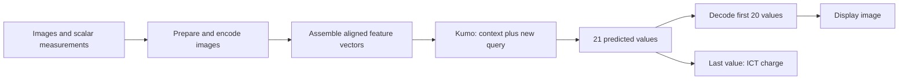

# Modular virtual diagnostics

Independent inference blocks for the current downramp camera-1 diagnostic.
Like the simulation packages, this directory is an independently installable
subproject; the repository root package is not its installer.



Acquisition, timestamp matching, and the 42 scalar measurements are supplied by
the caller. Known context examples also need **measured camera-1 images and
charge**. A new query needs only the input diagnostics and scalars.

## Components

| Module | Responsibility | Artifact |
| --- | --- | --- |
| `virtual_diagnostics.tabular.Kumo` | Vector prediction on 1–4 CUDA GPUs | Upstream Kumo weights |
| `virtual_diagnostics.encoders` | Gaia, TopView, camera-1, and FROG/OAP encoding | Separate neural/PCA checkpoints |
| `virtual_diagnostics.decoders.ImageDecoder` | Camera-1 latents to physical image intensity | Decoder-only checkpoint |
| `virtual_diagnostics.preprocessing` | Fixed backgrounds, ROIs, dust repair, intensity conversion | Gaia calibration mask |
| `virtual_diagnostics.features` | Explicit feature and target column order | Schema metadata |
| `virtual_diagnostics.artifacts` | Local file lookup and SHA-256 verification | Release manifest |

Kumo imports no image codec. Each codec loads only its own weights. Encoders
restore their training normalization without refitting it. Kumo fits table
preprocessing and populates an inference cache from the supplied context;
its pretrained neural network weights remain frozen.

## Install

Use a separate Python 3.11+ environment. Install a CUDA-enabled PyTorch build
for Kumo, or CPU PyTorch for codec-only use. From the repository root:

```bash
python -m pip install -e 'lpa/Virtual_Diagnostics[kumo,images,dev]'
```

The base package needs NumPy and PyTorch. `[kumo]` installs NVIDIA's
structured-data-models at the validated Git commit; `[images]` adds Gaia dust
repair and optional display. Inference never downloads artifacts automatically.

## Artifacts outside Git

Git contains code and manifests only. Weights, PCA fits, normalization,
calibration arrays, context data, and images are excluded from Git and the wheel.
The [manifest](virtual_diagnostics/manifests/artifacts.json) records each filename,
size, SHA-256 and provenance. Extracted checkpoints contain inference weights
and normalization only, without optimizer state or training images.

* **Kumo:** link to the upstream `nvidia/Kumo-Tabular` `large/regressor.pt` at
  commit `3c3e10bbdb590ace29e7026847f92db3c603096d`. The manifest includes its
  direct URL. Save it as `kumo_large_regressor.pt`; no duplicate upload is needed.
* **Encoders/decoder:** a separate, restricted Zenodo model-artifact record.
* **Context:** a restricted Zenodo data record, linked to the model-artifact
  version that defines its coordinates. This contains the frozen training
  context, a prepared example query, and the image energy axis.

Zenodo publication is not automatic. See [release/README.md](release/README.md)
for the FAIR metadata and publication checks. No DOI is invented before a
record exists. Restricted files still have public record metadata on Zenodo.

Place authorized downloads in any local directory, for example repository-root
`local/virtual_diagnostics/artifacts/` (already ignored), or the ignored
`artifacts/` directory here. Copy the same files to cluster-readable storage.
All examples take `--artifacts`; no API depends on a developer's Desktop.

```python
from virtual_diagnostics.artifacts import Artifacts
files = Artifacts("/path/to/private/artifacts")
encoder_weights = files.path("camera1_encoder")  # Checks existence and SHA-256.
```

## Connect the blocks

```python
import torch
from virtual_diagnostics.artifacts import Artifacts
from virtual_diagnostics.encoders import ImageEncoder
from virtual_diagnostics.decoders import ImageDecoder
from virtual_diagnostics.features import assemble_targets
from virtual_diagnostics.tabular import Kumo

def predict_image(train_x, measured_images, measured_charge, query, artifact_dir):
    files = Artifacts(artifact_dir)
    encoder = ImageEncoder(files.path("camera1_encoder"), device="cpu")
    # measured_images: float32 physical intensities, (2152, 1, 189, 285).
    train_z = torch.cat([encoder(batch) for batch in measured_images.split(8)]).numpy()
    train_y = assemble_targets(train_z, measured_charge)

    with Kumo(train_x, train_y, GPU=1, seed=20261009,
              weights=files.path("kumo")) as server:
        result = server.predict(query)  # float32 NumPy vector, shape (21,)

    decoder = ImageDecoder(files.path("camera1_decoder"), device="cpu")
    image = decoder(torch.from_numpy(result[:20]).unsqueeze(0))[0, 0].numpy()
    return result, image

# Call from `if __name__ == "__main__":` in scripts: GPU workers use spawn.
```

To form `train_x` or a query, encode the input images with `GaiaEncoder`,
`ImageEncoder(topview_weights)`, and two `PCAEncoder` instances, then call
`assemble_features(scalars=..., gaia=..., frog=..., oap=..., topview=...)`.
It returns `(N, 88)`; pass one row to `predict`. All blocks must describe
the same shots in the same order.

[encode_context.py](examples/encode_context.py) performs this assembly from a
private NPZ of **prepared** image crops and aligned scalars. It can encode
context rows or new query rows. Context target encoding is a separate operation.

```bash
python lpa/Virtual_Diagnostics/examples/encode_context.py \
  --artifacts /path/to/private/artifacts --images /path/to/prepared_train_images.npz \
  --context --output /path/to/context.npz

python lpa/Virtual_Diagnostics/examples/predict.py \
  --artifacts /path/to/private/artifacts --gpu 1 --show
```

`predict.py` uses the checked frozen `context.npz` and `example_features.npy`.
For newly encoded arrays, load them and pass them directly to Kumo as above;
overwriting frozen artifacts will intentionally fail their checksum checks.
Display is a separate Matplotlib call; omit `--show` for headless use.

## Frozen diagnostic contract

| Input block | Columns | Encoding |
| --- | --- | --- |
| Scalars | 0:42 | Existing measurements, without added standardization |
| Gaia | 42:56 | Fine-tuned encoder's deterministic posterior mean |
| FROG | 56:64 | Refreshed eight-component PCA |
| OAP | 64:72 | Refreshed eight-component PCA |
| TopView | 72:88 | 16-dimensional image encoder |

Exact names are in [schema.json](virtual_diagnostics/manifests/schema.json).
Targets 0:20 are camera-1 residual-encoder latents; target 20 is charge in pC.
Decoded images have shape `(N, 1, 189, 285)` and retain physical intensity scale.

The current **validated serving configuration** fixes 2,152 context rows,
88 numerical features, 21 outputs, and one query per call. New context sizes,
dimensions, feature definitions or encoder versions require validation.
Every input column must vary across the context. `GPU` defaults to one;
four ensemble members and four target groups are retained for GPU=1–4.
TF32 defaults to enabled; the network uses FP16 autocast and CUDA graphs.
Use `close()` or a context manager to release the workers.

Neural encoders take prepared float32 tensors `(N, 1, H, W)`: Gaia 304×304,
TopView 256×512, camera-1 189×285. PCA takes NumPy batches `(N, H, W)`:
FROG 459×393 and OAP 963×1010. The preprocessing module preserves the original
calibration; acquisition and alignment remain external. Camera-1 codes must
be scaled by their per-shot peak/4094. Neural normalization is applied inside
the encoder; do not apply it twice. PCA uses the original float64 projection
and returns float32 coordinates.

## Validation

```bash
python -m pytest -c lpa/Virtual_Diagnostics/pyproject.toml lpa/Virtual_Diagnostics/tests
```

Synthetic CPU tests need no private artifacts or GPU. Run them separately;
this package is excluded from the simulation environment's test collection.
[Validation instructions](validation/README.md) cover installed
package, private-artifact and Polaris checks.

The runtime derives from the tested Kumo bundle 0.2.1. Ensemble preprocessing
and numerical CUDA-graph capture were retained. Upstream SDM code is pinned and
verified at runtime rather than copied into this repository.
